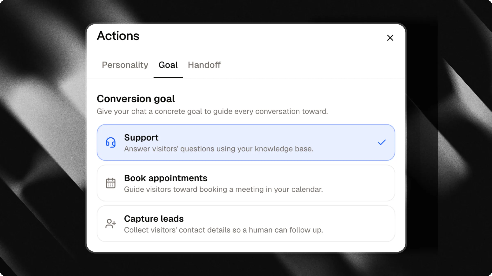
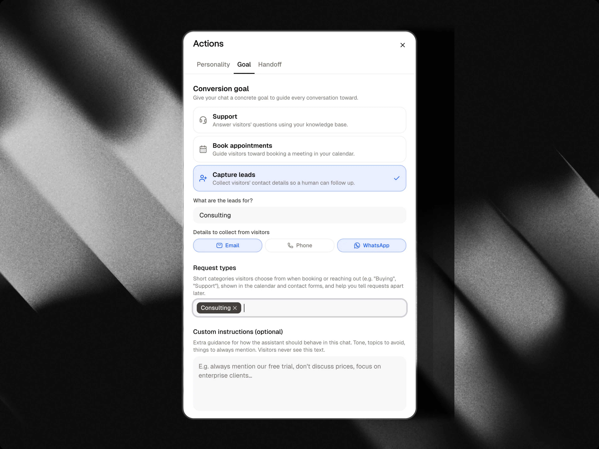

The **Goal** tab, in the **Actions** panel, tells your chat what it's actually trying to achieve with every visitor. Instead of just answering questions, your chat can actively guide the conversation toward booking a meeting or collecting contact details.

<Tip>
  Pick the goal that matches what you want out of your chat. You can change it at any time, it takes effect immediately for new conversations.
</Tip>

---

## Choose a goal

### Support

Answer visitors' questions using your knowledge base. This is the default: no active goal, the chat simply helps.

### Book appointments

Guide visitors toward booking a meeting in your calendar.

<Note>
  This option requires a connected Google Calendar. If it isn't set up yet for this chat, the option is grayed out with a link to connect one.
</Note>

<Card title="Google Calendar integration" icon="calendar-days" horizontal href="/integrations/google-calendar">
  Learn how to connect your calendar so visitors can book meetings directly in the chat.
</Card>

### Capture leads

Collect visitors' contact details so a human can follow up.

When you pick this goal, two settings appear:

| Field | What it does |
| :-- | :-- |
| **What are the leads for?** | A short description of why you're collecting leads (e.g. "homeowners interested in a property appraisal"). This tells the chat why visitors should leave their details, so it can bring it up naturally in conversation. |
| **Connected form** | The conversational form that runs when lead capture is triggered. Attlas connects a default contact form automatically, or you can pick any existing form from your chat. Click **Edit the form** to customize questions, choice options, contact fields, and confirmation messages. |

<Warning>
  Without a clear "what are the leads for?" description, the chat won't know why it should be asking visitors for their details and may not do it well. Always fill this in when using the leads goal.
</Warning>

### How conversational lead capture works

When **Capture leads** is active, lead capture runs directly inside the chat conversation rather than through a static pop-up:

1. **AI initiation**: The assistant never asks for personal contact information directly in plain text. When a visitor expresses clear interest or asks to be contacted, the assistant introduces the form with a single sentence and launches the connected form.
2. **Step-by-step guidance**: The form asks one question at a time. The chat input bar adapts dynamically to each question (such as phone input with country code picker, email validation, or date selector).
3. **Smart pre-filling**: If the visitor already mentioned an answer earlier in the conversation, that choice option is automatically pre-selected so they do not have to answer twice.
4. **CRM and AI summary**: Once submitted, all answers land in your [CRM](/basic/crm) on the contact record. The assistant also attaches an automatic summary of the visitor's request to the contact's notes.
5. **No duplicate prompts**: If a visitor completes the form or is already in the middle of filling it out, the assistant will not trigger lead capture again during that conversation.

<Card title="Forms" icon="clipboard-list" horizontal href="/basic/forms">
  Learn how to customize your lead form, add qualifying questions, and inspect completion funnels.
</Card>

---

## Custom instructions

Whatever goal you pick, you can add optional custom instructions, extra guidance for how the assistant should behave in this chat: tone to use, topics to avoid, things to always mention. Visitors never see this text, it only shapes how the chat talks.

---

## Request types

When booking appointments, you can define **request types**, short categories visitors choose from (e.g. "Buying", "Support", "Renting"). They show up in the calendar booking flow and help you categorize meetings when reviewing your agenda.

This list is also shared with the [Human in the loop](/actions/human-in-the-loop) tab, helping categorize visitor handoff requests. For lead capture chats, custom categories and qualifying questions are configured directly inside your connected form as choice questions.
