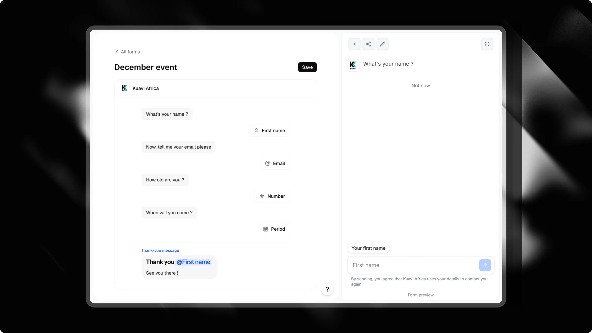

Forms turn data collection into a natural conversation. Instead of sending visitors to an external page or showing a long static form, your chat asks questions one at a time. Visitors tap options or reply directly in the chat bar.

Every response is saved, your CRM updates instantly, and you can track drop-offs step by step in a built-in funnel.

---

## Accessing Forms

<Check>
  To open your forms, select your chat in the dashboard and click the **<kbd>Forms</kbd>** tab in the left sidebar.
</Check>

From this page, you can create new forms, edit existing ones, check how many questions each form has, and inspect their conversion numbers.

---

## Creating and editing a form



Click **<kbd>Create</kbd>** in the top header to start a new form.

Attlas uses a document-style editor. You write your form like a text document, with no complex flowchart nodes:

- **Type plain text** to make your chat speak. Each paragraph becomes an individual chat bubble.
- **Type `/`** to insert questions, choices, media, or contact fields.
- **Drag blocks** using the handle on the left to reorder your sequence.
- **Preview in real time**: the preview panel on the right runs your form in an interactive chat as you edit.
- **Save your work**: click **<kbd>Save</kbd>** in the top-right corner when you are ready to publish changes.

<Tip>
  Keep your questions conversational and place contact fields at the end. Visitors convert better when they answer simple qualifying questions first.
</Tip>

---

## Available blocks

Type `/` anywhere in the editor to open the block menu:

### Chat messages

| Block | Command | Description |
| :--- | :--- | :--- |
| **Message** | Plain text | Regular text displayed in a chat bubble. Supports bold, italics, links, and emojis. |
| **Image** | `/image` | An image displayed inside a chat bubble. |
| **Video** | `/video` | A short, muted looping video displayed inside a chat bubble. |

### Visitor answers

When the form reaches an answer block, the chat input bar adapts to what is expected.

| Block | Command | Input mode | Validation |
| :--- | :--- | :--- | :--- |
| **Choice** | `/choice` | Button options under the question. | Select one option. Enable **Several answers** in settings for multi-select. |
| **Text** | `/text` | Standard text input. | Non-empty text with optional maximum length. Supports voice dictation on mobile. |
| **Number** | `/number` | Numeric keyboard. | Numbers only, with optional minimum and maximum limits. |
| **Link** | `/url` | URL keyboard. | Valid website address (`https://` added automatically if missing). |
| **Period** | `/period` | Date range selector. | Start date and end date picker. |

### Contact fields

Contact fields capture visitor details and qualify leads in your CRM. Each contact field can appear once per form:

| Block | Command | Description |
| :--- | :--- | :--- |
| **First name** | `/firstname` | Captures the visitor's first name with browser autofill. |
| **Last name** | `/lastname` | Captures the visitor's last name. |
| **Email** | `/email` | Captures and validates an email address. |
| **Phone** | `/phone` | International phone input with country code selector. |
| **WhatsApp** | `/whatsapp` | Phone input pre-filled with the visitor's detected country. |
| **Preferred date** | `/schedule` | Date picker for meeting preferences or target dates. |

<Warning>
  A form needs at least one contact field to create a lead in your CRM. If you only ask choice or text questions, responses are stored in the conversation history but no contact card is created.
</Warning>

---

## Thank-you message and `@` mentions

The last block in your editor is the thank-you message. This message displays automatically when a visitor finishes the form.

You can personalize this final message by typing `@` to cite any earlier response:

```text
Thank you, @firstname! We received your request for @choice and will reach out via WhatsApp at @whatsapp.
```

If left empty, Attlas displays a default confirmation message in the visitor's language.

---

## How visitors experience your form

The form runs directly inside the chat interface:

1. **Step by step**: The chat asks one question at a time.
2. **Context-aware input**: For phone, date, or text inputs, the chat input bar displays a dedicated badge (such as "Your WhatsApp" or "Preferred date") and sets the correct mobile keyboard.
3. **Side questions**: Visitors can click the **<kbd>×</kbd>** icon on the input badge to pause the form and ask a question. The chat answers using your knowledge base, then resumes the form at the current step.
4. **Exit option**: Under choice questions, visitors can tap **"Not now"** to leave the form flow without breaking the conversation.

---

## Connecting your form

You can trigger a form through four different paths:

### 1. Triggers

Add a **Form** trigger in your chat's **Triggers** tab. Select your form from the dropdown. It appears as an interactive button in your chat menu.

### 2. Campaigns (Launch on arrival)

In [Campaigns](/pro/campaigns), select your campaign channel and set **Launch on arrival** to your form trigger. When visitors click your ad or campaign link, the chat opens with the form already active, without requiring an initial click.

<Card title="Campaigns" icon="bullhorn" horizontal href="/pro/campaigns">
  Learn how to build dedicated welcome screens for paid ads with custom headlines and automatic form launch.
</Card>

### 3. Chat goal (Capture leads)

In **Actions** > **Goal**, select **Capture leads**. Attlas connects your lead objective directly to a form. When the conversation reaches lead capture, the assistant starts the form and automatically pre-fills any details the visitor already mentioned.

### 4. Direct link

Share a link with the `?form=<slug>` parameter to open your chat directly on a specific form.

---

## Tracking performance (Funnel)

On the **Forms** list page, click the **chart icon** next to any form to expand its conversion funnel.

The funnel tracks data over the last 30 days:

- **Starting points**: Shows where visitors came from, including visits from ad [campaigns](/pro/campaigns) and clicks on menu triggers.
- **Step completion**: Displays the number of visitors who answered each step, along with the retention rate compared to the previous step.
- **Leads generated**: The total number of completed contacts collected by this form.

<Info>
  Internal test conversations from workspace members and editor previews are excluded from funnel metrics.
</Info>

---

## Data collection and integrations

- **CRM**: Submitted details appear immediately in your **<kbd>CRM</kbd>** tab, with all custom answers saved to the contact record.
- **Webhooks**: Completing a form dispatches a `form_completed` webhook payload containing all answers and contact information.
- **Meta CAPI**: When Meta Conversions API is configured, completing a form sends a `Lead` event server-side for ad tracking.
- **Automatic translations**: Form text is translated automatically into all 13 supported languages so visitors see questions in their preferred language.
