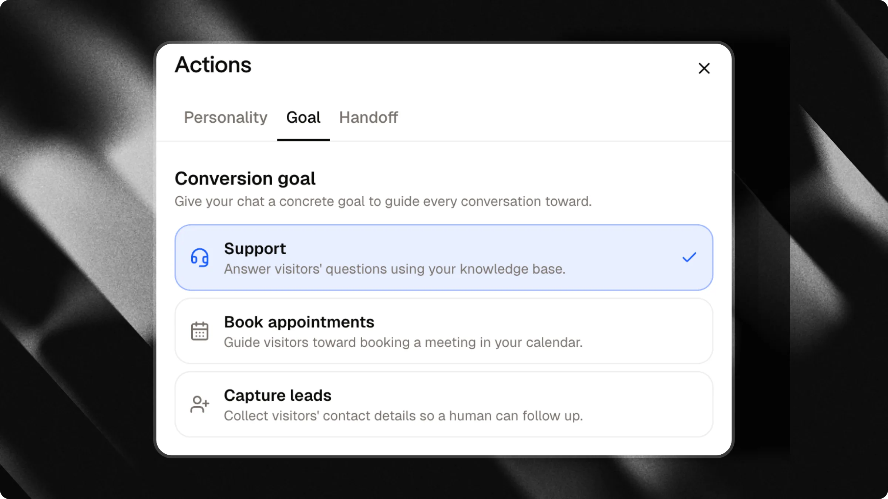
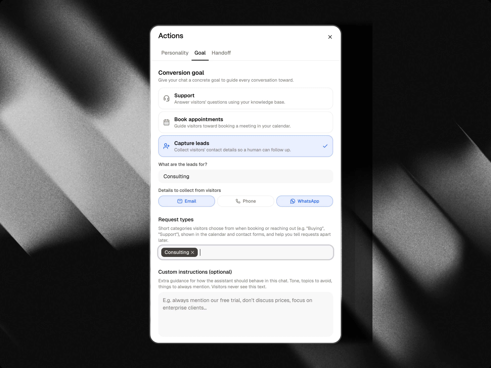

L'onglet **Objectif**, dans le panneau **Actions**, indique à votre chat ce qu'il essaie réellement d'accomplir avec chaque visiteur. Au lieu de simplement répondre aux questions, votre chat peut guider activement la conversation vers la réservation d'un rendez-vous ou la collecte de coordonnées.

<Tip>
  Choisissez l'objectif correspondant à ce que vous attendez de votre chat. Vous pouvez le modifier à tout moment, il prend effet immédiatement pour les nouvelles conversations.
</Tip>

---

## Choisir un objectif

### Assistance

Répond aux questions des visiteurs à l'aide de votre base de connaissances. C'est l'option par défaut : aucun objectif actif, le chat se contente d'aider.

### Réserver des rendez-vous

Guide les visiteurs vers la réservation d'un rendez-vous dans votre calendrier.

<Note>
  Cette option nécessite un agenda Google Calendar connecté. Si aucun agenda n'est encore configuré pour ce chat, l'option est grisée avec un lien pour en connecter un.
</Note>

<Card title="Intégration Google Calendar" icon="calendar-days" horizontal href="/fr/integrations/google-calendar">
  Découvrez comment connecter votre calendrier pour permettre aux visiteurs de réserver des rendez-vous directement dans le chat.
</Card>

### Capturer des prospects

Collectez les coordonnées des visiteurs afin qu'un humain puisse assurer le suivi.

Lorsque vous choisissez cet objectif, deux paramètres apparaissent :

| Champ | Rôle |
| :-- | :-- |
| **À quoi servent les prospects ?** | Une brève description de la raison pour laquelle vous collectez des prospects (par exemple, « propriétaires intéressés par une estimation de bien »). Cela indique au chat pourquoi les visiteurs devraient laisser leurs coordonnées, afin qu'il puisse l'évoquer naturellement dans la conversation. |
| **Formulaire connecté** | Le formulaire conversationnel qui s'exécute lorsque la capture de prospects est déclenchée. Attlas connecte automatiquement un formulaire de contact par défaut, ou vous pouvez choisir n'importe quel formulaire existant dans votre chat. Cliquez sur **Modifier le formulaire** pour personnaliser les questions, les options de choix, les champs de contact et les messages de confirmation. |

<Warning>
  Sans une description claire de « à quoi servent les prospects ? », le chat ne saura pas pourquoi il doit demander leurs coordonnées aux visiteurs et risque de ne pas le faire correctement. Renseignez toujours ce champ lorsque vous utilisez l'objectif de capture de prospects.
</Warning>

### Comment fonctionne la capture de prospects conversationnelle

Lorsque **Capturer des prospects** est actif, la capture de prospects s'exécute directement dans la conversation du chat plutôt que par le biais d'une fenêtre contextuelle statique :

1. **Déclenchement par l'IA** : L'assistant ne demande jamais directement des informations personnelles de contact en texte brut. Lorsqu'un visiteur manifeste un intérêt clair ou demande à être contacté, l'assistant présente le formulaire en une seule phrase et lance le formulaire connecté.
2. **Guidage pas à pas** : Le formulaire pose une question à la fois. La barre de saisie du chat s'adapte dynamiquement à chaque question (par exemple, saisie de numéro de téléphone avec sélecteur d'indicatif de pays, validation d'e-mail ou sélecteur de date).
3. **Préremplissage intelligent** : Si le visiteur a déjà mentionné une réponse plus tôt dans la conversation, cette option de choix est automatiquement présélectionnée afin qu'il n'ait pas à répondre deux fois.
4. **Résumé CRM et IA** : Une fois envoyées, toutes les réponses sont enregistrées dans votre [CRM](/fr/basic/crm) sur la fiche du contact. L'assistant ajoute également un résumé automatique de la demande du visiteur aux notes du contact.
5. **Aucune relance en double** : Si un visiteur remplit le formulaire ou est déjà en train de le remplir, l'assistant ne déclenchera pas à nouveau la capture de prospects pendant cette conversation.

<Card title="Formulaires" icon="clipboard-list" horizontal href="/fr/basic/forms">
  Découvrez comment personnaliser votre formulaire de prospects, ajouter des questions de qualification et consulter les entonnoirs de complétion.
</Card>

---

## Instructions personnalisées

Quel que soit l'objectif choisi, vous pouvez ajouter des instructions personnalisées facultatives, des consignes supplémentaires sur la manière dont l'assistant doit se comporter dans ce chat : ton à adopter, sujets à éviter, éléments à toujours mentionner. Les visiteurs ne voient jamais ce texte, il influence uniquement la façon dont le chat s'exprime.

---

## Types de demandes

Lors de la réservation de rendez-vous, vous pouvez définir des **types de demandes**, de courtes catégories parmi lesquelles les visiteurs choisissent (par exemple, « Achat », « Assistance », « Location »). Ils apparaissent dans le parcours de réservation de calendrier et vous aident à classer les rendez-vous lorsque vous consultez votre agenda.

Cette liste est également partagée avec l'onglet [Humain dans la boucle](/fr/actions/human-in-the-loop), ce qui aide à catégoriser les demandes de transfert des visiteurs. Pour les chats de capture de prospects, les catégories personnalisées et les questions de qualification sont configurées directement dans votre formulaire connecté sous forme de questions à choix.
