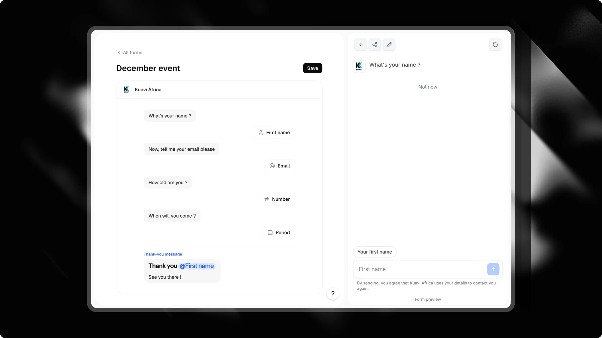

Les formulaires transforment la collecte de données en une conversation naturelle. Au lieu d'envoyer les visiteurs vers une page externe ou d'afficher un long formulaire statique, votre chat pose les questions une par une. Les visiteurs tapent une option ou répondent directement dans la barre de chat.

Chaque réponse est sauvegardée, votre CRM se met à jour instantanément et vous pouvez suivre les abandons étape par étape dans un entonnoir intégré.

---

## Accéder aux formulaires

<Check>
  Pour ouvrir vos formulaires, sélectionnez votre chat dans le tableau de bord et cliquez sur l'onglet **<kbd>Formulaires</kbd>** dans la barre latérale gauche.
</Check>

Depuis cette page, vous pouvez créer de nouveaux formulaires, modifier ceux existants, vérifier le nombre de questions de chaque formulaire et inspecter leurs chiffres de conversion.

---

## Créer et modifier un formulaire



Cliquez sur **<kbd>Créer</kbd>** dans l'en-tête supérieur pour démarrer un nouveau formulaire.

Attlas utilise un éditeur de type document. Vous rédigez votre formulaire comme un document texte, sans nœuds de diagramme complexes :

- **Tapez du texte brut** pour faire parler votre chat. Chaque paragraphe devient une bulle de chat individuelle.
- **Tapez `/`** pour insérer des questions, des choix, des médias ou des champs de contact.
- **Faites glisser les blocs** en utilisant la poignée à gauche pour réorganiser votre séquence.
- **Prévisualisez en temps réel** : le panneau de prévisualisation à droite exécute votre formulaire dans un chat interactif pendant que vous éditez.
- **Enregistrez votre travail** : cliquez sur **<kbd>Enregistrer</kbd>** dans le coin supérieur droit lorsque vous êtes prêt à publier les modifications.

<Tip>
  Gardez vos questions conversationnelles et placez les champs de contact à la fin. Les visiteurs convertissent mieux lorsqu'ils répondent d'abord à des questions de qualification simples.
</Tip>

---

## Blocs disponibles

Tapez `/` n'importe où dans l'éditeur pour ouvrir le menu des blocs :

### Messages de chat

| Bloc | Commande | Description |
| :--- | :--- | :--- |
| **Message** | Texte brut | Texte normal affiché dans une bulle de chat. Prend en charge le gras, l'italique, les liens et les emojis. |
| **Image** | `/image` | Une image affichée dans une bulle de chat. |
| **Vidéo** | `/video` | Une courte vidéo en boucle, sans son, affichée dans une bulle de chat. |

### Réponses du visiteur

Lorsque le formulaire atteint un bloc de réponse, la barre de saisie du chat s'adapte à ce qui est attendu.

| Bloc | Commande | Mode de saisie | Validation |
| :--- | :--- | :--- | :--- |
| **Choix** | `/choice` | Options sous forme de boutons sous la question. | Sélectionnez une option. Vous pouvez aussi activer **Plusieurs réponses** dans les paramètres pour la sélection multiple. |
| **Cases à cocher** | `/checkboxes` | Options avec cases à cocher sous la question. | Sélectionnez une ou plusieurs options, puis appuyez sur **Continuer**. |
| **Texte** | `/text` | Saisie de texte standard. | Texte non vide avec une longueur maximale optionnelle. Prend en charge la dictée vocale sur mobile. |
| **Nombre** | `/number` | Clavier numérique. | Chiffres uniquement, avec des limites minimales et maximales optionnelles. |
| **Lien** | `/url` | Clavier URL. | Adresse de site web valide (`https://` ajouté automatiquement si manquant). |
| **Période** | `/period` | Sélecteur de plage de dates. | Sélecteur de date de début et de fin. |
| **Envoyer un fichier** | `/file` | Bouton de pièce jointe. | Photos ou documents PDF jusqu'à 20 Mo. Activez **Plusieurs fichiers (5 max)** pour des envois multiples. Nécessite le forfait Pro. |

### Champs de contact

Les champs de contact capturent les détails du visiteur et qualifient les prospects dans votre CRM. Chaque champ de contact peut apparaître une fois par formulaire :

| Bloc | Commande | Description |
| :--- | :--- | :--- |
| **Prénom** | `/firstname` | Capture le prénom du visiteur avec l'autocomplétion du navigateur. |
| **Nom de famille** | `/lastname` | Capture le nom de famille du visiteur. |
| **E-mail** | `/email` | Capture et valide une adresse e-mail. |
| **Téléphone** | `/phone` | Saisie de numéro de téléphone international avec sélecteur de code pays. |
| **WhatsApp** | `/whatsapp` | Saisie de numéro de téléphone pré-remplie avec le pays détecté du visiteur. |
| **Date préférée** | `/schedule` | Sélecteur de date pour les préférences de rendez-vous ou les dates cibles. |

<Warning>
  Un formulaire a besoin d'au moins un champ de contact pour créer un prospect dans votre CRM. Si vous posez uniquement des questions de type choix, cases à cocher ou texte, les réponses sont stockées dans l'historique de conversation mais aucune fiche contact n'est créée.
</Warning>

---

## Message de remerciement et redirection

Le dernier bloc de votre éditeur est le message de remerciement. Ce message s'affiche automatiquement lorsqu'un visiteur termine le formulaire.

Vous pouvez personnaliser ce message final en tapant `@` pour citer n'importe quelle réponse précédente :

```text
Merci, @firstname ! Nous avons bien reçu votre demande pour @choice et nous vous contacterons via WhatsApp au @whatsapp.
```

Si ce champ est laissé vide, Attlas affiche un message de confirmation par défaut dans la langue du visiteur.

### Redirection automatique

Vous pouvez rediriger les visiteurs vers une adresse externe (page de paiement, calendrier ou site web) une fois le formulaire terminé :

1. Cliquez sur le bloc de fin au bas de l'éditeur de formulaire.
2. Renseignez une adresse complète (`https://...`) dans le champ **URL de redirection**.

Une fois envoyé, le chat affiche votre message de remerciement et un lien **Continuer**. La page redirige automatiquement au bout de 3 secondes. Dans les widgets intégrés et les iframes, les visiteurs cliquent sur **Continuer** pour ouvrir le lien dans la fenêtre principale.

---

## Comment les visiteurs vivent votre formulaire

Le formulaire s'exécute directement dans l'interface de chat :

1. **Étape par étape** : Le chat pose une question à la fois.
2. **Saisie contextuelle** : Pour les saisies de téléphone, de date ou de texte, la barre de saisie du chat affiche un badge dédié (tel que "Votre WhatsApp" ou "Date préférée") et définit le bon clavier mobile.
3. **Questions latérales** : Les visiteurs peuvent cliquer sur l'icône **<kbd>×</kbd>** sur le badge de saisie pour mettre en pause le formulaire et poser une question. Le chat répond en utilisant votre base de connaissances, puis reprend le formulaire à l'étape en cours.
4. **Option de sortie** : Sous les questions de choix ou de cases à cocher, les visiteurs peuvent appuyer sur **"Pas maintenant"** pour quitter le flux du formulaire sans interrompre la conversation.

---

## Connecter votre formulaire

Vous pouvez déclencher un formulaire par quatre chemins différents :

### 1. Déclencheurs

Ajoutez un déclencheur **Formulaire** dans l'onglet **Déclencheurs** de votre chat. Sélectionnez votre formulaire dans la liste déroulante. Il apparaît comme un bouton interactif dans le menu de votre chat.

### 2. Campagnes (Lancement à l'arrivée)

Dans [Campagnes](/fr/pro/campaigns), sélectionnez votre canal de campagne et définissez **Lancement à l'arrivée** sur le déclencheur de formulaire. Lorsque les visiteurs cliquent sur votre annonce ou lien de campagne, le chat s'ouvre avec le formulaire déjà actif, sans nécessiter de clic initial.

<Card title="Campagnes" icon="bullhorn" horizontal href="/fr/pro/campaigns">
  Découvrez comment créer des écrans d'accueil dédiés pour les publicités payantes avec des titres personnalisés et un lancement automatique du formulaire.
</Card>

### 3. Objectif de chat (Capturer des prospects)

Dans **Actions** > **Objectif**, sélectionnez **Capturer des prospects**. Attlas relie votre objectif de prospect directement à un formulaire. Lorsque la conversation atteint la capture de prospect, l'assistant démarre le formulaire et pré-remplit automatiquement tous les détails que le visiteur a déjà mentionnés.

### 4. Lien direct

Partagez un lien avec le paramètre `?form=<slug>` pour ouvrir votre chat directement sur un formulaire spécifique.

---

## Suivi des performances (Entonnoir)

Sur la page de liste des **Formulaires**, cliquez sur l'**icône de graphique** à côté d'un formulaire pour déplier son entonnoir de conversion.

L'entonnoir suit les données sur les 30 derniers jours :

- **Points de départ** : Indique d'où viennent les visiteurs, y compris les visites provenant de [campagnes](/fr/pro/campaigns) publicitaires et les clics sur les déclencheurs de menu.
- **Achèvement des étapes** : Affiche le nombre de visiteurs ayant répondu à chaque étape, ainsi que le taux de rétention par rapport à l'étape précédente.
- **Prospects générés** : Le nombre total de contacts complétés collectés par ce formulaire.

<Info>
  Les conversations de test internes des membres de l'espace de travail et les prévisualisations de l'éditeur sont exclues des métriques de l'entonnoir.
</Info>

---

## Collecte de données et intégrations

- **CRM** : Les détails soumis apparaissent immédiatement dans votre onglet **<kbd>CRM</kbd>**, avec toutes les réponses personnalisées enregistrées dans la fiche contact.
- **Webhooks** : La complétion d'un formulaire envoie une charge utile webhook `form_completed` contenant toutes les réponses et les informations de contact.
- **Meta CAPI** : Lorsque l'API de conversions Meta est configurée, la complétion d'un formulaire envoie un événement `Lead` côté serveur pour le suivi des annonces.
- **Traductions automatiques** : Le texte du formulaire est traduit automatiquement dans les 13 langues prises en charge afin que les visiteurs voient les questions dans leur langue préférée.
