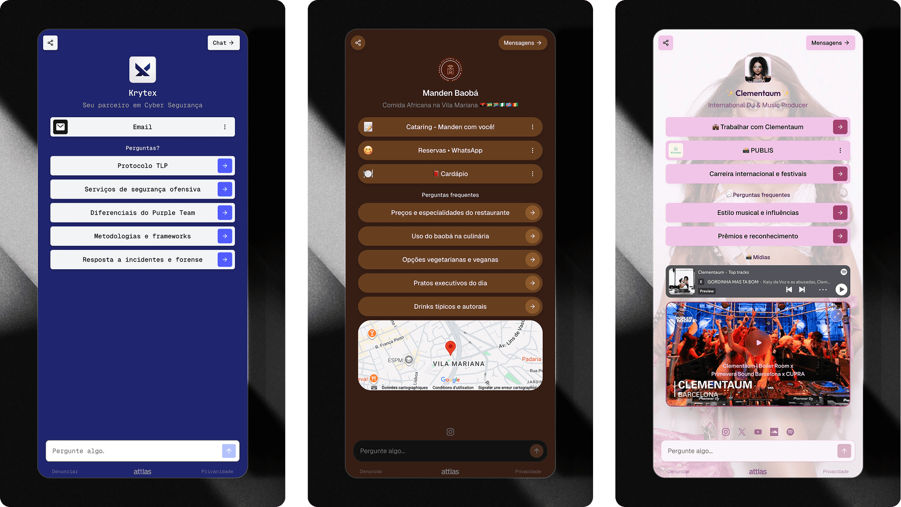

L'**agrégateur de liens Attlas** vous permet de regrouper vos liens, contenus et canaux les plus importants en une seule page partageable.

Il fonctionne comme une alternative aux plateformes traditionnelles de lien dans la bio, mais avec une différence majeure : en plus de vos liens, vous pouvez également proposer un chat intelligent entraîné sur votre propre contenu.

Cela signifie que vos visiteurs ne se contentent pas de cliquer sur des liens. Ils peuvent poser des questions, découvrir des informations et interagir directement avec votre base de connaissances.

---

## Que pouvez-vous ajouter à votre vue d'accueil (agrégateur de liens) ?

L'agrégateur de liens peut être utilisé pour centraliser tous vos canaux et ressources les plus importants.

**Voici les types de liens disponibles dans Attlas :**

- Profils de réseaux sociaux
- Sites web et blogs
- Pages de destination
- Produits et services
- Portfolios
- Vidéos
- Fichiers
- Formulaires
- Contenu exclusif

Le tout organisé en une seule page facile à partager.

---

## Liens et actions

Les boutons affichés dans votre agrégateur de liens sont gérés via des **triggers**.

**Vous pouvez ajouter :**

- Liens externes
- Formulaires et questionnaires
- Fichiers
- Fichiers Google Drive
- Vidéos YouTube
- Intégration Spotify
- Cartes de localisation
- Questions qui lancent des conversations

<Card title="En savoir plus sur les triggers" icon="target" horizontal href="/fr/start/triggers">
  Pour en savoir plus sur les types de triggers disponibles, consultez la section **triggers** de la documentation.
</Card>

---

## Chat intégré

L'une des plus grandes différences entre l'agrégateur de liens Attlas et un agrégateur de liens traditionnel est le chat intelligent intégré.

Alors que les autres plateformes redirigent simplement les utilisateurs vers des pages externes, Attlas permet aux visiteurs d'interagir directement avec votre contenu.

Les utilisateurs peuvent :

- Poser des questions
- Demander des informations
- Découvrir des produits et services
- Trouver des documents et des ressources
- Explorer votre contenu à travers des conversations

Tout cela sans quitter la page.

<Card title="En savoir plus sur le chat Attlas" icon="bot-message-square" horizontal href="/fr/basic/ai-chat">
  Découvrez le chat IA d'Attlas et son fonctionnement.
</Card>

---

## Quand utiliser l'agrégateur de liens ?

L'agrégateur de liens est idéal pour :

- Créateurs de contenu
- Influenceurs
- Éducateurs
- Entreprises
- Consultants
- Freelances
- Marques personnelles

Toute personne ayant besoin de partager plusieurs ressources et de rendre l'information plus accessible peut bénéficier de cette fonctionnalité.

---

## Partager votre agrégateur de liens

Une fois votre page configurée, partagez simplement votre lien de chat.

Vous pouvez l'utiliser comme **lien dans vos bios de réseaux sociaux**, y compris :

- Instagram
- TikTok
- LinkedIn
- X (Twitter)
- WhatsApp
- Email
- Codes QR
- Sites web et blogs

Votre agrégateur de liens est automatiquement mis à jour chaque fois que vous ajoutez de nouveaux triggers, du contenu ou des informations à votre chat.

---

## Plus qu'une page de liens

L'agrégateur de liens transforme une simple page de liens en une expérience conversationnelle.

En plus d'organiser vos ressources les plus importantes en un seul endroit, il permet aux visiteurs de trouver exactement ce qu'ils recherchent grâce à une conversation intelligente alimentée par vos propres connaissances.
