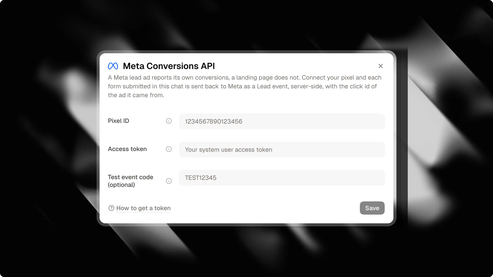

Si vous diffusez des publicités payantes sur Meta (Facebook et Instagram) renvoyant vers votre chat Attlas, il est essentiel d'envoyer les données de conversion à Meta. Sans cela, Meta optimise uniquement pour les clics sur les liens, ce qui augmente votre coût par lead réel (CPL).

Attlas se connecte directement à l'API de conversions Meta (CAPI) côté serveur. Chaque fois qu'un visiteur convertit dans votre chat, Attlas envoie cet événement de conversion directement à Meta sans dépendre d'un pixel navigateur.

<Note>
  L'intégration de l'API de conversions Meta est disponible sur l'offre Attlas Pro.
</Note>

---

## Pourquoi le suivi côté serveur est important

Contrairement au suivi web traditionnel qui repose sur un pixel navigateur, Attlas gère le suivi des conversions entièrement côté serveur :

- **Aucun script de suivi côté client** : votre chat reste rapide et léger, sans aucun script de suivi externe chargé dans le navigateur.
- **Respectueux de la vie privée et du référencement** : le chat ne définit aucun cookie de suivi, évitant les bannières intrusives de consentement aux cookies et préservant une exploration optimale pour les moteurs de recherche.
- **Suivi fiable** : les événements côté serveur contournent les bloqueurs de publicité et les restrictions de confidentialité du navigateur qui bloquent souvent les pixels navigateur.
- **Attribution au premier contact** : Attlas enregistre le clic d'origine sur la publicité Meta (`fbclid`) lorsque le visiteur arrive, conservant ainsi une attribution précise même après une longue conversation.
- **Données de test propres** : les conversations dans le bac à sable du tableau de bord ou marquées comme internes n'envoient jamais d'événements à Meta, empêchant les conversations de test de fausser vos métriques de campagne.

---

## Événements de conversion pris en charge

Attlas mappe automatiquement les actions des visiteurs vers les événements standard de Meta :

| Événement | Déclenché lorsque | Description |
| --- | --- | --- |
| `Lead` | Capture de contact ou formulaire complété | Un visiteur soumet ses coordonnées dans le chat, remplit un formulaire de chat guidé ou demande une conversation WhatsApp. |
| `Schedule` | Réservation d'un calendrier | Un visiteur prend un rendez-vous via l'outil de planification Google Calendar intégré. |

<Info>
Les détails de contact (e-mail, téléphone, prénom et pays) sont normalisés et hachés avec SHA-256 avant d'être envoyés à Meta, en totale conformité avec les exigences de confidentialité des données clients de Meta.
</Info>

---

## Suivi des campagnes et des paramètres UTM

Si votre campagne publicitaire dirige le trafic vers un canal de campagne spécifique ou inclut des paramètres de suivi, Attlas les transmet automatiquement à Meta :

- **Origine de la campagne** : lorsque les visiteurs arrivent via un lien de campagne dédié (`?origin=<campaign_id>`), l'identifiant de la campagne est inclus dans les données personnalisées de l'événement. Pour apprendre à créer des écrans d'accueil personnalisés et des déclencheurs de conversation pour vos publicités, consultez notre guide [Campagnes](/fr/pro/campaigns).
- **Campagne UTM** : tout paramètre `utm_campaign` capturé à l'arrivée est joint à l'événement de conversion pour une analyse facile dans le Gestionnaire d'événements Meta.

<Tip>
Combinez l'API de conversions Meta avec les [Campagnes](/fr/pro/campaigns) pour afficher des messages d'accueil personnalisés et des déclencheurs de conversation ciblés pour chaque publicité tout en suivant automatiquement les conversions.
</Tip>

---

## Comment configurer l'API de conversions Meta

La configuration de la connexion ne prend que quelques minutes :

1. Ouvrez vos **Paramètres de chat** dans le tableau de bord Attlas.
2. Sélectionnez l'onglet **Intégrations**.
3. Repérez la carte **API de conversions Meta** et cliquez sur **Connecter**.
4. Renseignez votre **ID Pixel** et votre **Jeton d'accès**.
5. (Facultatif) Saisissez un **Code d'événement de test** si vous souhaitez vérifier les événements avant de passer en production.
6. Cliquez sur **Enregistrer**. Si un code d'événement de test est fourni, Attlas vérifie vos identifiants directement auprès de Meta avant l'enregistrement.

---

## Paramètres de configuration

| Champ | Requis | Description |
| --- | --- | --- |
| `Pixel ID` | Oui | L'ID numérique de votre Pixel Meta ou de votre ensemble de données. Vous pouvez le trouver dans le Gestionnaire d'événements Meta sous Sources de données. |
| `Access token` | Oui | Un jeton d'accès de l'API de conversions généré à partir des paramètres de votre pixel dans le Gestionnaire d'événements Meta. Attlas stocke ce jeton de manière chiffrée. |
| `Test event code` | Non | Un code temporaire disponible dans l'onglet « Événements de test » du Gestionnaire d'événements Meta (par exemple `TEST12345`). Lorsqu'il est renseigné, les événements sont uniquement acheminés vers la console de test et n'affecteront pas les campagnes publicitaires en production. |

<Warning>
Le **Code d'événement de test** est facultatif et sert uniquement à vérifier votre configuration. Laissez-le vide si vous souhaitez passer en production. Le code expire automatiquement 1 heure après son enregistrement. Pour passer en production immédiatement, laissez le champ vide avant d'enregistrer.
</Warning>

---

## Tester votre intégration

Une fois votre connexion enregistrée :

1. Accédez à votre **Gestionnaire d'événements Meta** et ouvrez l'onglet **Événements de test** pour votre pixel.
2. Si vous utilisez un code de test, assurez-vous que le même code est enregistré dans la boîte de dialogue d'intégration Attlas.
3. Dans Attlas, ouvrez la boîte de dialogue d'intégration Meta et cliquez sur **Envoyer un événement de test**.
4. Vérifiez l'écran du Gestionnaire d'événements Meta. Vous verrez un événement `Lead` entrant apparaître en quelques secondes.

<Tip>
Vous pouvez suspendre le rapport de conversion à tout moment en utilisant le bouton bascule sur la carte Meta, sans supprimer vos identifiants.
</Tip>
