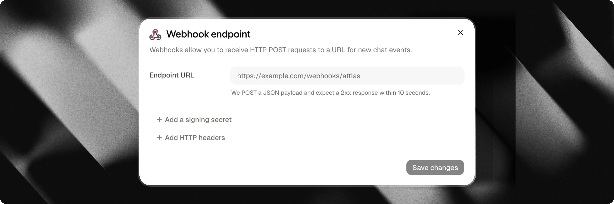

Les webhooks connectent votre chat Attlas à votre backend, votre CRM ou vos outils d'automatisation externes en temps réel. Chaque fois qu'un visiteur interagit avec votre chat, par exemple en soumettant ses coordonnées, en complétant un formulaire en plusieurs étapes ou en réservant un rendez-vous, Attlas envoie une requête HTTP POST automatisée vers votre endpoint spécifié.

---



## Événements clés

Attlas déclenche des webhooks pour cinq événements principaux répartis en trois catégories :

| Événement | Catégorie | Déclenché lorsque |
| :--- | :--- | :--- |
| `contact_created` | `contact` | Un nouveau lead ou profil de contact est créé à partir d'une conversation, d'un formulaire ou d'une réservation de calendrier. |
| `contact_updated` | `contact` | Un contact existant est reconnu et mis à jour avec de nouvelles informations. |
| `form_completed` | `form` | Un visiteur termine toutes les étapes d'un formulaire interactif, avec ou sans champs de contact. |
| `event_created` | `calendar` | Un visiteur planifie un nouveau rendez-vous sur Google Agenda via le chat. |
| `event_canceled` | `calendar` | Un rendez-vous planifié est annulé par vous ou par le visiteur. |

<Note>
**Routage et paires d'événements** :
- Si un visiteur récurrent fournit des informations et est reconnu par e-mail, téléphone, numéro WhatsApp ou identifiant de conversation, Attlas émet `contact_updated` au lieu de `contact_created`.
- Une réservation de rendez-vous envoie à la fois un événement de contact (`contact_created` ou `contact_updated`) et un événement `event_created`.
- Un formulaire complété avec des champs de contact envoie à la fois un événement de contact et un événement `form_completed`.
- Étant donné que les événements appariés s'exécutent simultanément, les endpoints de réception doivent router les payloads en vérifiant le champ `event`.
</Note>

<Info>
**Rendez-vous reportés** : Attlas n'a pas d'événement `event_rescheduled` distinct. Lorsqu'un rendez-vous est reporté, Attlas émet un événement `event_canceled` suivi d'un nouvel événement `event_created`.
</Info>

---

## Comment configurer les webhooks

La configuration d'un endpoint de webhook prend moins d'une minute :

1. Dans votre tableau de bord Attlas, sélectionnez votre chat et accédez à **Paramètres** > **Intégrations**.
2. Repérez la carte **Webhooks** et cliquez sur **Connecter** (ou **Configurer**).
3. Saisissez l'**URL du webhook** de destination (elle doit être une adresse `https://` sécurisée et accessible publiquement).
4. (Optionnel) Configurez des en-têtes HTTP personnalisés si votre serveur de réception nécessite des jetons d'autorisation statiques ou des clés API (jusqu'à 10 en-têtes).
5. (Optionnel) Cliquez sur **Ajouter un secret de signature** pour générer un secret HMAC utilisé pour vérifier l'authenticité des requêtes.
6. Cliquez sur **Enregistrer** pour activer votre endpoint.
7. Cliquez sur **Envoyer un test** pour envoyer un payload de test et confirmer que votre serveur répond avec `200 OK`.

---

## Enveloppe de payload du webhook

Chaque requête webhook contient une enveloppe JSON avec des métadonnées de livraison et un objet `data` spécifique à l'événement :

```json
{
  "id": "5c6f8a0b-1234-4567-890a-bcdef1234567",
  "type": "contact",
  "event": "contact_created",
  "created_at": "2026-10-31T20:15:11.480Z",
  "chat_id": 42,
  "data": { ... }
}
```

| Champ | Type | Description |
| :--- | :--- | :--- |
| `id` | `string` | UUID unique de la tentative de livraison, correspondant à l'en-tête `X-Attlas-Delivery`. |
| `type` | `string` | Catégorie de haut niveau : `contact`, `form` ou `calendar`. |
| `event` | `string` | Nom de l'événement : `contact_created`, `contact_updated`, `form_completed`, `event_created` ou `event_canceled`. |
| `created_at` | `string` | Horodatage ISO 8601 au moment où l'événement a été envoyé. |
| `chat_id` | `number` | ID numérique du chat qui a produit l'événement. |
| `data` | `object` | Payload spécifique à l'événement. Les chaînes vides, les valeurs nulles et les tableaux vides sont automatiquement omis. |

---

## Événements de contact (`contact_created`, `contact_updated`)

Les événements de contact se déclenchent chaque fois qu'un visiteur laisse ses coordonnées via un formulaire de capture de lead, une demande de transfert à un humain, un déclencheur WhatsApp ou une réservation de calendrier.

```json
{
  "id": "5c6f8a0b-1234-4567-890a-bcdef1234567",
  "type": "contact",
  "event": "contact_created",
  "created_at": "2026-10-31T20:15:11.480Z",
  "chat_id": 42,
  "data": {
    "id": "b1e23456-7890-4abc-def0-1234567890ab",
    "firstname": "Ana",
    "email": "ana@example.com",
    "phone": "+33612345678",
    "country": "FR",
    "source": "form",
    "kind": "new_lead",
    "form_id": "4391e4f0-1111-2222-3333-abcdef123456",
    "campaign_id": "black-friday",
    "origin": "black-friday",
    "conversation_id": "9f0a1b2c-3d4e-5f6a-7b8c-9d0e1f2a3b4c",
    "history": [
      {
        "type": "user",
        "content": "I would like to book a demo for next week",
        "manual": true,
        "timestampz": "2026-10-31T20:14:54.000Z"
      },
      {
        "type": "assistant",
        "content": "I would be happy to help! Let me gather a few details.",
        "manual": false,
        "timestampz": "2026-10-31T20:15:01.000Z"
      }
    ]
  }
}
```

### Champs de contact

| Champ | Type | Description |
| :--- | :--- | :--- |
| `id` | `string` | Identifiant unique du profil de contact dans Attlas. |
| `firstname` | `string` | Prénom fourni par le visiteur. |
| `lastname` | `string` | Nom de famille fourni par le visiteur. |
| `email` | `string` | Adresse e-mail fournie par le visiteur. |
| `phone` | `string` | Numéro de téléphone au format E.164. |
| `whatsapp` | `string` | Numéro de téléphone WhatsApp s'il est fourni ou capturé via un déclencheur WhatsApp. |
| `country` | `string` | Code pays ISO à deux lettres détecté à partir des paramètres régionaux du visiteur ou de son adresse IP. |
| `source` | `string` | Origine de stockage interne (`form`, `human`, `whatsapp`, `calendar`). |
| `kind` | `string` | Intention brute du visiteur (`new_lead`, `human_request`, `booking`, `whatsapp`). |
| `channel` | `string` | Support du canal de sortie le cas échéant (par exemple `"whatsapp"`). Omis sinon. |
| `notes` | `string` | Résumé ou notes concernant le lead, comme le contexte de la conversation. |
| `options` | `string[]` | Réponses collectées à partir de questions de qualification ou d'étapes de formulaire. |
| `form_id` | `string` | UUID du formulaire si le lead a été collecté via un formulaire Attlas. Omis sinon. |
| `campaign_id` | `string` | Slug de la campagne lorsque le visiteur est arrivé via un lien de campagne tracké correspondant à une campagne active. Omis sinon. |
| `origin` | `string` | Paramètre de requête brut `?origin=` de l'URL s'il est présent. |
| `preferred_at` | `string` | Horodatage de rendez-vous ou de contact préféré si demandé par le visiteur. |
| `conversation_id` | `string` | Identifiant unique de la conversation du chat. |
| `history` | `array` | Liste chronologique des messages du chat échangés avant la soumission. |

### Intention du lead (`kind`)

Utilisez `kind` pour identifier la raison pour laquelle le contact a été créé :

- `new_lead` : le visiteur a soumis ses coordonnées via un formulaire de capture de lead ou une invite.
- `human_request` : le visiteur a demandé à parler avec un membre humain de l'équipe.
- `booking` : le visiteur a planifié un rendez-vous via Google Agenda.
- `whatsapp` : le visiteur a cliqué sur un déclencheur WhatsApp pour poursuivre la conversation sur WhatsApp.

---

## Événements de fin de formulaire (`form_completed`)

Lorsqu'un visiteur atteint la fin d'un formulaire interactif dans votre chat, Attlas envoie un événement `form_completed`. Cet événement se déclenche pour chaque formulaire terminé, y compris les enquêtes, les questionnaires et les quiz qui n'incluent pas de champs de contact.

```json
{
  "id": "5c6f8a0b-1234-4567-890a-bcdef1234567",
  "type": "form",
  "event": "form_completed",
  "created_at": "2026-10-31T20:15:11.480Z",
  "chat_id": 42,
  "data": {
    "form_id": "4391e4f0-1111-2222-3333-abcdef123456",
    "form_name": "Product Qualification",
    "conversation_id": "b064e2d1-4444-5555-6666-777788889999",
    "contact_id": "aeea8853-aaaa-bbbb-cccc-ddddeeeeffff",
    "campaign_id": "black-friday",
    "origin": "black-friday",
    "notes": "Interested in team onboarding package",
    "completed_at": "2026-10-31T20:15:11.418Z",
    "answers": [
      {
        "step_id": "ee4c1111",
        "type": "choice",
        "question": "What is your team size?",
        "answer": "10 to 50 employees",
        "value": ["opt_10_50"],
        "option_ids": ["opt_10_50"]
      },
      {
        "step_id": "5e092222",
        "type": "contact",
        "field": "firstname",
        "answer": "Ana",
        "value": "Ana"
      },
      {
        "step_id": "34183333",
        "type": "contact",
        "field": "email",
        "answer": "ana@example.com",
        "value": "ana@example.com"
      }
    ],
    "history": [ ... ]
  }
}
```

### Champs de fin de formulaire

| Champ | Type | Description |
| :--- | :--- | :--- |
| `form_id` | `string` | Identifiant unique du formulaire complété. |
| `form_name` | `string` | Nom d'affichage du formulaire dans votre tableau de bord Attlas. |
| `completed_at` | `string` | Horodatage ISO 8601 au moment où le formulaire a été complété. |
| `conversation_id` | `string` | Identifiant de la conversation où le formulaire a été rempli. |
| `contact_id` | `string` | ID du contact si des champs de contact ont été soumis. Correspond à `id` dans `contact_created`. |
| `campaign_id` | `string` | Slug de la campagne si le visiteur est arrivé via un lien de campagne. |
| `origin` | `string` | Paramètre de requête brut `?origin=` de l'URL. |
| `notes` | `string` | Notes de synthèse si elles sont fournies. |
| `answers` | `array` | Liste séquentielle des réponses dans l'ordre du formulaire. |

### Structure des objets de réponse

Chaque entrée de `answers` représente une question répondue ou une saisie de contact :

- `step_id` : identifiant stable de l'étape du formulaire. Il reste inchangé même si vous modifiez ultérieurement le texte de la question.
- `type` : type d'étape, comme `choice`, `text`, `number`, `url`, `period` ou `contact`.
- `question` : le libellé de la question affiché au visiteur.
- `answer` : texte lisible par l'humain de la réponse, mis en forme dans la langue principale du propriétaire de l'espace de travail.
- `value` : réponse brute lisible par machine (chaîne pour le texte, tableau d'ID pour les choix, ou objet `{ "start": "YYYY-MM-DD", "end": "YYYY-MM-DD" }` pour les plages de dates).
- `option_ids` : tableau des ID d'option sélectionnés (présent pour les étapes `choice`).
- `field` : nom de la propriété de contact (présent pour les étapes `contact`, comme `firstname`, `lastname`, `email`, `phone`, `whatsapp` ou `schedule`).

---

## Événements de calendrier (`event_created`, `event_canceled`)

Lorsque les visiteurs réservent ou annulent des rendez-vous via l'intégration Google Agenda, Attlas envoie des événements webhook de calendrier.

### `event_created`

Envoyé immédiatement lorsqu'un rendez-vous est confirmé :

```json
{
  "id": "5c6f8a0b-1234-4567-890a-bcdef1234567",
  "type": "calendar",
  "event": "event_created",
  "created_at": "2026-10-31T20:15:11.480Z",
  "chat_id": 42,
  "data": {
    "appointment_id": "app_123456",
    "google_event_id": "abc123google",
    "title": "Product Demo with Ana",
    "starts_at": "2026-11-04T14:00:00.000Z",
    "ends_at": "2026-11-04T14:30:00.000Z",
    "duration_min": 30,
    "calendar_link": "https://calendar.google.com/calendar/event?eid=...",
    "contact": {
      "id": "b1e23456-7890-4abc-def0-1234567890ab",
      "firstname": "Ana",
      "email": "ana@example.com",
      "phone": "+33612345678",
      "source": "calendar",
      "kind": "booking"
    },
    "conversation_id": "9f0a1b2c-3d4e-5f6a-7b8c-9d0e1f2a3b4c",
    "history": [ ... ]
  }
}
```

### `event_canceled`

Envoyé lorsqu'un rendez-vous est annulé :

```json
{
  "id": "5c6f8a0b-1234-4567-890a-bcdef1234567",
  "type": "calendar",
  "event": "event_canceled",
  "created_at": "2026-10-31T21:00:00.000Z",
  "chat_id": 42,
  "data": {
    "google_event_id": "abc123google",
    "starts_at": "2026-11-04T14:00:00.000Z",
    "ends_at": "2026-11-04T14:30:00.000Z",
    "cancelled_at": "2026-10-31T21:00:00.000Z",
    "cancelled_by": "user",
    "contact_id": "b1e23456-7890-4abc-def0-1234567890ab"
  }
}
```

<Info>
L'historique de conversation est omis pour les événements `event_canceled` afin de conserver des payloads d'annulation légers.
</Info>

---

## Objets d'historique de conversation

Lorsque `conversation_id` est présent dans `contact_created`, `contact_updated`, `form_completed` ou `event_created`, Attlas inclut la séquence complète des messages dans `data.history`, classée chronologiquement de la plus ancienne à la plus récente.

Chaque élément de message contient :

- `type` : `"user"` pour les saisies du visiteur, ou `"assistant"` pour les réponses de l'IA.
- `content` : contenu textuel du message.
- `manual` : `true` si le visiteur a saisi le message manuellement, ou `false` s'il a été envoyé en appuyant sur une pastille de déclencheur ou envoyé par l'assistant.
- `timestampz` : horodatage ISO 8601 au moment où le message a été enregistré.

---

## Sécurité et vérification de signature

Pour vérifier que les requêtes proviennent d'Attlas et empêcher toute falsification, générez un **secret de signature** dans les paramètres de votre webhook.

Lorsqu'un secret est configuré, Attlas calcule une signature HMAC-SHA256 et l'ajoute dans l'en-tête `X-Attlas-Signature` :

```http
X-Attlas-Signature: t=1753351953,v1=6f8a9b0c...
```

La signature est calculée sur `${t}.${rawBody}`, en combinant l'horodatage `t` et la chaîne exacte du corps brut de la requête HTTP.

<Warning>
Vérifiez toujours les signatures en utilisant le **corps de requête brut et non analysé**. La re-sérialisation d'un objet JSON analysé modifie le formatage et les espaces blancs, ce qui entraîne l'échec de la vérification de la signature.
</Warning>

### Exemples de code de vérification

<CodeGroup>
```javascript Node.js
import { createHmac, timingSafeEqual } from "node:crypto";

export function verifyAttlasWebhook(rawBody, signatureHeader, secret, toleranceSec = 300) {
  const parts = Object.fromEntries(
    signatureHeader.split(",").map((p) => p.split("=", 2))
  );

  const timestamp = Number(parts.t);
  const signature = parts.v1;

  if (!timestamp || !signature) {
    throw new Error("Invalid signature header format");
  }

  // Reject requests older than tolerance window (default: 5 minutes)
  const currentTimestamp = Math.floor(Date.now() / 1000);
  if (Math.abs(currentTimestamp - timestamp) > toleranceSec) {
    throw new Error("Request timestamp is outside the tolerance window");
  }

  const expected = createHmac("sha256", secret)
    .update(`${timestamp}.${rawBody}`)
    .digest("hex");

  const expectedBuffer = Buffer.from(expected, "utf8");
  const signatureBuffer = Buffer.from(signature, "utf8");

  if (
    expectedBuffer.length !== signatureBuffer.length ||
    !timingSafeEqual(expectedBuffer, signatureBuffer)
  ) {
    throw new Error("Signature verification failed");
  }

  return true;
}
```

```python Python
import hmac
import hashlib
import time

def verify_attlas_webhook(raw_body: str, signature_header: str, secret: str, tolerance_sec: int = 300) -> bool:
    try:
        parts = dict(part.split("=", 1) for part in signature_header.split(","))
        timestamp = int(parts["t"])
        signature = parts["v1"]
    except (KeyError, ValueError):
        raise ValueError("Invalid signature header format")

    # Reject requests older than tolerance window (default: 5 minutes)
    if abs(time.time() - timestamp) > tolerance_sec:
        raise ValueError("Request timestamp is outside the tolerance window")

    signed_payload = f"{timestamp}.{raw_body}".encode("utf-8")
    expected_signature = hmac.new(
        secret.encode("utf-8"),
        signed_payload,
        hashlib.sha256
    ).hexdigest()

    if not hmac.compare_digest(expected_signature, signature):
        raise ValueError("Signature verification failed")

    return True
```
</CodeGroup>

### En-têtes de requête

Chaque envoi de webhook inclut des en-têtes standard :

| En-tête | Description |
| :--- | :--- |
| `Content-Type` | `application/json` |
| `User-Agent` | `Attlas-Webhooks/1.0` |
| `X-Attlas-Event` | Nom de l'événement correspondant à l'attribut `event` du payload (par ex. `form_completed`). |
| `X-Attlas-Delivery` | UUID de livraison unique correspondant au `id` du payload, idéal pour un traitement idempotent des événements. |
| `X-Attlas-Signature` | Horodatage et signature HMAC (envoyés uniquement lorsqu'un secret de signature est activé). |
| En-têtes personnalisés | En-têtes clé-valeur définis par l'utilisateur (jusqu'à 10 en-têtes ; ne peuvent pas remplacer les en-têtes réservés). |

---

## Livraison, nouvelles tentatives et surveillance

- **Livraison asynchrone en arrière-plan** : Attlas livre les webhooks en arrière-plan à l'aide de la fonction `after()` de Next.js. Ni les interactions des visiteurs, ni les soumissions de formulaire, ni les réservations de calendrier ne sont retardées ou bloquées par votre récepteur de webhooks.
- **Protection SSRF** : les URL de webhook doivent utiliser des adresses `https://` publiques. Les requêtes vers `localhost`, les suffixes de domaine locaux (`.local`, `.internal`), les plages d'adresses IP de réseau privé (10.0.0.0/8, 172.16.0.0/12, 192.168.0.0/16, 100.64.0.0/10) et les services de métadonnées cloud (comme 169.254.169.254) sont rejetées. Les redirections HTTP (3xx) sont traitées comme des échecs afin d'empêcher le contournement de réseau basé sur les redirections.
- **Délais d'expiration et politique de nouvelles tentatives** : les requêtes ont un délai d'expiration strict de 10 secondes. Si votre endpoint renvoie une erreur serveur `5xx` ou rencontre un problème réseau, Attlas retente automatiquement la livraison jusqu'à 3 fois avec un backoff exponentiel (1 s, 2 s, 4 s). Les réponses avec des erreurs client `4xx` sont traitées comme des échecs permanents et ne seront pas réessayées.
- **Journaux de livraison** : vous pouvez inspecter les livraisons de webhooks récentes directement dans votre tableau de bord Attlas en ouvrant **Paramètres** > **Intégrations** > **Webhooks**. Les journaux affichent les types d'événements, les codes de statut de réponse HTTP, la latence, les erreurs, le nombre de tentatives et les payloads complets. Les journaux de livraison sont automatiquement conservés pendant 30 jours.
