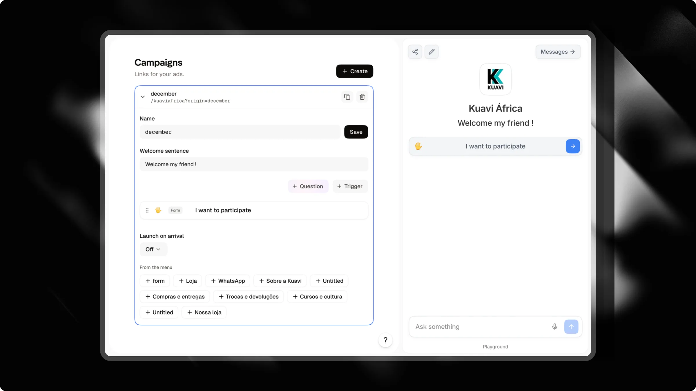

Lorsque vous diffusez des publicités payantes sur Instagram ou Facebook, rediriger le trafic vers une page d'accueil générique ou un lien dans la bio réduit souvent votre taux de conversion. Les visiteurs s'attendent à retrouver exactement le sujet ou l'offre promis dans votre contenu publicitaire.

Les **Campagnes** vous permettent de créer des écrans d'accueil dédiés pour chaque publicité. Chaque campagne fournit un lien de suivi unique, un titre personnalisé et un ensemble ciblé de déclencheurs conçus pour guider les visiteurs directement vers la conversion.

---

## Fonctionnement des écrans d'accueil de campagne

Lorsqu'un visiteur ouvre le lien de votre campagne (`https://attlas.so/your-chat?origin=campaign-name`), il se produit ceci :

- **Titre dédié** : Une phrase d'accueil bien visible remplace la description standard de votre chat, en accord avec la promesse publicitaire.
- **Déclencheurs ciblés** : Le visiteur voit uniquement les questions ou actions que vous avez choisies pour cette publicité, plutôt que l'intégralité de votre menu.
- **Expérience sans distraction** : Les liens externes et les icônes sociales restent masqués afin que les visiteurs se concentrent sur votre message.
- **Lancement automatique de formulaire** : Vous pouvez automatiquement démarrer une conversation ou un formulaire de contact dès que le visiteur arrive sur l'écran.
- **Déverrouillage du menu après conversion** : Une fois que le visiteur a soumis ses coordonnées ou réservé un rendez-vous, le menu complet du chat se déverrouille automatiquement.

<Info>
La section **Campagnes** apparaît dans la barre latérale de votre chat une fois que vous avez connecté l'[API Conversions Meta](/fr/integrations/meta) dans **Paramètres** > **Intégrations**. La connexion à Meta permet à Attlas de signaler les leads et les réservations directement à votre gestionnaire de publicités.
</Info>

---

## Créer une campagne

La configuration d'un écran de campagne prend moins de deux minutes :

1. Dans votre tableau de bord Attlas, sélectionnez votre chat et cliquez sur **Campagnes** dans la barre latérale.
2. Cliquez sur **Créer** dans le coin supérieur droit.
3. Choisissez un **Nom** descriptif (comme `black-friday` ou `spring-audit`). Attlas utilise ce nom dans l'URL de votre publicité.
4. Saisissez votre **Phrase d'accueil**. Soyez percutant et cohérent avec le texte de votre publicité.
5. Ajoutez les déclencheurs que vous souhaitez afficher pour cette publicité.
6. (Optionnel) Sélectionnez un formulaire dans **Lancer à l'arrivée** pour démarrer le questionnaire immédiatement.
7. Cliquez sur **Enregistrer**, puis cliquez sur l'icône **Copier le lien** à côté du nom de votre campagne.
8. Collez le lien dans votre gestionnaire de publicités Meta comme URL de destination.

<Info>
Utilisez l'aperçu du chat en direct sur le côté droit de l'écran pour prévisualiser l'apparence du titre et des déclencheurs de votre campagne avant de dépenser votre budget publicitaire.
</Info>

---

## Paramètres de configuration

| Paramètre | Description |
| --- | --- |
| `Nom` | L'identifiant de la campagne. Il forme le paramètre de requête de suivi dans votre lien (par exemple, `?origin=promo-ete`). |
| `Phrase d'accueil` | Le titre affiché en haut de votre chat, remplaçant votre description par défaut. Jusqu'à 120 caractères. |
| `Déclencheurs` | Les actions ou questions spécifiques visibles sur cet écran de campagne. |
| `Lancer à l'arrivée` | Déclencheur de formulaire optionnel qui démarre automatiquement dès qu'un visiteur ouvre votre lien. |

---

## Gérer les déclencheurs pour une publicité

Vous pouvez créer un écran de campagne sans recréer les déclencheurs à partir de zéro :

- **Créer de nouveaux déclencheurs** : Utilisez l'éditeur de déclencheurs intégré pour ajouter des questions, des formulaires, des liens ou des médias spécifiques à cette campagne.
- **Copier depuis le menu** : Cliquez sur n'importe quel déclencheur sous **Depuis le menu** pour dupliquer un déclencheur existant dans cette campagne. Attlas copie le déclencheur ainsi que tous ses enfants imbriqués.
- **Modifications indépendantes** : Modifier ou supprimer un déclencheur copié dans votre campagne n'affecte jamais l'original dans votre menu principal.
- **Réutilisable entre les campagnes** : Comme les déclencheurs sont copiés plutôt que déplacés, le déclencheur original reste dans **Depuis le menu**, ce qui vous permet de le réutiliser dans plusieurs campagnes.

<Warning>
Incluez toujours au moins un déclencheur de type **Question** ou **Formulaire** dans votre campagne. Les déclencheurs qui affichent uniquement des liens ou des médias maintiennent les visiteurs en dehors de la conversation et empêchent Attlas de capturer des leads.
</Warning>

---

## Suivi des performances

Chaque ligne de campagne affiche les statistiques de performance des 30 derniers jours :

- **Vues** : Nombre total de visites reçues via ce lien de campagne.
- **Conversations** : Visiteurs qui ont commencé à chatter ou ont cliqué sur un déclencheur de question.
- **Leads** : Visiteurs qui ont soumis leurs coordonnées ou réservé un rendez-vous dans l'agenda.
- **Taux de conversion** : Pourcentage de visiteurs ayant rempli un formulaire de contact ou effectué une réservation.
- **Déclencheur principal** : La question ou le bouton spécifique sur lequel les visiteurs ont le plus cliqué.
