L'onglet **Déclencheurs** est l'endroit où vous ajoutez des boutons de lien interactifs, des intégrations de médias et des raccourcis de contact qui apparaissent au centre de votre chat.

Les déclencheurs aident les visiteurs à découvrir votre contenu, explorer vos ressources et agir sans quitter la conversation.

<Check>
  Pour ajouter des déclencheurs, cliquez sur l'onglet **"Déclencheurs"** dans le menu latéral gauche.
</Check>

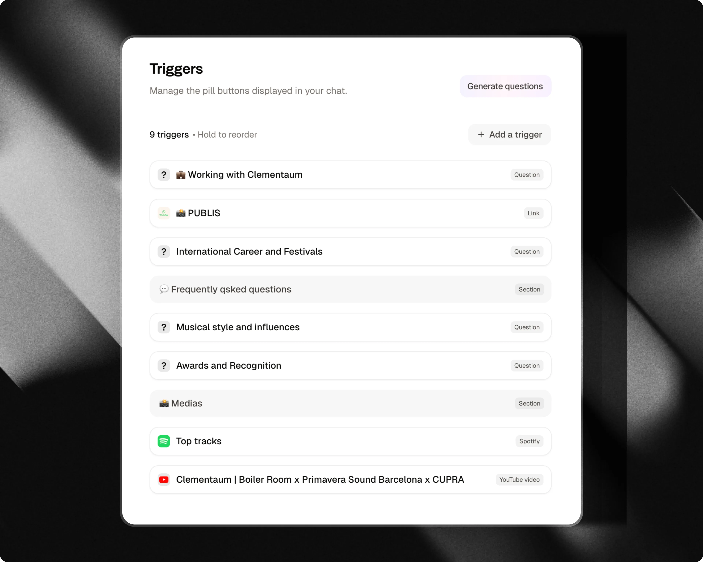

## Types de déclencheurs

Attlas propose une grande variété de types de déclencheurs de liens et de médias organisés par catégorie :

### Pour commencer

- **Liens externes** : Dirigez les utilisateurs vers des sites web externes, des pages d'atterrissage ou des ressources.
- **Formulaires** : Lancez des questionnaires en plusieurs étapes, des sondages ou des flux de leads directement dans le chat.
- **Cartes** : Mettez en avant des articles, des annonces ou des éléments avec une image de couverture visuelle au format 16:9.
- **Fichiers** : Proposez des PDF, e-books, guides ou catalogues téléchargeables.

### Organiser

- **Section** : Regroupez et catégorisez vos déclencheurs sous des séparateurs d'en-tête clairs.
- **Espace** : Ajoutez un espacement vertical entre les blocs de déclencheurs pour une mise en page équilibrée.

### Médias

- **Mini-vidéo** : Télévhargez une courte vidéo que les visieurs peuvent lire directement dans le chat.
- **Vidéos YouTube** : Mettez en avant des vidéos ou des tutorieuls spécifiques en ligne.
- **Chaîne YouTube** : Liez votre chaîne pour encourager les abonnements et la découverte de vidéos.
- **Pinterest** : Affichez votre profil Pinterest et vos dernierères épingles directement dans le chat.
- **Spotify** : Intégrez des chansons, des albums ou des playlists écoutables directement dans le chat.
- **SoundCloud** : Intégrez des pistes audio ou des playlists avec une hauteur de lecteur personnalisée.
- **Fichiers Google Drive** : Partgez des documents, des présentations ou des feuilles de calcul hébeergés sur Google Drive.

### Contact & localisation

- **Cartes de localisation** : Partgez des cartes de localisation interactives et des itinéraires.
- **WhatsApp** : Capteurez les déails du lead (nom, téléphone, message) avant de rediriger vers WhatsApp.
- **E-mail** : Fournisez une action de contact par e-mail instantanée.
- **Téléphone** : Permettez aux visieurs d'appeler votre numéro de téléphone directement.

### Spécialisé

- **Prochaines dates (Bandsintown)** : Affichez les dates de tournée en direct et les liens de billets pour les artistess et les interprètes.
- **Application** : Dirigez les visieurs vers le téléchargement de votre application mobile depuis l'App Store d'Apple, le Google Play Store ou les deux.

### Boutique

- **Produit** : Vendez des articles ou présenttez des annonces avec une image, un prix, une devise et une URL de paiement de destination dans votre onglet Boutique.

---

## Contenu et liens

### Liens externes

Ajoutez des liens vers des pages importantes que vous souhatez partager avec vos visieurs.

Vous pouvz partager :

- Sites web d'enttreprise
- Pages d'aterrissage
- Blogs et articles
- Portfolios
- Pages d'insription ou de réservation

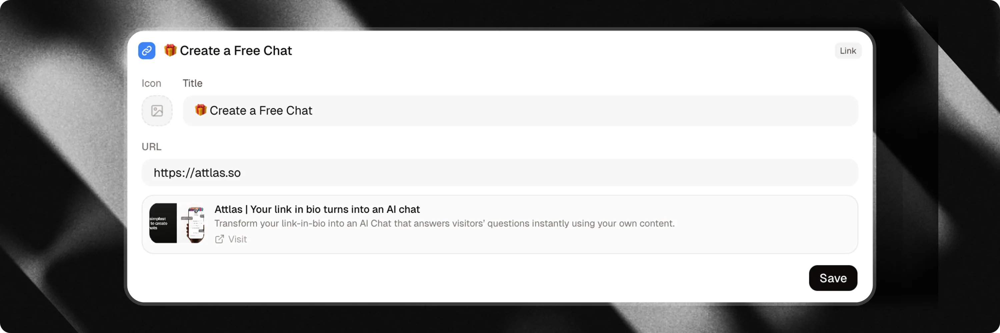

---

### Cartes

Créez des cartes de lien visuelles pour attir l'attension de vos visieurs avec une grande image de couvertre.

Les cartes sont idéales pour mette en avant :

- Articles de blog et guides
- Offres spéciales ou annonces
- Actualités importantes
- Services mis en avant

La carte comprend une image de couvertre au format 16:9 et un titre. Lorsque vous ajotez une URL, la carte devient cliquable et redirige les visieurs vers votre page. Les visieurs peuvent égalment copier le lien directment depuis la carte.

<Info>
  Attlas ajoute automatiquement des paramètres de suivi UTM pour vous aider à analyser les sorces de trafic.
</Info>

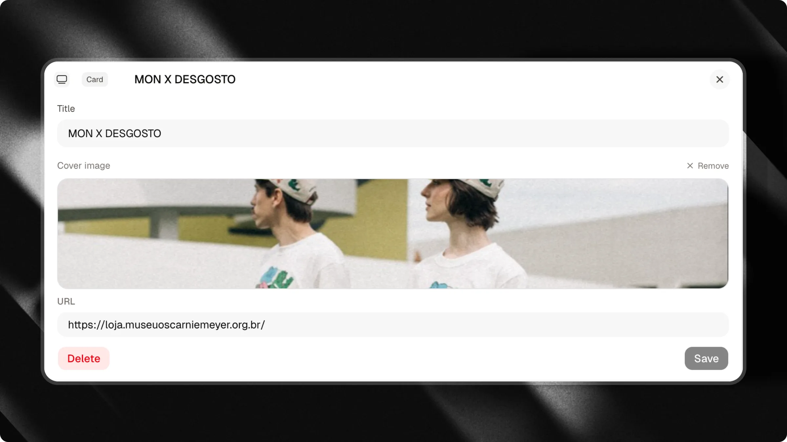

---

### Fichiers

Rendez des documents disponibles en téléchargement direct via les déclencheurs.

Idéal pour partager :

- PDFs
- E-books
- Catalogues
- Guides et livres blancs
- Diapositives de présentations

Les visieurs peuvent télécharger le document immédiatement sans quiter l'interface du chat.

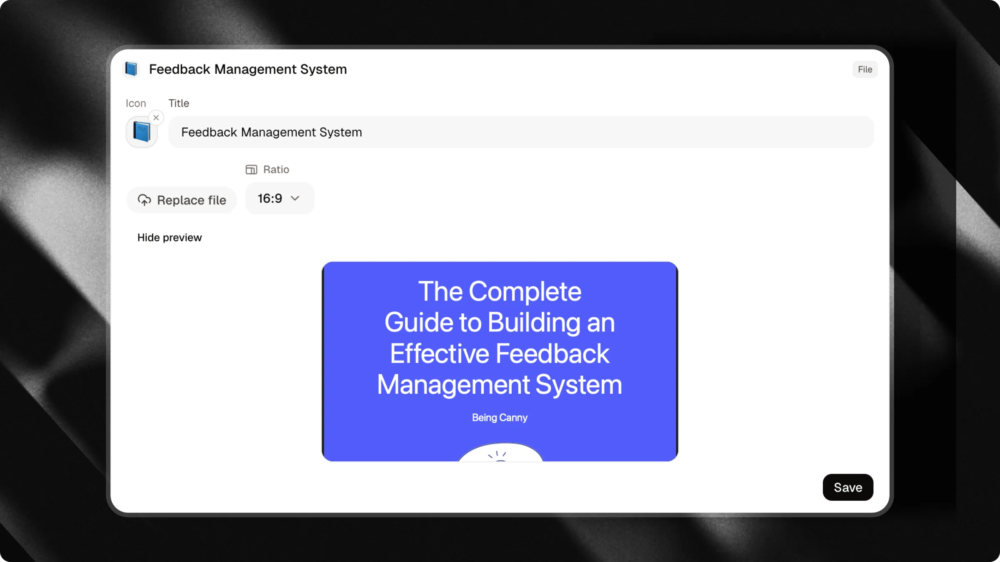

---

### Fichiers Google Drive

Partgez des documents, des présentations, des feilles de calcul ou tout autre fichier stocké sur Google Drive.

Ajoutez simplement le lien de partage public pour donner aux visieurs un accès instantanné à votre contenu.

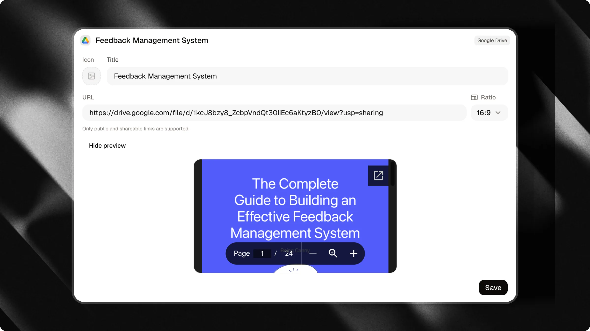

---

### Formulaires

Lancez des formulaires interactifs étape par étape et des questionnaires directment dans le fil de conversation.

Les formulaires guident les visieurs à travers des questions une par une, ce qui facilte la qualification des leads, la collecte de commentaires ou la collecte d'informations structurées sans envoyer les utilisateurs vers des pages externes.

Lors de la configuration d'un déclencheur de formulaire :

- **Titre** : Saisissez le libellé affiché sur le bouton du déclencheur (par exemple "Obtenir un devis" ou "Démarrer le questionnaire").
- **Formulaire** : Sélectionnez le formulaire de votre chat qui s'executera lorsque les visieurs cliquent sur le déclencheur.

Lorsqu'un visieur clique sur un déclencheur de formulaire :

- Le libellé du bouton apparaît comme un message envoyé par le visieur dans le chat.
- L'assistant commmence immédiatement le flux du formulaire et présente la première étape.
- Les visieurs répondent directment dans le chat en utilisant la barre de saisie (texte, options, dates ou détaails de contact).
- Les réponses complètes sont enristrées dans votre CRM.

<Info>
  Créez et gérez vos formulaires dans la section **Formulaires** de votre tableau de bord. Si un formulaire lié est supprimé, le déclencheur est automatiquement masqué sur le chat public jusqu'à ce qu'un nouveau formulaire soit atrbué.
</Info>

<Tip>
  Vous lancez des campagnes publicitaires ? Vous pouvez configurer n'importe quel déclencheur de formulaire pour qu'il se lance automatiquement à l'arrivée lorsque les visieurs ouvrent un lien de campagne. En savoir plus dans notre guide [Campagnes](/fr/pro/campaignes).
</Tip>

<Card title="Apprenez à créer et personnaliser les formulaires de chat" icon="clipboard-list" horizental href="/fr/basic/forms">
  Explrer notre guide dédié pour apprendre à créer des formulaires, configurer les types d'étapes et recueillir des réponses structurées.
</Card>

---

## Intégrations de médias

### Mini-vidéo

Téléchargez une courte vidéo MP4 pour créer un point d'entrée personnalisé et engeageant dans votre chat. Les visieurs peuvent lire ou mettere en pause la vidéo, actver/désactiver le son et voir la duré restante.

Vous pouvz choisir entre une forme **cercle** ou **carré arrondi**, et actver la **Lecture autommatique**. Les vidéos en lecture autommatique démarent toujours en mode silencieux afin que les visieurs gardent le contrôe de l'audio.

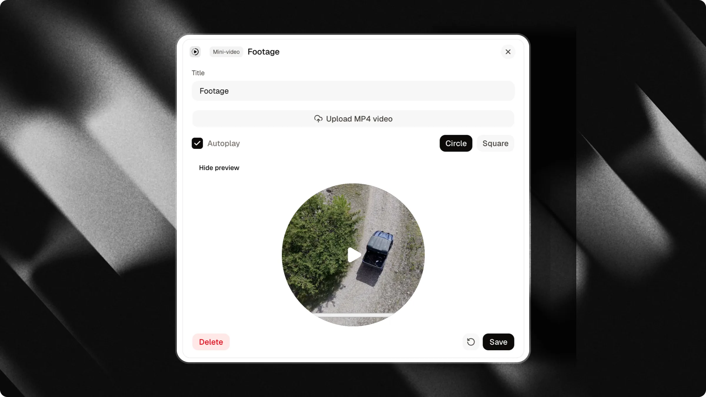

<Warning>
  Les mini-vidéos doivent être des fichiers MP4 téléchargés depuis votre apareil, ne dépassant pas 50 Mo et ne dépassant pas 2 minutes de durée.
</Warning>

---

### Vidéos YouTube

Promouvez des vidéos spécifiques de votre chaîne ou des tutorieuls tiers directment dans votre chat.

Idéal pour :

- Visites guidées de produit
- Tutorieuls vidéo
- Présentations
- Études de cas

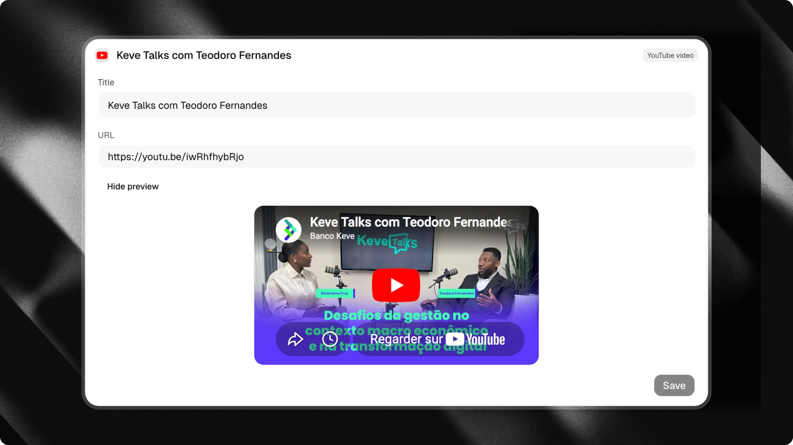

---

### Chaîne YouTube

Ajoutez le lien de votre chaîne pour que les visieurs puissent découurir vos vidéos et s'abonner facilement.

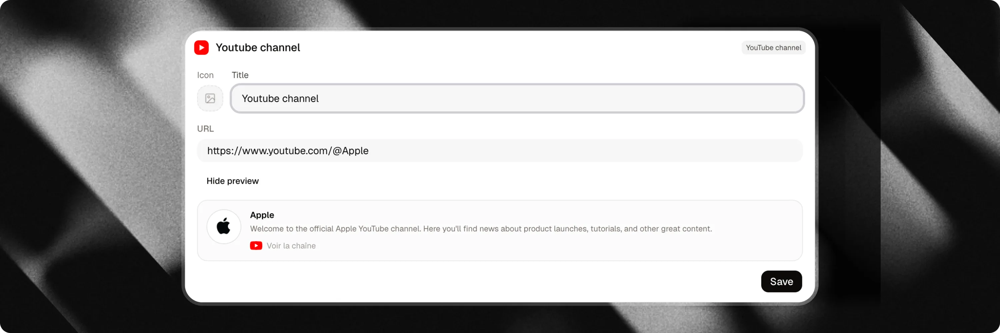

---

### Intégration Spotify

Partgez de la musique, des podcasts ou des playlists directment dans l'interface du chat.

Que vous soyez un artiste, un podcasteur ou que vous organisiez des recomandations pour votre audience, ajoutez n'importe quel lien Spotify pour intégrer un widget jouable.

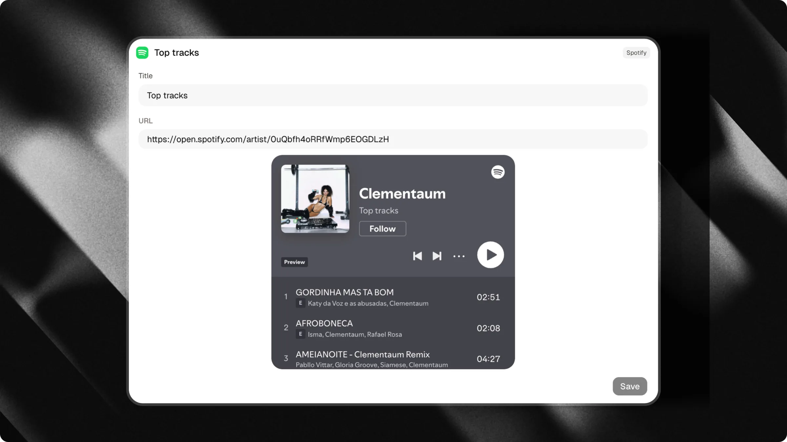

---

### Intégration SoundCloud

Intégrez des pistes audio ou des playlists directment dans l'interface du chat.

Ajoutez n'importe quel lien de piste ou de playlist SoundCloud public. Vous pouvez également personaliser la hauteur de l'intégration (entre 100px et 1000px, par défaut 200px) pour adapter votre mise en page.

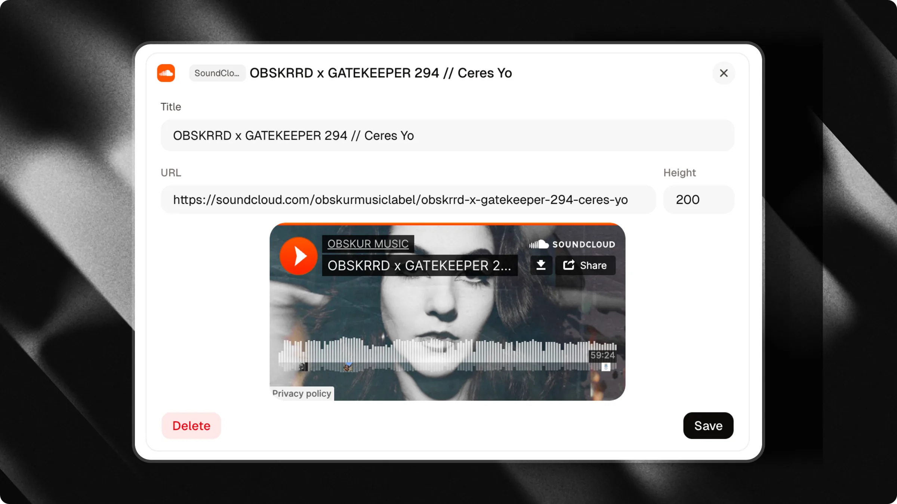

---

### Pinterest

Partgez votre profil Pinterest directment dans votre chat. Les visieurs peuvent parcourir vos épingles les plus récentes sans quiter la conversation.

Saisissez votre nom d'utilisateur Pinterest lors de la configuration du déclencheur. Utilisez uniquement des lettres, des chiffres, des traits de souignement et des traits d'union, sans espaces ni URL complètes.

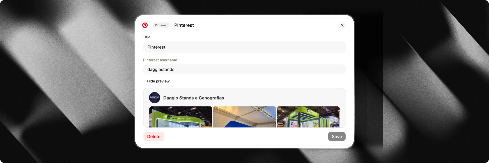

---

## Contact et localisation

### Cartes de localisation

Partgez un emplacement directment dans votre chat pour aider les visieurs à trouver vos locaux physiques.

Ajoutez une adresse pour afficher un repère de carte interactif avec des liens de navigation directs.

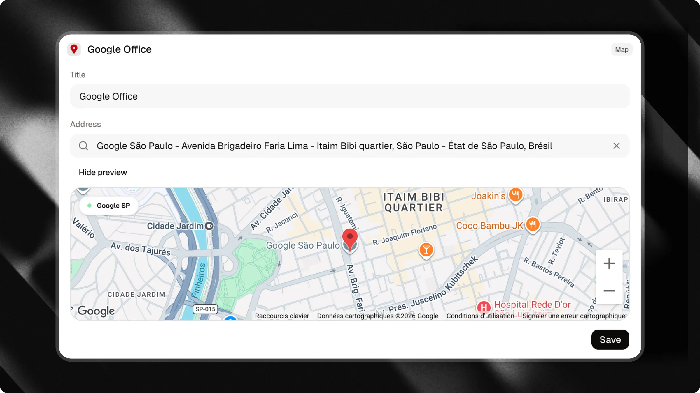

---

### WhatsApp

Permetez aux visieurs de vous contacter sur WhatsApp directment depuis votre chat.

Cliquer sur un déclencheur WhatsApp ouvre un tiroir interactif de capture de leads. Les visieurs peuvent saisir leur nom, numéro de téléphone et message. Attlas enregistre automatiquement le lead dans votre CRM avant de rediriger vers WhatsApp avec le message pré-rempli.

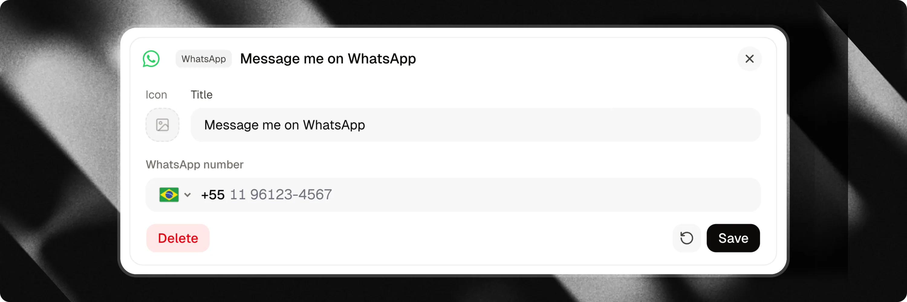

---

### E-mail et Téléphone

Fournissez des déclencheurs de communication en une seule tape pour les visieurs qui préfèrent les méthodes de contact traditionnelles.

- **E-mail** : Ouvre le client de messagerie par défaut du visiteur avec votre adresse pré-remplie.
- **Téléphone** : Incite l'appareil du visiteur à appeler directement votre numéro de téléphone.

---

### Prochaines dates (Bandsintown)

Affichez les dates de tournée en direct et les événements de concert à venir directement dans votre chat via votre profil Bandsintown connecté.

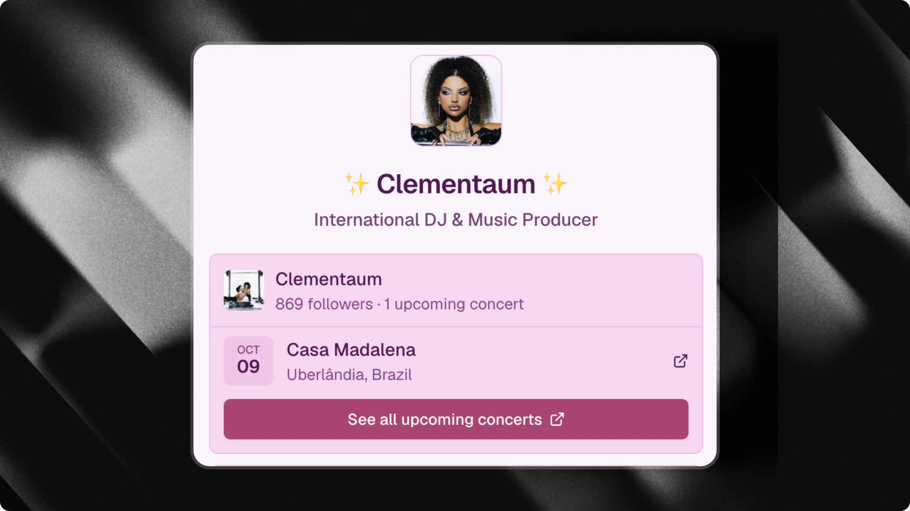

Les visiteurs peuvent parcourir les dates de tournée à venir, les lieux, les emplacements et accéder aux liens de billets dans la conversation.

<Card title="Apprenez à configurer l'intégration Bandsintown" icon="music" horizontal href="/fr/integrations/bandsintown">
  Connectez votre profil Bandsintown pour afficher les dates de tournée en direct et les spectacles à venir directement dans votre chat.
</Card>

---

### Application

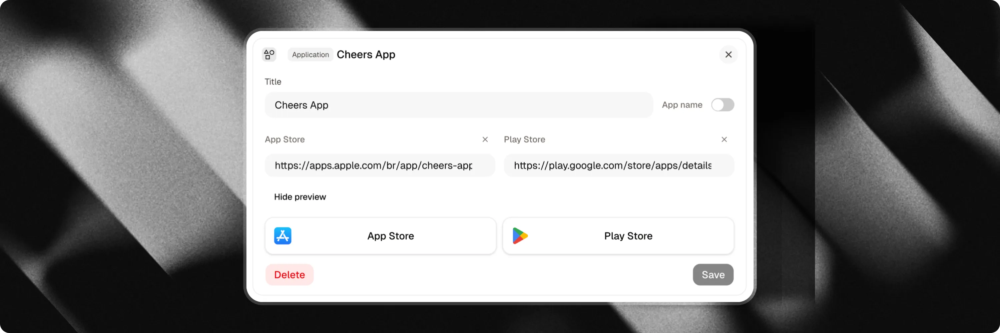

Faites la promotion de votre application mobile et dirigez les visiteurs vers son téléchargement depuis l'App Store d'Apple, le Google Play Store ou les deux.

Ajoutez le lien de votre App Store ou de votre Play Store pour afficher des badges de téléchargement natifs directement dans votre chat.

---

## Mise en page et organisation

### Sections

Utilisez les séparateurs **Section** pour organiser les déclencheurs liés en groupes nommés (par ex. "Ressources", "Médias", "Nous contacter").

### Espace

Ajoutez un espacement vertical entre les déclencheurs pour créer un espace de respiration visuel et séparer différents blocs de contenu.

---

## Personnalisation des icônes

Chaque type de déclencheur est doté d'une icône par défaut. Pour la plupart des types de déclencheurs, vous pouvez personnaliser cette icône pour l'adapter à votre marque.

### Options de personnalisation

Cliquez sur l'aperçu de l'icône dans le tiroir d'édition pour ouvrir le sélecteur de médias :

- **Télécharger** : Téléchargez un fichier image personnalisé (PNG, JPG, SVG) depuis votre appareil.
- **Lien** : Fournissez une URL directe vers une image hébergée en ligne.
- **Emoji** : Choisissez un emoji standard.
- **Icône** : Choisissez parmi une bibliothèque d'icônes système.
- **Unsplash** : Recherchez et sélectionnez des photos de stock gratuites.

### Prise en charge des icônes par type de déclencheur

| Type de déclencheur | Icône personnalisable | Icône par défaut |
| :--- | :--- | :--- |
| **Lien externe** | Oui | Lien / Chaîne |
| **Carte** | Non (affiche sa propre image de couverture) | Aucune |
| **Fichier** | Oui | Fichier / Trombone |
| **Google Drive** | Oui | Logo Google Drive |
| **Formulaire** | Oui | Liste de vérification |
| **Mini-vidéo** | Non (affiche son propre lecteur vidéo) | Aucune |
| **Vidéo YouTube** | Non | Logo YouTube |
| **Chaîne YouTube** | Oui | Logo YouTube |
| **Pinterest** | Non | Logo Pinterest |
| **Spotify** | Non | Logo Spotify |
| **SoundCloud** | Non | Logo SoundCloud |
| **Cartes de localisation** | Non | Épingle de carte |
| **WhatsApp** | Oui | Logo WhatsApp |
| **E-mail** | Oui | Enveloppe de courrier |
| **Téléphone** | Oui | Combiné téléphonique |
| **Concerts** | Non | Logo Bandsintown |
| **Application** | Non | Logos App Store / Google Play |
| **Produit** | Non (affiche sa propre image de couverture) | Aucune |
| **Section** | Non (stylisé comme séparateur d'en-tête) | Aucune |
| **Espace** | Non (s'affiche comme un espacement vide) | Aucune |

---

## Déclencheurs imbriqués (Parent-Enfant)

Vous pouvez imbriquer des déclencheurs sous des déclencheurs parents pour garder votre interface de chat compacte et organisée.

### Déclencheurs pliables

Seuls certains types de déclencheurs peuvent agir comme parent (pliable) et contenir des déclencheurs enfants :

| Type de déclencheur | Pliable |
| :--- | :--- |
| Lien | Oui |
| Carte | Oui |
| Fichier | Oui |
| Google Drive | Oui |
| Section | Oui |
| Formulaire | Non |
| Mini-vidéo | Non |
| Vidéo YouTube | Non |
| Chaîne YouTube | Non |
| Pinterest | Non |
| Spotify | Non |
| SoundCloud | Non |
| Carte | Non |
| Concerts | Non |
| Application | Non |
| Produit | Non |
| WhatsApp | Non |
| E-mail | Non |
| Téléphone | Non |
| Espace | Non |

### Comment configurer des déclencheurs imbriqués

<Frame caption="Glisser le déclencheur dans le groupe">
  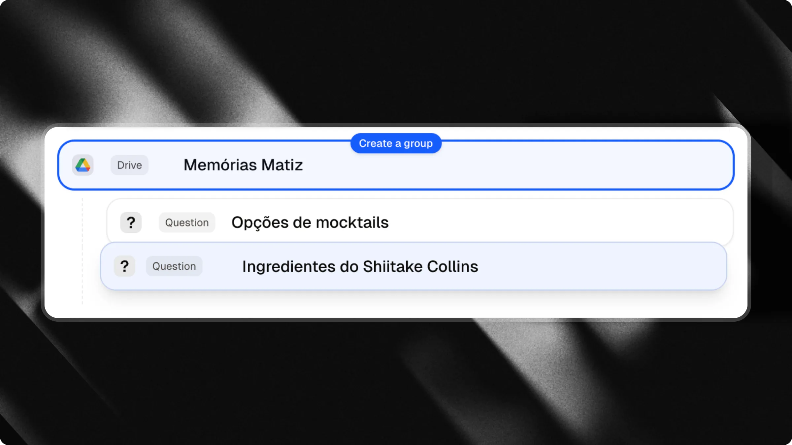
</Frame>

<Frame caption="Glisser le déclencheur hors du groupe">
  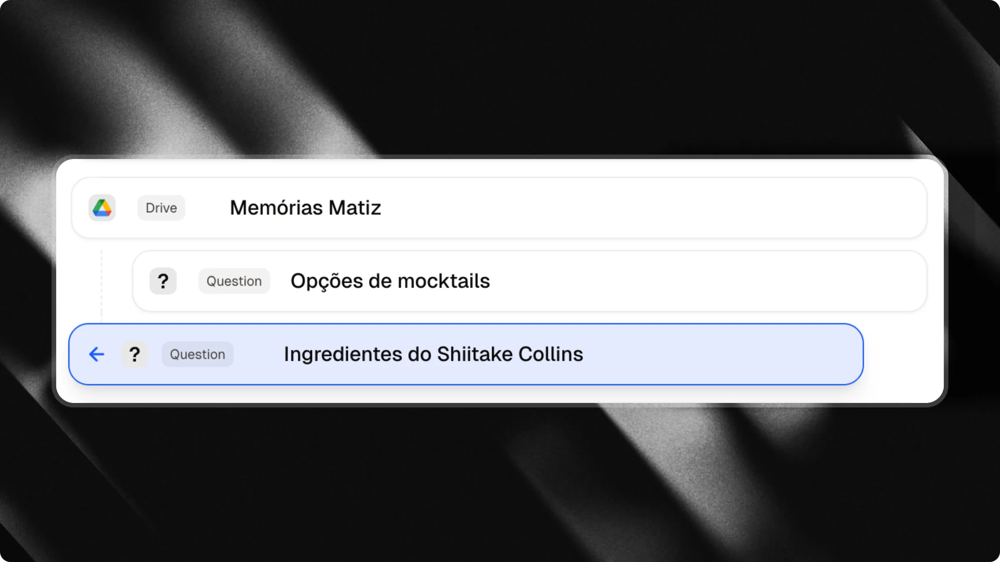
</Frame>

Vous pouvez créer des relations parent-enfant de deux façons :

1. **Glisser-déposer** : Dans la liste des déclencheurs, faites glisser un déclencheur vers la droite (en l'indentant) pour l'imbriquer sous le déclencheur au-dessus de lui. Faites-le glisser vers la gauche (en le désindentant) pour le rétablir en tant que déclencheur de premier niveau.
2. **Depuis l'éditeur** : Ouvrez le tiroir d'édition de tout déclencheur éligible en tant que parent, faites défiler jusqu'à la section **Questions suggérées**, et cliquez sur <kbd>Ajouter une question</kbd> pour ajouter des questions directement comme enfants.

<Info>
  Dans l'onglet **Boutique**, une **Section** peut contenir des **Produit** enfants pour organiser les articles en catégories.
</Info>

---

## Aperçu

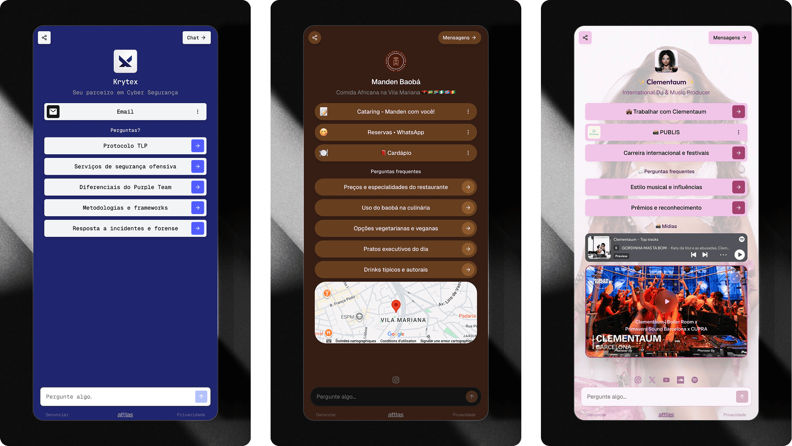

<Note>
  Les déclencheurs fonctionnent en parallèle de votre assistant IA. Les visiteurs peuvent cliquer sur n'importe quel déclencheur pour explorer le contenu, ou taper librement des questions dans la barre de message.
</Note>

<Card title="Apprenez à vendre des produits dans notre guide Boutique" icon="bag-shopping" horizontal href="/fr/start/shop">
  Présentez des produits et des marchandises directement dans votre chat avec une mise en page de boutique dédiée.
</Card>
