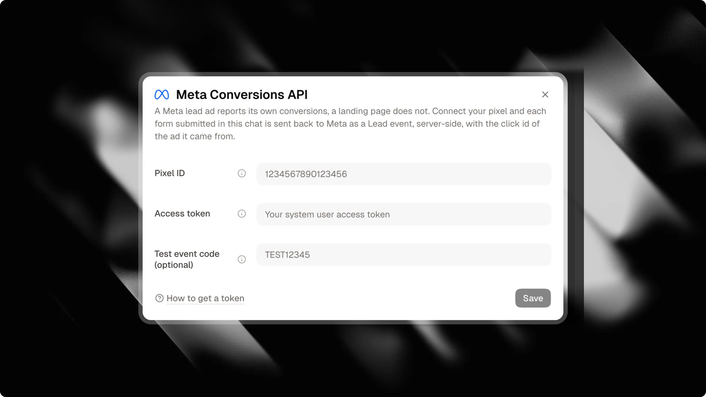

If you run paid ads on Meta (Facebook and Instagram) directed to your Attlas Chat, sending conversion data back to Meta is essential. Without it, Meta only optimizes for link clicks, which drives up your real cost per lead (CPL).

Attlas connects directly to the Meta Conversions API (CAPI) on the server side. Whenever a visitor converts in your chat, Attlas sends that conversion event straight to Meta without relying on a browser pixel.

<Note>
  The Meta Conversions API integration is available on the Attlas Pro plan.
</Note>

---

## Why server-side tracking matters

Unlike traditional web tracking that relies on a browser pixel, Attlas handles conversion tracking entirely on the server:

- **No client-side tracking script**: Your chat remains fast and lightweight, with zero external tracking scripts loaded in the browser.
- **Privacy and SEO friendly**: No tracking cookies are set by the chat, avoiding intrusive cookie consent banners and preserving optimal crawlability for search engines.
- **Reliable tracking**: Server-side events bypass ad blockers and browser privacy restrictions that often block browser pixels.
- **First-touch attribution**: Attlas records the original Meta ad click (`fbclid`) when the visitor arrives, keeping accurate attribution even after an extended conversation.
- **Clean test data**: Conversations in your dashboard playground or conversations marked as internal never send events to Meta, preventing test conversations from skewing your campaign metrics.

---

## Supported conversion events

Attlas automatically maps visitor actions to Meta standard events:

| Event | Triggered when | Description |
| --- | --- | --- |
| `Lead` | Contact capture or form completion | A visitor submits contact details in the chat, completes a guided chat form, or requests a WhatsApp conversation. |
| `Schedule` | Calendar booking | A visitor books an appointment through the integrated Google Calendar scheduler. |

<Info>
Contact details (email, phone, first name, and country) are normalized and hashed using SHA-256 before being sent to Meta, in full compliance with Meta's customer data privacy requirements.
</Info>

---

## Campaign and UTM tracking

If your ad campaign directs traffic to a specific campaign channel or includes tracking parameters, Attlas automatically forwards them to Meta:

- **Campaign Origin**: When visitors land via a dedicated campaign link (`?origin=<campaign_id>`), the campaign identifier is included in the event custom data. To learn how to build tailored welcome screens and conversation starters for your ads, see our [Campaigns](/pro/campaigns) guide.
- **UTM Campaign**: Any `utm_campaign` parameter captured upon landing is attached to the conversion event for easy breakdown in Meta Events Manager.

<Tip>
Combine Meta Conversions API with [Campaigns](/pro/campaigns) to show custom greetings and targeted conversation triggers for each ad while tracking conversions automatically.
</Tip>

---

## How to set up Meta Conversions API

Setting up the connection takes just a couple of minutes:

1. Open your **Chat Settings** in the Attlas dashboard.
2. Select the **Integrations** tab.
3. Locate the **Meta Conversions API** card and click **Connect**.
4. Fill in your **Pixel ID** and **Access token**.
5. (Optional) Enter a **Test event code** if you want to verify events before going live.
6. Click **Save**. If a test event code is provided, Attlas verifies your credentials with Meta directly before saving.

---

## Configuration settings

| Field | Required | Description |
| --- | --- | --- |
| `Pixel ID` | Yes | The numeric ID of your Meta Pixel or Dataset. You can find this in Meta Events Manager under Data sources. |
| `Access token` | Yes | A Conversions API access token generated from your pixel settings in Meta Events Manager. Attlas stores this token encrypted. |
| `Test event code` | No | A temporary code found in the "Test events" tab of Meta Events Manager (for example `TEST12345`). When filled, events are only routed to the testing console and will not affect live ad campaigns. |

<Warning>
The **Test event code** is optional and only meant for checking your setup. Leave it empty if you want to go live. The code expires automatically 1 hour after you save it. To go live immediately, leave the field empty before saving.
</Warning>

---

## Testing your integration

Once your connection is saved:

1. Go to your **Meta Events Manager** and open the **Test events** tab for your pixel.
2. If using a test code, make sure the same code is saved in your Attlas integration dialog.
3. In Attlas, open the Meta integration dialog and click **Send a test event**.
4. Check the Meta Events Manager screen. You will see an incoming `Lead` event appear within seconds.

<Tip>
You can pause conversion reporting at any time using the toggle switch on the Meta card without deleting your credentials.
</Tip>
