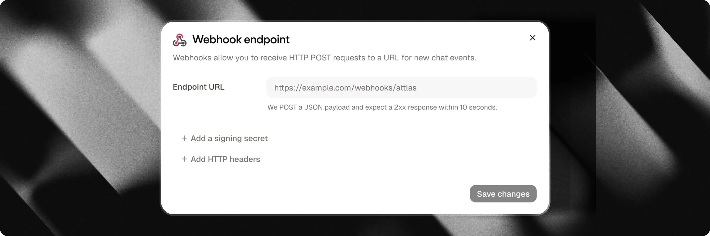

Webhooks connect your Attlas chat to your backend, CRM, or external automation tools in real time. Whenever a visitor interacts with your chat, such as submitting contact details, completing a multi-step form, or booking a meeting, Attlas sends an automated HTTP POST request to your specified endpoint.

---



## Key events

Attlas triggers webhooks for five primary events across three categories:

| Event | Category | Triggered when |
| :--- | :--- | :--- |
| `contact_created` | `contact` | A new lead or contact profile is created from a conversation, form, or calendar booking. |
| `contact_updated` | `contact` | An existing contact is recognized and updated with fresh information. |
| `form_completed` | `form` | A visitor completes all steps of an interactive form, with or without contact fields. |
| `event_created` | `calendar` | A visitor schedules a new meeting on Google Calendar through the chat. |
| `event_canceled` | `calendar` | A scheduled meeting is canceled by you or the visitor. |

<Note>
**Event routing and pairs**:
- If a returning visitor provides information and is matched by email, phone, WhatsApp number, or conversation ID, Attlas emits `contact_updated` instead of `contact_created`.
- A meeting booking sends both a contact event (`contact_created` or `contact_updated`) and an `event_created` event.
- A completed form with contact fields sends both a contact event and a `form_completed` event.
- Because paired events run concurrently, receiving endpoints should route payloads by checking the `event` field.
</Note>

<Info>
**Rescheduled meetings**: Attlas does not have a separate `event_rescheduled` event. When an appointment is rescheduled, Attlas issues an `event_canceled` event followed by a new `event_created` event.
</Info>

---

## How to set up Webhooks

Setting up a webhook endpoint takes less than a minute:

1. In your Attlas dashboard, select your chat and navigate to **Settings** > **Integrations**.
2. Locate the **Webhooks** card and click **Connect** (or **Configure**).
3. Enter your destination **Webhook URL** (must be a secure, publicly accessible `https://` address).
4. (Optional) Configure custom HTTP headers if your receiving server requires static authorization tokens or API keys (up to 10 headers).
5. (Optional) Click **Add signing secret** to generate an HMAC secret used to verify request authenticity.
6. Click **Save** to activate your endpoint.
7. Click **Send test** to dispatch a test payload and confirm that your server responds with `200 OK`.

---

## Webhook payload envelope

Every webhook request contains a JSON envelope with delivery metadata and an event-specific `data` object:

```json
{
  "id": "5c6f8a0b-1234-4567-890a-bcdef1234567",
  "type": "contact",
  "event": "contact_created",
  "created_at": "2026-10-31T20:15:11.480Z",
  "chat_id": 42,
  "data": { ... }
}
```

| Field | Type | Description |
| :--- | :--- | :--- |
| `id` | `string` | Unique UUID for the delivery attempt, matching the `X-Attlas-Delivery` header. |
| `type` | `string` | High-level category: `contact`, `form`, or `calendar`. |
| `event` | `string` | Event name: `contact_created`, `contact_updated`, `form_completed`, `event_created`, or `event_canceled`. |
| `created_at` | `string` | ISO 8601 timestamp when the event was dispatched. |
| `chat_id` | `number` | Numeric ID of the chat that produced the event. |
| `data` | `object` | Event-specific payload. Empty strings, null values, and empty arrays are omitted automatically. |

---

## Contact events (`contact_created`, `contact_updated`)

Contact events fire whenever a visitor leaves contact details through a lead capture form, a human handoff request, a WhatsApp trigger, or a calendar booking.

```json
{
  "id": "5c6f8a0b-1234-4567-890a-bcdef1234567",
  "type": "contact",
  "event": "contact_created",
  "created_at": "2026-10-31T20:15:11.480Z",
  "chat_id": 42,
  "data": {
    "id": "b1e23456-7890-4abc-def0-1234567890ab",
    "firstname": "Ana",
    "email": "ana@example.com",
    "phone": "+33612345678",
    "country": "FR",
    "source": "form",
    "kind": "new_lead",
    "form_id": "4391e4f0-1111-2222-3333-abcdef123456",
    "campaign_id": "black-friday",
    "origin": "black-friday",
    "conversation_id": "9f0a1b2c-3d4e-5f6a-7b8c-9d0e1f2a3b4c",
    "history": [
      {
        "type": "user",
        "content": "I would like to book a demo for next week",
        "manual": true,
        "timestampz": "2026-10-31T20:14:54.000Z"
      },
      {
        "type": "assistant",
        "content": "I would be happy to help! Let me gather a few details.",
        "manual": false,
        "timestampz": "2026-10-31T20:15:01.000Z"
      }
    ]
  }
}
```

### Contact fields

| Field | Type | Description |
| :--- | :--- | :--- |
| `id` | `string` | Unique identifier of the contact profile in Attlas. |
| `firstname` | `string` | First name provided by the visitor. |
| `lastname` | `string` | Last name provided by the visitor. |
| `email` | `string` | Email address provided by the visitor. |
| `phone` | `string` | Phone number in E.164 format. |
| `whatsapp` | `string` | WhatsApp phone number if provided or captured via WhatsApp trigger. |
| `country` | `string` | Two-letter ISO country code detected from visitor locale or IP address. |
| `source` | `string` | Internal storage origin (`form`, `human`, `whatsapp`, `calendar`). |
| `kind` | `string` | Raw visitor intent (`new_lead`, `human_request`, `booking`, `whatsapp`). |
| `channel` | `string` | Exit channel medium when applicable (e.g. `"whatsapp"`). Omitted otherwise. |
| `notes` | `string` | Summary or notes about the lead, such as the conversation context. |
| `options` | `string[]` | Answers collected from qualifying questions or form steps. |
| `form_id` | `string` | UUID of the form if the lead was collected through an Attlas form. Omitted otherwise. |
| `campaign_id` | `string` | Campaign slug when the visitor arrived via a tracked campaign link matching an active campaign. Omitted otherwise. |
| `origin` | `string` | Raw `?origin=` query parameter from the URL if present. |
| `preferred_at` | `string` | Preferred meeting or contact timestamp if requested by the visitor. |
| `conversation_id` | `string` | Unique identifier of the chat conversation. |
| `history` | `array` | Chronological list of chat messages exchanged prior to submission. |

### Lead intent (`kind`)

Use `kind` to identify why the contact was created:

- `new_lead`: Visitor submitted details through a lead capture form or prompt.
- `human_request`: Visitor asked to speak with a human team member.
- `booking`: Visitor scheduled a meeting via Google Calendar.
- `whatsapp`: Visitor clicked a WhatsApp trigger to continue the conversation on WhatsApp.

---

## Form completion events (`form_completed`)

When a visitor reaches the end of an interactive form in your chat, Attlas dispatches a `form_completed` event. This event triggers for every completed form, including surveys, questionnaires, and quizzes that do not include contact fields.

```json
{
  "id": "5c6f8a0b-1234-4567-890a-bcdef1234567",
  "type": "form",
  "event": "form_completed",
  "created_at": "2026-10-31T20:15:11.480Z",
  "chat_id": 42,
  "data": {
    "form_id": "4391e4f0-1111-2222-3333-abcdef123456",
    "form_name": "Product Qualification",
    "conversation_id": "b064e2d1-4444-5555-6666-777788889999",
    "contact_id": "aeea8853-aaaa-bbbb-cccc-ddddeeeeffff",
    "campaign_id": "black-friday",
    "origin": "black-friday",
    "notes": "Interested in team onboarding package",
    "completed_at": "2026-10-31T20:15:11.418Z",
    "answers": [
      {
        "step_id": "ee4c1111",
        "type": "choice",
        "question": "What is your team size?",
        "answer": "10 to 50 employees",
        "value": ["opt_10_50"],
        "option_ids": ["opt_10_50"]
      },
      {
        "step_id": "5e092222",
        "type": "contact",
        "field": "firstname",
        "answer": "Ana",
        "value": "Ana"
      },
      {
        "step_id": "34183333",
        "type": "contact",
        "field": "email",
        "answer": "ana@example.com",
        "value": "ana@example.com"
      }
    ],
    "history": [ ... ]
  }
}
```

### Form completion fields

| Field | Type | Description |
| :--- | :--- | :--- |
| `form_id` | `string` | Unique identifier of the completed form. |
| `form_name` | `string` | Display name of the form in your Attlas dashboard. |
| `completed_at` | `string` | ISO 8601 timestamp when the form reached completion. |
| `conversation_id` | `string` | Conversation identifier where the form was answered. |
| `contact_id` | `string` | Contact ID if contact fields were submitted. Matches `id` in `contact_created`. |
| `campaign_id` | `string` | Campaign slug if the visitor arrived through a campaign link. |
| `origin` | `string` | Raw `?origin=` query parameter from the URL. |
| `notes` | `string` | Summary notes if provided. |
| `answers` | `array` | Sequential list of answers in form order. |

### Answer objects structure

Each entry in `answers` represents one answered question or contact input:

- `step_id`: Stable identifier of the form step. Remains unchanged even if you edit the question text later.
- `type`: Step type, such as `choice`, `text`, `number`, `url`, `period`, or `contact`.
- `question`: The question label displayed to the visitor.
- `answer`: Human-readable text of the response, formatted in the workspace owner's primary language.
- `value`: Raw, machine-readable answer (string for text, array of IDs for choices, or an object `{ "start": "YYYY-MM-DD", "end": "YYYY-MM-DD" }` for date ranges).
- `option_ids`: Array of selected option IDs (present for `choice` steps).
- `field`: Contact property name (present for `contact` steps, such as `firstname`, `lastname`, `email`, `phone`, `whatsapp`, or `schedule`).

---

## Calendar events (`event_created`, `event_canceled`)

When visitors book or cancel appointments through Google Calendar integration, Attlas delivers calendar webhook events.

### `event_created`

Dispatched immediately when an appointment is confirmed:

```json
{
  "id": "5c6f8a0b-1234-4567-890a-bcdef1234567",
  "type": "calendar",
  "event": "event_created",
  "created_at": "2026-10-31T20:15:11.480Z",
  "chat_id": 42,
  "data": {
    "appointment_id": "app_123456",
    "google_event_id": "abc123google",
    "title": "Product Demo with Ana",
    "starts_at": "2026-11-04T14:00:00.000Z",
    "ends_at": "2026-11-04T14:30:00.000Z",
    "duration_min": 30,
    "calendar_link": "https://calendar.google.com/calendar/event?eid=...",
    "contact": {
      "id": "b1e23456-7890-4abc-def0-1234567890ab",
      "firstname": "Ana",
      "email": "ana@example.com",
      "phone": "+33612345678",
      "source": "calendar",
      "kind": "booking"
    },
    "conversation_id": "9f0a1b2c-3d4e-5f6a-7b8c-9d0e1f2a3b4c",
    "history": [ ... ]
  }
}
```

### `event_canceled`

Dispatched when a meeting is canceled:

```json
{
  "id": "5c6f8a0b-1234-4567-890a-bcdef1234567",
  "type": "calendar",
  "event": "event_canceled",
  "created_at": "2026-10-31T21:00:00.000Z",
  "chat_id": 42,
  "data": {
    "google_event_id": "abc123google",
    "starts_at": "2026-11-04T14:00:00.000Z",
    "ends_at": "2026-11-04T14:30:00.000Z",
    "cancelled_at": "2026-10-31T21:00:00.000Z",
    "cancelled_by": "user",
    "contact_id": "b1e23456-7890-4abc-def0-1234567890ab"
  }
}
```

<Info>
Conversation history is omitted for `event_canceled` events to keep cancellation payloads lightweight.
</Info>

---

## Conversation history objects

When `conversation_id` is present in `contact_created`, `contact_updated`, `form_completed`, or `event_created`, Attlas includes the full message sequence in `data.history`, ordered chronologically from oldest to newest.

Each message item contains:

- `type`: `"user"` for visitor inputs, or `"assistant"` for AI responses.
- `content`: Text message content.
- `manual`: `true` if the visitor typed the message manually, or `false` if sent by tapping a trigger pill or sent by the assistant.
- `timestampz`: ISO 8601 timestamp when the message was recorded.

---

## Security and signature verification

To verify that requests originate from Attlas and prevent tampering, generate a **Signing Secret** in your webhook settings.

When a secret is configured, Attlas computes an HMAC-SHA256 signature and attaches it in the `X-Attlas-Signature` header:

```http
X-Attlas-Signature: t=1753351953,v1=6f8a9b0c...
```

The signature is computed over `${t}.${rawBody}`, combining the timestamp `t` and the exact raw HTTP request body string.

<Warning>
Always verify signatures using the **raw, unparsed request body**. Re-serializing a parsed JSON object changes formatting and whitespace, which causes signature verification to fail.
</Warning>

### Verification code examples

<CodeGroup>
```javascript Node.js
import { createHmac, timingSafeEqual } from "node:crypto";

export function verifyAttlasWebhook(rawBody, signatureHeader, secret, toleranceSec = 300) {
  const parts = Object.fromEntries(
    signatureHeader.split(",").map((p) => p.split("=", 2))
  );

  const timestamp = Number(parts.t);
  const signature = parts.v1;

  if (!timestamp || !signature) {
    throw new Error("Invalid signature header format");
  }

  // Reject requests older than tolerance window (default: 5 minutes)
  const currentTimestamp = Math.floor(Date.now() / 1000);
  if (Math.abs(currentTimestamp - timestamp) > toleranceSec) {
    throw new Error("Request timestamp is outside the tolerance window");
  }

  const expected = createHmac("sha256", secret)
    .update(`${timestamp}.${rawBody}`)
    .digest("hex");

  const expectedBuffer = Buffer.from(expected, "utf8");
  const signatureBuffer = Buffer.from(signature, "utf8");

  if (
    expectedBuffer.length !== signatureBuffer.length ||
    !timingSafeEqual(expectedBuffer, signatureBuffer)
  ) {
    throw new Error("Signature verification failed");
  }

  return true;
}
```

```python Python
import hmac
import hashlib
import time

def verify_attlas_webhook(raw_body: str, signature_header: str, secret: str, tolerance_sec: int = 300) -> bool:
    try:
        parts = dict(part.split("=", 1) for part in signature_header.split(","))
        timestamp = int(parts["t"])
        signature = parts["v1"]
    except (KeyError, ValueError):
        raise ValueError("Invalid signature header format")

    # Reject requests older than tolerance window (default: 5 minutes)
    if abs(time.time() - timestamp) > tolerance_sec:
        raise ValueError("Request timestamp is outside the tolerance window")

    signed_payload = f"{timestamp}.{raw_body}".encode("utf-8")
    expected_signature = hmac.new(
        secret.encode("utf-8"),
        signed_payload,
        hashlib.sha256
    ).hexdigest()

    if not hmac.compare_digest(expected_signature, signature):
        raise ValueError("Signature verification failed")

    return True
```
</CodeGroup>

### Request headers

Every webhook dispatch includes standard headers:

| Header | Description |
| :--- | :--- |
| `Content-Type` | `application/json` |
| `User-Agent` | `Attlas-Webhooks/1.0` |
| `X-Attlas-Event` | Event name matching the payload `event` attribute (e.g. `form_completed`). |
| `X-Attlas-Delivery` | Unique delivery UUID matching the payload `id`, ideal for idempotent event processing. |
| `X-Attlas-Signature` | HMAC timestamp and signature (sent only when a signing secret is enabled). |
| Custom headers | User-defined key-value headers (up to 10 headers; cannot override reserved headers). |

---

## Delivery, retries, and monitoring

- **Asynchronous background delivery**: Attlas delivers webhooks in the background using Next.js `after()`. Neither visitor interactions, form submissions, nor calendar bookings are delayed or blocked by your webhook receiver.
- **SSRF protection**: Webhook URLs must use public `https://` addresses. Requests to `localhost`, local domain suffixes (`.local`, `.internal`), private network IP ranges (10.0.0.0/8, 172.16.0.0/12, 192.168.0.0/16, 100.64.0.0/10), and cloud metadata services (such as 169.254.169.254) are rejected. HTTP redirects (3xx) are treated as failures to prevent redirect-based network traversal.
- **Timeouts and retry policy**: Requests have a strict 10-second timeout. If your endpoint returns a `5xx` server error or encounters a network issue, Attlas automatically retries delivery up to 3 times with exponential backoff (1s, 2s, 4s). Responses with `4xx` client errors are treated as permanent failures and will not retry.
- **Delivery logs**: You can inspect recent webhook deliveries directly in your Attlas dashboard by opening **Settings** > **Integrations** > **Webhooks**. The logs display event types, HTTP response status codes, latency, errors, attempt counts, and full payloads. Delivery logs are automatically retained for 30 days.
