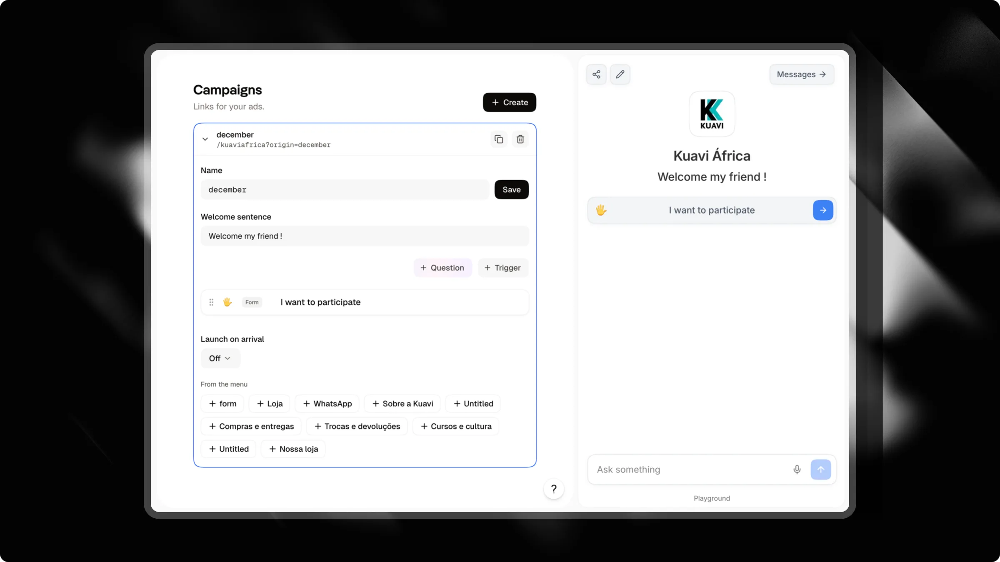

When running paid ads on Instagram or Facebook, directing traffic to a generic homepage or link-in-bio often lowers your conversion rate. Visitors arrive expecting the exact topic or offer promised in your ad creative.

**Campaigns** let you create dedicated welcome screens for each ad. Each campaign provides a unique tracking link, a custom headline, and a focused set of triggers designed to guide visitors straight toward converting.

---

## How campaign welcome screens work

When a visitor opens your campaign link (`https://attlas.so/your-chat?origin=campaign-name`):

- **Dedicated headline**: A prominent welcome sentence replaces your standard chat description, matching the ad promise.
- **Targeted triggers**: The visitor only sees the questions or actions you chose for this ad, rather than your entire menu.
- **Distraction-free experience**: External links and social icons stay hidden so visitors focus on your message.
- **Automatic form launch**: You can automatically start a conversation or lead form the moment the visitor lands on the screen.
- **Menu unlock after conversion**: Once the visitor submits their contact details or books a meeting, the full chat menu unlocks automatically.

<Info>
The **Campaigns** section appears in your chat sidebar once you connect the [Meta Conversions API](/integrations/meta) in **Settings** > **Integrations**. Connecting Meta allows Attlas to report leads and bookings directly to your ad manager.
</Info>

---

## Creating a campaign

Setting up a campaign screen takes less than two minutes:

1. In your Attlas dashboard, select your chat and click **Campaigns** in the sidebar.
2. Click **Create** in the top right corner.
3. Choose a descriptive **Name** (such as `black-friday` or `spring-audit`). Attlas uses this name in your ad URL.
4. Enter your **Welcome sentence**. Keep it punchy and aligned with your ad copy.
5. Add the triggers you want to display for this ad.
6. (Optional) Select a form in **Launch on arrival** to start the questionnaire immediately.
7. Click **Save**, then click the **Copy link** icon next to your campaign name.
8. Paste the link into your Meta Ads Manager as the destination URL.

<Tip>
Use the live chat preview on the right side of the screen to preview how your campaign headline and triggers look before spending ad budget.
</Tip>

---

## Configuration settings

| Setting | Description |
| --- | --- |
| `Name` | The campaign slug. It forms the tracking query parameter in your link (e.g., `?origin=summer-promo`). |
| `Welcome sentence` | The headline shown at the top of your chat, replacing your default description. Up to 120 characters. |
| `Triggers` | The specific actions or questions visible on this campaign screen. |
| `Launch on arrival` | Optional form trigger that automatically starts as soon as a visitor opens your link. |

---

## Managing triggers for an ad

You can build a campaign screen without recreating triggers from scratch:

- **Create new triggers**: Use the built-in trigger editor to add questions, forms, links, or media specific to this campaign.
- **Copy from the menu**: Click any trigger under **From the menu** to duplicate an existing trigger into this campaign. Attlas copies the trigger along with all of its nested children.
- **Independent edits**: Modifying or deleting a copied trigger in your campaign never affects the original in your main menu.
- **Reusable across campaigns**: Because triggers are copied rather than moved, the original trigger remains in **From the menu** so you can reuse it in several campaigns.

<Warning>
Always include at least one **Question** or **Form** trigger in your campaign. Triggers that only display links or media keep visitors outside the conversation and prevent Attlas from capturing leads.
</Warning>

---

## Tracking performance

Every campaign row displays performance statistics from the last 30 days:

- **Views**: Total number of visits received through this campaign link.
- **Conversations**: Visitors who started chatting or tapped a question trigger.
- **Leads**: Visitors who submitted contact information or booked a calendar meeting.
- **Conversion rate**: Percentage of visitors who completed a lead form or booking.
- **Top trigger**: The specific question or button visitors tapped the most.
