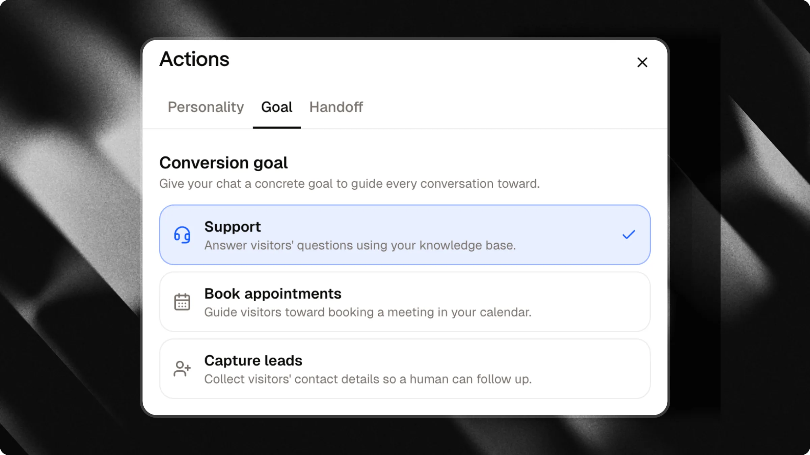
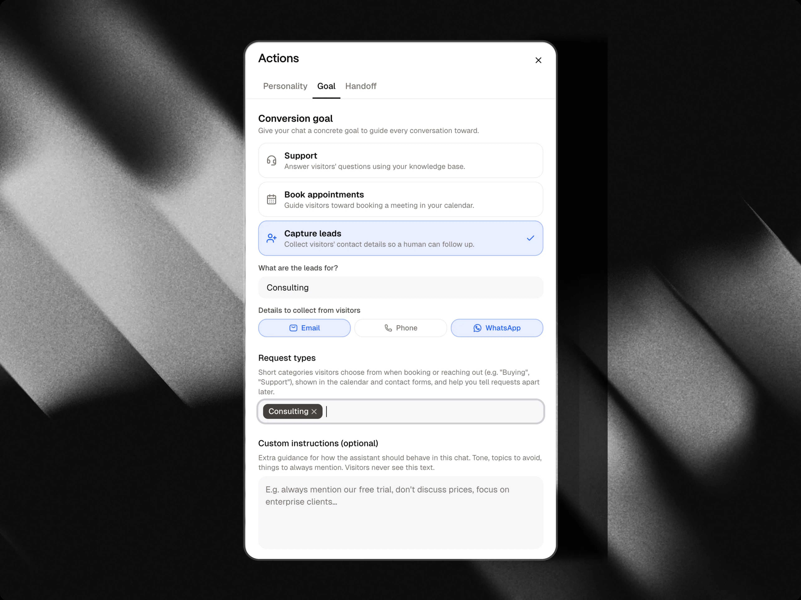

A aba **Objetivo**, no painel **Ações**, informa ao seu chat o que ele está realmente tentando alcançar com cada visitante. Em vez de apenas responder perguntas, seu chat pode guiar ativamente a conversa para agendar uma reunião ou coletar detalhes de contato.

<Tip>
  Escolha o objetivo que corresponde ao que você deseja do seu chat. Você pode alterá-lo a qualquer momento, ele entra em vigor imediatamente para novas conversas.
</Tip>

---

## Escolha um objetivo

### Suporte

Responder às perguntas dos visitantes usando sua base de conhecimento. É o padrão: nenhum objetivo ativo, o chat apenas ajuda.

### Agendar reuniões

Guiar os visitantes para agendar uma reunião no seu calendário.

<Note>
  Esta opção requer um Google Calendar conectado. Se ainda não estiver configurado para este chat, a opção fica cinza com um link para conectar um.
</Note>

<Card title="Integração com Google Calendar" icon="calendar-days" horizontal href="/pt/integrations/google-calendar">
  Saiba como conectar seu calendário para que os visitantes possam agendar reuniões diretamente no chat.
</Card>

### Capturar leads

Coletar os detalhes de contato dos visitantes para que um humano possa dar seguimento.

Ao escolher este objetivo, duas configurações aparecem:

| Campo | O que faz |
| :-- | :-- |
| **Para que servem os leads?** | Uma breve descrição do motivo pelo qual você está coletando leads (ex.: "proprietários de imóveis interessados em uma avaliação de propriedade"). Isso informa ao chat por que os visitantes devem deixar seus dados, para que ele possa mencionar isso naturalmente na conversa. |
| **Formulário conectado** | O formulário conversacional que é executado quando a captura de leads é acionada. O Attlas conecta automaticamente um formulário de contato padrão, ou você pode escolher qualquer formulário existente do seu chat. Clique em **Editar o formulário** para personalizar perguntas, opções de escolha, campos de contato e mensagens de confirmação. |

<Warning>
  Sem uma descrição clara de "para que servem os leads?", o chat não saberá por que deve pedir os detalhes dos visitantes e pode não fazer isso bem. Sempre preencha isso ao usar o objetivo de captura de leads.
</Warning>

### Como funciona a captura de leads conversacional

Quando a **Captura de leads** está ativa, a captura de leads ocorre diretamente dentro da conversa do chat, em vez de um pop-up estático:

1. **Iniciação por IA**: O assistente nunca pede informações pessoais de contato diretamente em texto simples. Quando um visitante demonstra interesse claro ou pede para ser contatado, o assistente apresenta o formulário com uma única frase e inicia o formulário conectado.
2. **Orientação passo a passo**: O formulário faz uma pergunta por vez. A barra de entrada do chat se adapta dinamicamente a cada pergunta (como campo de telefone com seletor de código de país, validação de e-mail ou seletor de data).
3. **Preenchimento automático inteligente**: Se o visitante já mencionou uma resposta anteriormente na conversa, essa opção é automaticamente pré-selecionada para que ele não precise responder duas vezes.
4. **CRM e resumo da IA**: Depois de enviado, todas as respostas chegam ao seu [CRM](/pt/basic/crm) no registro do contato. O assistente também anexa um resumo automático da solicitação do visitante às notas do contato.
5. **Sem solicitações duplicadas**: Se um visitante concluir o formulário ou já estiver no meio do preenchimento, o assistente não acionará a captura de leads novamente durante essa conversa.

<Card title="Formulários" icon="clipboard-list" horizontal href="/pt/basic/forms">
  Aprenda a personalizar seu formulário de leads, adicionar perguntas qualificadoras e inspecionar os funis de conclusão.
</Card>

---

## Instruções personalizadas

Seja qual for o objetivo escolhido, você pode adicionar instruções personalizadas opcionais, orientações extras sobre como o assistente deve se comportar neste chat: tom a usar, tópicos a evitar, coisas a sempre mencionar. Os visitantes nunca veem esse texto, ele apenas molda a forma como o chat fala.

---

## Tipos de solicitação

Ao agendar reuniões, você pode definir **tipos de solicitação**, categorias curtas que os visitantes escolhem (ex.: "Compra", "Suporte", "Aluguel"). Eles aparecem no fluxo de agendamento do calendário e ajudam a categorizar as reuniões ao revisar sua agenda.

Esta lista também é compartilhada com a aba [Humano no circuito](/pt/actions/human-in-the-loop), ajudando a categorizar as solicitações de transferência de visitantes. Para chats de captura de leads, categorias personalizadas e perguntas qualificadoras são configuradas diretamente dentro do seu formulário conectado como perguntas de escolha.
