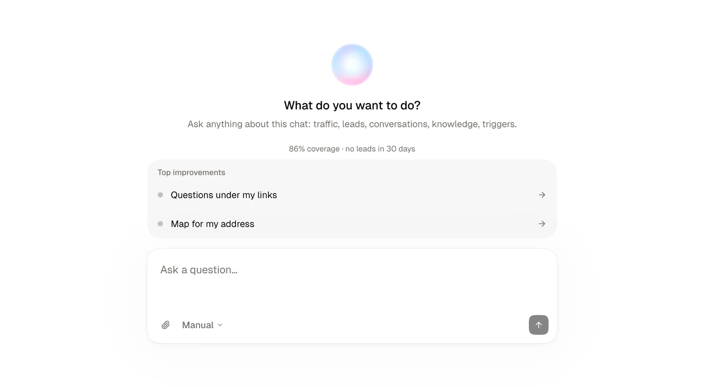

O agente é um chat dentro do seu painel. Você digita um pedido em linguagem natural, e ele lê os dados do seu chat ou faz alterações para você. Ele se baseia nas mesmas ferramentas fundamentais do nosso Workspace MCP (abrangendo 59 recursos de leitura e escrita, além da exclusão segura de formulários para a lixeira de 30 dias, enquanto outras ações destrutivas permanecem exclusivas do painel).

Por exemplo, você pode perguntar:

- "Quantos visitantes meu chat recebeu esta semana, e de onde eles vieram?"
- "Quais perguntas meu chat respondeu mal?"
- "Adicione três perguntas sugeridas sobre meu horário de funcionamento."
- "Mude para um tema mais escuro."

<Note>
  Cada solicitação que você envia ao agente usa uma **mensagem de agente**. Seu plano inclui uma cota mensal:

  | Plano | Mensagens de agente por mês |
  |---|---|
  | Free | 20 |
  | Pro | 300 |

  Quando você atinge o limite, o agente para de responder até que sua cota seja renovada. Mude para o plano Pro para obter mais.
</Note>

---

## Abrir o agente

1. Abra um dos seus chats no painel.
2. Clique em **Agente** na barra superior. No celular, toque no botão redondo **Agente** na parte inferior da tela.

O agente atua no chat que você tem aberto. A prévia do seu chat permanece visível à direita, para que você veja cada alteração assim que for aplicada.

<Info>
  Somente membros do seu espaço de trabalho podem usar o agente. Um membro com a função de **Visualizador** pode fazer perguntas, mas não pode alterar nada.
</Info>

---

## Comece pelas principais melhorias

Ao abrir uma nova conversa, o agente mostra **Principais melhorias**: as três coisas mais úteis que estão faltando no seu chat, como conhecimento, uma saudação ou perguntas sugeridas. Você também vê sua taxa de cobertura e o número de leads dos últimos 30 dias.

Clique em uma melhoria e o agente o guiará por ela, uma pergunta de cada vez.

---

## Escolha como as alterações são aplicadas

O seletor de modo fica na caixa de mensagem.

| Modo | O que acontece |
|---|---|
| **Manual** (padrão) | O agente mostra cada alteração em um cartão. Você clica em **Aplicar** para realizá-la, ou em **Recusar** para ignorá-la. |
| **Auto** | O agente faz as alterações imediatamente e mostra um cartão para cada uma que aplicou. |

<Warning>
  O agente nunca apaga seus dados definitivamente. Ele pode mover um formulário para a lixeira de 30 dias via `delete_form` (o que o desconecta com segurança e permite sua restauração), seguindo o modo Manual ou Auto selecionado. Para excluir um chat, documento, gatilho, campanha ou contato, use a tela correspondente no painel.

  No modo **Auto**, textos escritos por seus visitantes ou encontrados em seus documentos podem provocar uma alteração que você não solicitou. Fique no modo **Manual** se quiser revisar cada alteração antes.
</Warning>

---

## O que o agente pode fazer

| Ler | Alterar |
|---|---|
| Visitas, leads e números de conversão | Perguntas sugeridas (gatilhos): adicionar, editar, reordenar, agrupar ou conectar a formulários |
| Conversas dos visitantes | Tema, identidade visual, avatar e links sociais |
| Contatos e compromissos | Objetivo e personalidade |
| Perguntas que seu chat respondeu mal | Informações do negócio, descrição, saudação e SEO |
| Documentos de conhecimento | Conhecimento: adicionar um link ou arquivo, escrever um documento, adicionar uma correção, limpar um documento |
| Formulários e funis de desistência de 30 dias | Formulários: criar, editar, configurar uploads de arquivos (Pro) e URL de redirecionamento, restaurar ou mover para a lixeira, e conectar à captação ou a gatilhos |
| Campanhas de anúncios e métricas de conversão | Campanhas de anúncios: criar, definir frase de boas-vindas, copiar gatilhos do menu, iniciar formulário na chegada, restaurar |
| Relatórios | Canais de distribuição: criar canais nomeados (site, bio do Instagram, newsletter) para marcar conversas recebidas |
| Prévia de páginas da web (preço de produto, imagem e descrição) | Gerar um novo relatório |
| Perfis do Instagram e LinkedIn | |
| Código de incorporação para seu site | |
| Playbooks e skills de produtos | |

O agente também pode aconselhá-lo: qual recurso se adequa ao seu objetivo, como organizar seu conhecimento, quais perguntas seus visitantes esperam.

Algumas configurações permanecem no painel. O agente indica a tela correta quando você pergunta sobre:

- exclusão definitiva de chats, documentos, gatilhos, campanhas ou contatos (apenas formulários podem ser movidos para a lixeira pelo agente),
- alterar a URL do seu chat,
- conectar uma integração (Google Calendar, Notion, um banco de dados, Bandsintown, a API de Conversões da Meta, um domínio personalizado, um webhook),
- modo de acesso, senha ou visibilidade,
- seu plano, faturamento e membros do espaço de trabalho.

---

## Anexar arquivos e imagens

Clique no botão de anexo na caixa de mensagem para adicionar até 5 arquivos. O agente lê PDFs e imagens (PNG, JPEG, WebP, GIF) para responder a você. Peça para adicionar um arquivo ao seu conhecimento e ele o importa da mesma forma que a janela [Fontes](/pt/start/sources). Arquivos de áudio também contam para a sua cota da mesma forma.

---

## Pesquisa na web

O agente pode pesquisar na web, por exemplo, para verificar seu horário de funcionamento em uma listagem pública. Ele mostra as fontes que usou abaixo da resposta.

Depois que o agente fez uma pesquisa na web em uma conversa, toda alteração aguarda que você clique em **Aplicar**, mesmo no modo **Auto**.

<Tip>
  Você também pode comandar seu espaço de trabalho a partir do Claude, Cursor ou outro assistente de IA, com as mesmas ações e conselhos. Veja [Workspace MCP](/pt/mcp/workspace).
</Tip>
