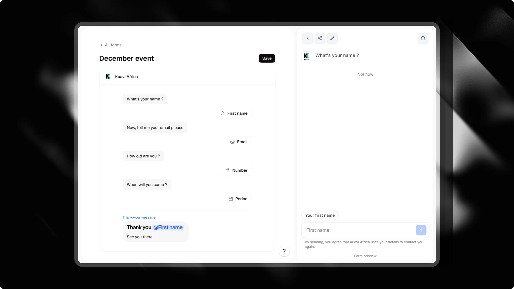

Formulários transformam a coleta de dados em uma conversa natural. Em vez de enviar os visitantes para uma página externa ou mostrar um formulário longo estático, seu chat faz as perguntas uma de cada vez. Os visitantes tocam nas opções ou respondem diretamente na barra do chat.

Cada resposta é salva, seu CRM é atualizado instantaneamente e você pode acompanhar os abandonos etapa por etapa em um funil integrado.

---

## Acessando os Formulários

<Check>
  Para abrir seus formulários, selecione seu chat no painel e clique na aba **<kbd>Formulários</kbd>** na barra lateral esquerda.
</Check>

Nesta página, você pode criar novos formulários, editar os existentes, verificar quantas perguntas cada formulário tem e inspecionar seus números de conversão.

---

## Criando e editando um formulário



Clique em **<kbd>Criar</kbd>** no cabeçalho superior para iniciar um novo formulário.

O Attlas utiliza um editor no estilo de documento. Você escreve seu formulário como se fosse um documento de texto, sem nós complexos de fluxograma:

- **Digite texto simples** para fazer o chat falar. Cada parágrafo se torna um balão de chat individual.
- **Digite `/`** para inserir perguntas, opções, mídia ou campos de contato.
- **Arraste os blocos** usando a alça à esquerda para reordenar sua sequência.
- **Pré-visualize em tempo real**: o painel de pré-visualização à direita executa seu formulário em um chat interativo enquanto você edita.
- **Salve seu trabalho**: clique em **<kbd>Salvar</kbd>** no canto superior direito quando estiver pronto para publicar as alterações.

<Tip>
  Mantenha suas perguntas em tom de conversa e coloque os campos de contato no final. Os visitantes convertem melhor quando respondem primeiro a perguntas de qualificação simples.
</Tip>

---

## Blocos disponíveis

Digite `/` em qualquer lugar do editor para abrir o menu de blocos:

### Mensagens do chat

| Bloco | Comando | Descrição |
| :--- | :--- | :--- |
| **Mensagem** | Texto simples | Texto comum exibido em um balão de chat. Suporta negrito, itálico, links e emojis. |
| **Imagem** | `/image` | Uma imagem exibida dentro de um balão de chat. |
| **Vídeo** | `/video` | Um vídeo curto, silencioso e em looping exibido dentro de um balão de chat. |

### Respostas do visitante

Quando o formulário chega a um bloco de resposta, a barra de entrada do chat se adapta ao que é esperado.

| Bloco | Comando | Modo de entrada | Validação |
| :--- | :--- | :--- | :--- |
| **Escolha** | `/choice` | Opções em botões abaixo da pergunta. | Selecione uma opção. Você também pode ativar **Várias respostas** nas configurações para seleção múltipla. |
| **Caixas de seleção** | `/checkboxes` | Opções com caixas de seleção abaixo da pergunta. | Selecione uma ou mais opções e toque em **Continuar**. |
| **Texto** | `/text` | Entrada de texto padrão. | Texto não vazio com comprimento máximo opcional. Suporta ditado por voz em dispositivos móveis. |
| **Número** | `/number` | Teclado numérico. | Apenas números, com limites mínimo e máximo opcionais. |
| **Link** | `/url` | Teclado para URL. | Endereço de site válido (`https://` adicionado automaticamente se estiver faltando). |
| **Período** | `/period` | Seletor de intervalo de datas. | Seletor de data inicial e final. |
| **Enviar um arquivo** | `/file` | Botão de anexo de arquivo. | Fotos ou documentos PDF de até 20 MB. Ative **Vários arquivos (máx. 5)** para envios múltiplos. Requer o plano Pro. |

### Campos de contato

Os campos de contato capturam os detalhes do visitante e qualificam leads em seu CRM. Cada campo de contato pode aparecer uma vez por formulário:

| Bloco | Comando | Descrição |
| :--- | :--- | :--- |
| **Nome** | `/firstname` | Captura o nome do visitante com preenchimento automático do navegador. |
| **Sobrenome** | `/lastname` | Captura o sobrenome do visitante. |
| **Email** | `/email` | Captura e valida um endereço de e-mail. |
| **Telefone** | `/phone` | Entrada de telefone internacional com seletor de código de país. |
| **WhatsApp** | `/whatsapp` | Entrada de telefone pré-preenchida com o país detectado do visitante. |
| **Data preferida** | `/schedule` | Seletor de data para preferências de reunião ou datas alvo. |

<Warning>
  Um formulário precisa de pelo menos um campo de contato para criar um lead em seu CRM. Se você fizer apenas perguntas de escolha, caixas de seleção ou texto, as respostas são armazenadas no histórico da conversa, mas nenhum cartão de contato será criado.
</Warning>

---

## Mensagem de agradecimento e redirecionamento

O último bloco no seu editor é a mensagem de agradecimento. Esta mensagem é exibida automaticamente quando um visitante conclui o formulário.

Você pode personalizar essa mensagem final digitando `@` para citar qualquer resposta anterior:

```text
Obrigado, @firstname! Recebemos sua solicitação de @choice e entraremos em contato pelo WhatsApp em @whatsapp.
```

Se deixada em branco, o Attlas exibe uma mensagem de confirmação padrão no idioma do visitante.

### Redirecionamento automático

Você pode redirecionar os visitantes para um endereço externo (como página de pagamento, agendamento de calendário ou seu site principal) após a conclusão do formulário:

1. Clique no bloco final na parte inferior do editor de formulário.
2. Insira um endereço completo (`https://...`) no campo **URL de redirecionamento**.

Após o envio, o chat exibe sua mensagem de agradecimento e um link **Continuar**. A página redireciona automaticamente após 3 segundos. Em widgets incorporados e iframes, os visitantes clicam em **Continuar** para abrir o link na janela principal.

---

## Como os visitantes vivenciam seu formulário

O formulário é executado diretamente dentro da interface do chat:

1. **Etapa por etapa**: O chat faz uma pergunta por vez.
2. **Entrada sensível ao contexto**: Para entradas de telefone, data ou texto, a barra de entrada do chat exibe um selo dedicado (como "Seu WhatsApp" ou "Data preferida") e configura o teclado móvel correto.
3. **Perguntas paralelas**: Os visitantes podem clicar no ícone **<kbd>×</kbd>** no selo de entrada para pausar o formulário e fazer uma pergunta. O chat responde usando sua base de conhecimento e, em seguida, retoma o formulário na etapa atual.
4. **Opção de saída**: Abaixo das perguntas de escolha ou de caixas de seleção, os visitantes podem tocar em **"Agora não"** para sair do fluxo do formulário sem interromper a conversa.

---

## Conectando seu formulário

Você pode acionar um formulário através de quatro caminhos diferentes:

### 1. Gatilhos

Adicione um gatilho **Formulário** na aba **Gatilhos** do seu chat. Selecione seu formulário no menu suspenso. Ele aparece como um botão interativo no menu do chat.

### 2. Campanhas (Lançar na chegada)

Em [Campanhas](/pt/pro/campaigns), selecione o canal da sua campanha e defina **Lançar na chegada** para o gatilho do seu formulário. Quando os visitantes clicam no seu anúncio ou link de campanha, o chat abre com o formulário já ativo, sem a necessidade de um clique inicial.

<Card title="Campanhas" icon="bullhorn" horizontal href="/pt/pro/campaigns">
  Saiba como criar telas de boas-vindas dedicadas para anúncios pagos com títulos personalizados e lançamento automático do formulário.
</Card>

### 3. Objetivo do chat (Capturar leads)

Em **Ações** > **Objetivo**, selecione **Capturar leads**. O Attlas conecta seu objetivo de lead diretamente a um formulário. Quando a conversa atinge a captura de leads, o assistente inicia o formulário e preenche automaticamente quaisquer detalhes que o visitante já tenha mencionado.

### 4. Link direto

Compartilhe um link com o parâmetro `?form=<slug>` para abrir seu chat diretamente em um formulário específico.

---

## Acompanhamento de desempenho (Funil)

Na página de lista **Formulários**, clique no **ícone de gráfico** ao lado de qualquer formulário para expandir seu funil de conversão.

O funil rastreia dados dos últimos 30 dias:

- **Pontos de partida**: Mostra de onde os visitantes vieram, incluindo visitas de [campanhas](/pt/pro/campaigns) de anúncios e cliques em gatilhos do menu.
- **Conclusão de etapas**: Exibe o número de visitantes que responderam a cada etapa, juntamente com a taxa de retenção em relação à etapa anterior.
- **Leads gerados**: O número total de contatos completos coletados por este formulário.

<Info>
  Conversas de teste internas de membros do espaço de trabalho e pré-visualizações do editor são excluídas das métricas do funil.
</Info>

---

## Coleta de dados e integrações

- **CRM**: Os detalhes enviados aparecem imediatamente na sua aba **<kbd>CRM</kbd>**, com todas as respostas personalizadas salvas no registro do contato.
- **Webhooks**: A conclusão de um formulário despacha uma carga útil de webhook `form_completed` contendo todas as respostas e informações de contato.
- **Meta CAPI**: Quando a API de Conversões da Meta está configurada, a conclusão de um formulário envia um evento de `Lead` do lado do servidor para rastreamento de anúncios.
- **Traduções automáticas**: O texto do formulário é traduzido automaticamente para todos os 13 idiomas suportados, para que os visitantes vejam as perguntas em seu idioma preferido.
