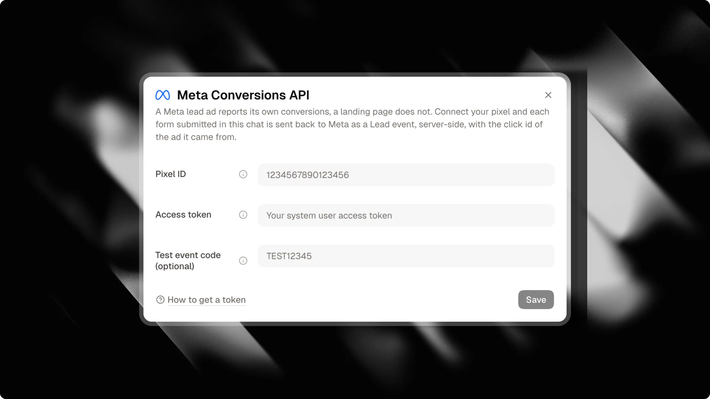

Se você exibe anúncios pagos no Meta (Facebook e Instagram) direcionados ao seu Attlas Chat, enviar dados de conversão de volta para o Meta é essencial. Sem isso, o Meta otimiza apenas para cliques nos links, o que aumenta seu custo por lead (CPL) real.

O Attlas se conecta diretamente à Meta Conversions API (CAPI) no lado do servidor. Sempre que um visitante converte no seu chat, o Attlas envia esse evento de conversão diretamente para o Meta sem depender de um pixel do navegador.

---

## Por que o rastreamento no lado do servidor é importante

Diferente do rastreamento web tradicional que depende de um pixel do navegador, o Attlas gerencia o rastreamento de conversões totalmente no servidor:

- **Nenhum script de rastreamento no lado do cliente**: Seu chat permanece rápido e leve, com zero scripts de rastreamento externos carregados no navegador.
- **Amigável para privacidade e SEO**: Nenhum cookie de rastreamento é definido pelo chat, evitando banners intrusivos de consentimento de cookies e preservando a indexação ideal para mecanismos de busca.
- **Rastreamento confiável**: Eventos no lado do servidor ignoram bloqueadores de anúncios e restrições de privacidade do navegador que frequentemente bloqueiam pixels do navegador.
- **Atribuição de primeiro toque**: O Attlas registra o clique original do anúncio Meta (`fbclid`) quando o visitante chega, mantendo uma atribuição precisa mesmo após uma conversa prolongada.
- **Dados de teste limpos**: Conversas no playground do seu painel ou conversas marcadas como internas nunca enviam eventos para o Meta, evitando que conversas de teste distorçam as métricas da sua campanha.

---

## Eventos de conversão suportados

O Attlas mapeia automaticamente as ações do visitante para os eventos padrão do Meta:

| Evento | Acionado quando | Descrição |
| --- | --- | --- |
| `Lead` | Captura de contato ou conclusão de formulário | Um visitante envia detalhes de contato no chat, completa um formulário guiado no chat ou solicita uma conversa no WhatsApp. |
| `Schedule` | Agendamento no calendário | Um visitante agenda um compromisso através do agendador integrado do Google Calendar. |

<Info>
Detalhes de contato (e-mail, telefone, primeiro nome e país) são normalizados e hasheados usando SHA-256 antes de serem enviados ao Meta, em total conformidade com os requisitos de privacidade de dados do cliente do Meta.
</Info>

---

## Rastreamento de campanha e UTM

Se sua campanha de anúncios direciona o tráfego para um canal de campanha específico ou inclui parâmetros de rastreamento, o Attlas os encaminha automaticamente para o Meta:

- **Origem da campanha**: Quando os visitantes chegam via um link de campanha dedicado (`?origin=<campaign_id>`), o identificador da campanha é incluído nos dados personalizados do evento. Para aprender a criar telas de boas-vindas personalizadas e iniciadores de conversa para seus anúncios, consulte nosso guia [Campanhas](/pt/pro/campaigns).
- **Campanha UTM**: Qualquer parâmetro `utm_campaign` capturado ao chegar é anexado ao evento de conversão para facilitar a análise no Gerenciador de Eventos do Meta.

<Tip>
Combine a Meta Conversions API com [Campanhas](/pt/pro/campaigns) para exibir saudações personalizadas e gatilhos de conversa direcionados para cada anúncio enquanto rastreia conversões automaticamente.
</Tip>

---

## Como configurar a Meta Conversions API

A configuração da conexão leva apenas alguns minutos:

1. Abra as **Configurações do Chat** no painel do Attlas.
2. Selecione a aba **Integrações**.
3. Localize o cartão **Meta Conversions API** e clique em **Conectar**.
4. Preencha seu **Pixel ID** e **Token de acesso**.
5. (Opcional) Insira um **Código de evento de teste** se desejar verificar os eventos antes de ficar ativo.
6. Clique em **Salvar**. Se um código de evento de teste for fornecido, o Attlas verifica suas credenciais com o Meta diretamente antes de salvar.

---

## Configurações

| Campo | Obrigatório | Descrição |
| --- | --- | --- |
| `Pixel ID` | Sim | O ID numérico do seu Pixel ou Conjunto de Dados do Meta. Você pode encontrá-lo no Gerenciador de Eventos do Meta, em Fontes de dados. |
| `Access token` | Sim | Um token de acesso da API de Conversões gerado a partir das configurações do seu pixel no Gerenciador de Eventos do Meta. O Attlas armazena este token criptografado. |
| `Test event code` | Não | Um código temporário encontrado na aba "Eventos de teste" do Gerenciador de Eventos do Meta (por exemplo, `TEST12345`). Quando preenchido, os eventos são encaminhados apenas para o console de teste e não afetarão as campanhas de anúncios ativas. |

<Warning>
O **Código de evento de teste** é opcional e destinado apenas para verificar sua configuração. Deixe-o vazio se quiser ficar ativo. O código expira automaticamente 1 hora após você salvá-lo. Para ficar ativo imediatamente, deixe o campo vazio antes de salvar.
</Warning>

---

## Testando sua integração

Uma vez que sua conexão esteja salva:

1. Acesse seu **Gerenciador de Eventos do Meta** e abra a aba **Eventos de teste** para seu pixel.
2. Se estiver usando um código de teste, certifique-se de que o mesmo código esteja salvo no diálogo de integração do Attlas.
3. No Attlas, abra o diálogo de integração Meta e clique em **Enviar um evento de teste**.
4. Verifique a tela do Gerenciador de Eventos do Meta. Você verá um evento `Lead` aparecer em segundos.

<Tip>
Você pode pausar o relatório de conversões a qualquer momento usando o botão de alternância no cartão Meta sem excluir suas credenciais.
</Tip>
