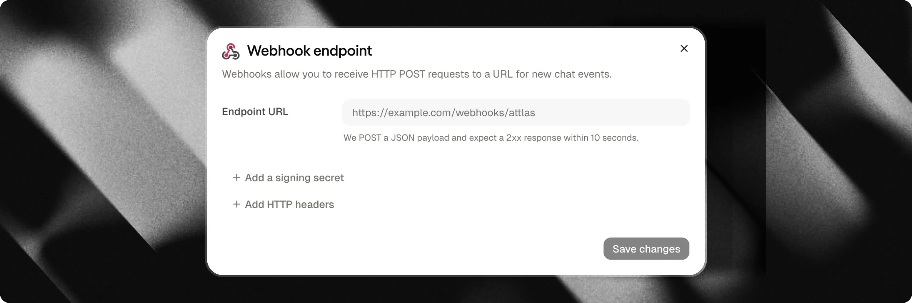

Webhooks conectam seu chat Attlas ao seu backend, CRM ou ferramentas de automação externas em tempo real. Sempre que um visitante interage com seu chat, como enviar detalhes de contato, completar um formulário de várias etapas ou agendar uma reunião, o Attlas envia uma requisição HTTP POST automatizada para o seu endpoint especificado.

---



## Eventos principais

O Attlas dispara webhooks para cinco eventos principais em três categorias:

| Event | Category | Disparado quando |
| :--- | :--- | :--- |
| `contact_created` | `contact` | Um novo lead ou perfil de contato é criado a partir de uma conversa, formulário ou agendamento no calendário. |
| `contact_updated` | `contact` | Um contato existente é reconhecido e atualizado com novas informações. |
| `form_completed` | `form` | Um visitante completa todas as etapas de um formulário interativo, com ou sem campos de contato. |
| `event_created` | `calendar` | Um visitante agenda uma nova reunião no Google Calendar através do chat. |
| `event_canceled` | `calendar` | Uma reunião agendada é cancelada por você ou pelo visitante. |

<Note>
**Roteamento de eventos e pares**:
- Se um visitante recorrente fornecer informações e for correspondido por email, telefone, número do WhatsApp ou ID da conversa, o Attlas emitirá `contact_updated` em vez de `contact_created`.
- Um agendamento de reunião envia tanto um evento de contato (`contact_created` ou `contact_updated`) quanto um evento `event_created`.
- Um formulário concluído com campos de contato envia tanto um evento de contato quanto um evento `form_completed`.
- Como os eventos emparelhados são executados simultaneamente, os endpoints receptores devem rotear as cargas verificando o campo `event`.
</Note>

<Info>
**Reuniões reagendadas**: O Attlas não tem um evento `event_rescheduled` separado. Quando um compromisso é reagendado, o Attlas emite um evento `event_canceled` seguido de um novo evento `event_created`.
</Info>

---

## Como configurar Webhooks

Configurar um endpoint de webhook leva menos de um minuto:

1. No painel do Attlas, selecione seu chat e navegue até **Configurações** > **Integrações**.
2. Localize o card **Webhooks** e clique em **Conectar** (ou **Configurar**).
3. Insira a **URL do Webhook** de destino (deve ser um endereço `https://` seguro e acessível publicamente).
4. (Opcional) Configure cabeçalhos HTTP personalizados se seu servidor receptor exigir tokens de autorização estáticos ou chaves de API (até 10 cabeçalhos).
5. (Opcional) Clique em **Adicionar segredo de assinatura** para gerar um segredo HMAC usado para verificar a autenticidade da requisição.
6. Clique em **Salvar** para ativar seu endpoint.
7. Clique em **Enviar teste** para enviar uma carga de teste e confirmar que seu servidor responde com `200 OK`.

---

## Envelope da carga do webhook

Toda requisição de webhook contém um envelope JSON com metadados de entrega e um objeto `data` específico do evento:

```json
{
  "id": "5c6f8a0b-1234-4567-890a-bcdef1234567",
  "type": "contact",
  "event": "contact_created",
  "created_at": "2026-10-31T20:15:11.480Z",
  "chat_id": 42,
  "data": { ... }
}
```

| Campo | Tipo | Descrição |
| :--- | :--- | :--- |
| `id` | `string` | UUID único da tentativa de entrega, correspondendo ao cabeçalho `X-Attlas-Delivery`. |
| `type` | `string` | Categoria de alto nível: `contact`, `form` ou `calendar`. |
| `event` | `string` | Nome do evento: `contact_created`, `contact_updated`, `form_completed`, `event_created` ou `event_canceled`. |
| `created_at` | `string` | Data e hora ISO 8601 em que o evento foi despachado. |
| `chat_id` | `number` | ID numérico do chat que gerou o evento. |
| `data` | `object` | Carga específica do evento. Strings vazias, valores nulos e arrays vazios são omitidos automaticamente. |

---

## Eventos de contato (`contact_created`, `contact_updated`)

Os eventos de contato são disparados sempre que um visitante deixa detalhes de contato por meio de um formulário de captura de leads, uma solicitação de atendimento humano, um gatilho do WhatsApp ou um agendamento no calendário.

```json
{
  "id": "5c6f8a0b-1234-4567-890a-bcdef1234567",
  "type": "contact",
  "event": "contact_created",
  "created_at": "2026-10-31T20:15:11.480Z",
  "chat_id": 42,
  "data": {
    "id": "b1e23456-7890-4abc-def0-1234567890ab",
    "firstname": "Ana",
    "email": "ana@example.com",
    "phone": "+33612345678",
    "country": "FR",
    "source": "form",
    "kind": "new_lead",
    "form_id": "4391e4f0-1111-2222-3333-abcdef123456",
    "campaign_id": "black-friday",
    "origin": "black-friday",
    "conversation_id": "9f0a1b2c-3d4e-5f6a-7b8c-9d0e1f2a3b4c",
    "history": [
      {
        "type": "user",
        "content": "I would like to book a demo for next week",
        "manual": true,
        "timestampz": "2026-10-31T20:14:54.000Z"
      },
      {
        "type": "assistant",
        "content": "I would be happy to help! Let me gather a few details.",
        "manual": false,
        "timestampz": "2026-10-31T20:15:01.000Z"
      }
    ]
  }
}
```

### Campos de contato

| Campo | Tipo | Descrição |
| :--- | :--- | :--- |
| `id` | `string` | Identificador único do perfil de contato no Attlas. |
| `firstname` | `string` | Primeiro nome fornecido pelo visitante. |
| `lastname` | `string` | Sobrenome fornecido pelo visitante. |
| `email` | `string` | Endereço de email fornecido pelo visitante. |
| `phone` | `string` | Número de telefone no formato E.164. |
| `whatsapp` | `string` | Número de telefone do WhatsApp se fornecido ou capturado via gatilho do WhatsApp. |
| `country` | `string` | Código ISO de duas letras do país detectado a partir da localidade do visitante ou endereço IP. |
| `source` | `string` | Origem do armazenamento interno (`form`, `human`, `whatsapp`, `calendar`). |
| `kind` | `string` | Intenção bruta do visitante (`new_lead`, `human_request`, `booking`, `whatsapp`). |
| `channel` | `string` | Meio do canal de saída quando aplicável (ex. `"whatsapp"`). Omitido caso contrário. |
| `notes` | `string` | Resumo ou observações sobre o lead, como o contexto da conversa. |
| `options` | `string[]` | Respostas coletadas de perguntas de qualificação ou etapas do formulário. |
| `form_id` | `string` | UUID do formulário se o lead foi capturado por meio de um formulário do Attlas. Omitido caso contrário. |
| `campaign_id` | `string` | Slug da campanha quando o visitante chegou por um link de campanha rastreado correspondente a uma campanha ativa. Omitido caso contrário. |
| `origin` | `string` | Parâmetro de consulta `?origin=` bruto da URL, se presente. |
| `preferred_at` | `string` | Data e hora preferida para a reunião ou contato, se solicitada pelo visitante. |
| `conversation_id` | `string` | Identificador único da conversa do chat. |
| `history` | `array` | Lista cronológica de mensagens do chat trocadas antes do envio. |

### Intenção do lead (`kind`)

Use `kind` para identificar por que o contato foi criado:

- `new_lead`: Visitante enviou detalhes por meio de um formulário de captura de leads ou prompt.
- `human_request`: Visitante pediu para falar com um membro da equipe humana.
- `booking`: Visitante agendou uma reunião pelo Google Calendar.
- `whatsapp`: Visitante clicou em um gatilho do WhatsApp para continuar a conversa no WhatsApp.

---

## Eventos de conclusão de formulário (`form_completed`)

Quando um visitante chega ao final de um formulário interativo em seu chat, o Attlas despacha um evento `form_completed`. Esse evento é disparado para todo formulário concluído, incluindo pesquisas, questionários e quizzes que não incluem campos de contato.

```json
{
  "id": "5c6f8a0b-1234-4567-890a-bcdef1234567",
  "type": "form",
  "event": "form_completed",
  "created_at": "2026-10-31T20:15:11.480Z",
  "chat_id": 42,
  "data": {
    "form_id": "4391e4f0-1111-2222-3333-abcdef123456",
    "form_name": "Product Qualification",
    "conversation_id": "b064e2d1-4444-5555-6666-777788889999",
    "contact_id": "aeea8853-aaaa-bbbb-cccc-ddddeeeeffff",
    "campaign_id": "black-friday",
    "origin": "black-friday",
    "notes": "Interested in team onboarding package",
    "completed_at": "2026-10-31T20:15:11.418Z",
    "answers": [
      {
        "step_id": "ee4c1111",
        "type": "choice",
        "question": "What is your team size?",
        "answer": "10 to 50 employees",
        "value": ["opt_10_50"],
        "option_ids": ["opt_10_50"]
      },
      {
        "step_id": "5e092222",
        "type": "contact",
        "field": "firstname",
        "answer": "Ana",
        "value": "Ana"
      },
      {
        "step_id": "34183333",
        "type": "contact",
        "field": "email",
        "answer": "ana@example.com",
        "value": "ana@example.com"
      }
    ],
    "history": [ ... ]
  }
}
```

### Campos de conclusão de formulário

| Campo | Tipo | Descrição |
| :--- | :--- | :--- |
| `form_id` | `string` | Identificador único do formulário concluído. |
| `form_name` | `string` | Nome de exibição do formulário no painel do Attlas. |
| `completed_at` | `string` | Data e hora ISO 8601 em que o formulário foi concluído. |
| `conversation_id` | `string` | Identificador da conversa onde o formulário foi respondido. |
| `contact_id` | `string` | ID do contato, se campos de contato foram enviados. Corresponde a `id` em `contact_created`. |
| `campaign_id` | `string` | Slug da campanha se o visitante chegou por um link de campanha. |
| `origin` | `string` | Parâmetro de consulta `?origin=` bruto da URL. |
| `notes` | `string` | Observações resumidas, se fornecidas. |
| `answers` | `array` | Lista sequencial de respostas na ordem do formulário. |

### Estrutura dos objetos de resposta

Cada entrada em `answers` representa uma pergunta respondida ou entrada de contato:

- `step_id`: Identificador estável da etapa do formulário. Permanece inalterado mesmo se você editar o texto da pergunta posteriormente.
- `type`: Tipo da etapa, como `choice`, `text`, `number`, `url`, `period` ou `contact`.
- `question`: O rótulo da pergunta exibido para o visitante.
- `answer`: Texto legível da resposta, formatado no idioma principal do proprietário do espaço de trabalho.
- `value`: Resposta bruta, legível por máquina (string para texto, array de IDs para escolhas, ou um objeto `{ "start": "YYYY-MM-DD", "end": "YYYY-MM-DD" }` para intervalos de data).
- `option_ids`: Array de IDs das opções selecionadas (presente para etapas `choice`).
- `field`: Nome da propriedade de contato (presente para etapas `contact`, como `firstname`, `lastname`, `email`, `phone`, `whatsapp` ou `schedule`).

---

## Eventos de calendário (`event_created`, `event_canceled`)

Quando visitantes agendam ou cancelam compromissos por meio da integração com o Google Calendar, o Attlas entrega eventos de webhook de calendário.

### `event_created`

Despachado imediatamente quando um compromisso é confirmado:

```json
{
  "id": "5c6f8a0b-1234-4567-890a-bcdef1234567",
  "type": "calendar",
  "event": "event_created",
  "created_at": "2026-10-31T20:15:11.480Z",
  "chat_id": 42,
  "data": {
    "appointment_id": "app_123456",
    "google_event_id": "abc123google",
    "title": "Product Demo with Ana",
    "starts_at": "2026-11-04T14:00:00.000Z",
    "ends_at": "2026-11-04T14:30:00.000Z",
    "duration_min": 30,
    "calendar_link": "https://calendar.google.com/calendar/event?eid=...",
    "contact": {
      "id": "b1e23456-7890-4abc-def0-1234567890ab",
      "firstname": "Ana",
      "email": "ana@example.com",
      "phone": "+33612345678",
      "source": "calendar",
      "kind": "booking"
    },
    "conversation_id": "9f0a1b2c-3d4e-5f6a-7b8c-9d0e1f2a3b4c",
    "history": [ ... ]
  }
}
```

### `event_canceled`

Despachado quando uma reunião é cancelada:

```json
{
  "id": "5c6f8a0b-1234-4567-890a-bcdef1234567",
  "type": "calendar",
  "event": "event_canceled",
  "created_at": "2026-10-31T21:00:00.000Z",
  "chat_id": 42,
  "data": {
    "google_event_id": "abc123google",
    "starts_at": "2026-11-04T14:00:00.000Z",
    "ends_at": "2026-11-04T14:30:00.000Z",
    "cancelled_at": "2026-10-31T21:00:00.000Z",
    "cancelled_by": "user",
    "contact_id": "b1e23456-7890-4abc-def0-1234567890ab"
  }
}
```

<Info>
O histórico da conversa é omitido em eventos `event_canceled` para manter as cargas de cancelamento leves.
</Info>

---

## Objetos de histórico de conversa

Quando `conversation_id` está presente em `contact_created`, `contact_updated`, `form_completed` ou `event_created`, o Attlas inclui a sequência completa de mensagens em `data.history`, ordenadas cronologicamente da mais antiga para a mais recente.

Cada item de mensagem contém:

- `type`: `"user"` para entradas do visitante, ou `"assistant"` para respostas da IA.
- `content`: Conteúdo da mensagem em texto.
- `manual`: `true` se o visitante digitou a mensagem manualmente, ou `false` se foi enviada ao tocar em um botão de gatilho ou enviada pelo assistente.
- `timestampz`: Data e hora ISO 8601 em que a mensagem foi registrada.

---

## Segurança e verificação de assinatura

Para verificar se as requisições são originadas do Attlas e evitar adulteração, gere um **Segredo de Assinatura** nas suas configurações de webhook.

Quando um segredo é configurado, o Attlas calcula uma assinatura HMAC-SHA256 e a anexa no cabeçalho `X-Attlas-Signature`:

```http
X-Attlas-Signature: t=1753351953,v1=6f8a9b0c...
```

A assinatura é calculada sobre `${t}.${rawBody}`, combinando o timestamp `t` e a string exata do corpo bruto da requisição HTTP.

<Warning>
Sempre verifique assinaturas usando o **corpo bruto da requisição, sem parse**. Re-serializar um objeto JSON parseado altera formatação e espaços em branco, o que faz a verificação de assinatura falhar.
</Warning>

### Exemplos de código de verificação

<CodeGroup>
```javascript Node.js
import { createHmac, timingSafeEqual } from "node:crypto";

export function verifyAttlasWebhook(rawBody, signatureHeader, secret, toleranceSec = 300) {
  const parts = Object.fromEntries(
    signatureHeader.split(",").map((p) => p.split("=", 2))
  );

  const timestamp = Number(parts.t);
  const signature = parts.v1;

  if (!timestamp || !signature) {
    throw new Error("Invalid signature header format");
  }

  // Reject requests older than tolerance window (default: 5 minutes)
  const currentTimestamp = Math.floor(Date.now() / 1000);
  if (Math.abs(currentTimestamp - timestamp) > toleranceSec) {
    throw new Error("Request timestamp is outside the tolerance window");
  }

  const expected = createHmac("sha256", secret)
    .update(`${timestamp}.${rawBody}`)
    .digest("hex");

  const expectedBuffer = Buffer.from(expected, "utf8");
  const signatureBuffer = Buffer.from(signature, "utf8");

  if (
    expectedBuffer.length !== signatureBuffer.length ||
    !timingSafeEqual(expectedBuffer, signatureBuffer)
  ) {
    throw new Error("Signature verification failed");
  }

  return true;
}
```

```python Python
import hmac
import hashlib
import time

def verify_attlas_webhook(raw_body: str, signature_header: str, secret: str, tolerance_sec: int = 300) -> bool:
    try:
        parts = dict(part.split("=", 1) for part in signature_header.split(","))
        timestamp = int(parts["t"])
        signature = parts["v1"]
    except (KeyError, ValueError):
        raise ValueError("Invalid signature header format")

    # Reject requests older than tolerance window (default: 5 minutes)
    if abs(time.time() - timestamp) > tolerance_sec:
        raise ValueError("Request timestamp is outside the tolerance window")

    signed_payload = f"{timestamp}.{raw_body}".encode("utf-8")
    expected_signature = hmac.new(
        secret.encode("utf-8"),
        signed_payload,
        hashlib.sha256
    ).hexdigest()

    if not hmac.compare_digest(expected_signature, signature):
        raise ValueError("Signature verification failed")

    return True
```
</CodeGroup>

### Cabeçalhos da requisição

| Header | Descrição |
| :--- | :--- |
| `Content-Type` | `application/json` |
| `User-Agent` | `Attlas-Webhooks/1.0` |
| `X-Attlas-Event` | Nome do evento correspondente ao atributo `event` da carga (ex. `form_completed`). |
| `X-Attlas-Delivery` | UUID de entrega único correspondente ao `id` da carga, ideal para processamento idempotente de eventos. |
| `X-Attlas-Signature` | Timestamp e assinatura HMAC (enviado apenas quando um segredo de assinatura está habilitado). |
| Cabeçalhos personalizados | Cabeçalhos de chave-valor definidos pelo usuário (até 10 cabeçalhos; não podem sobrescrever cabeçalhos reservados). |

---

## Entrega, tentativas e monitoramento

- **Entrega assíncrona em segundo plano**: O Attlas entrega webhooks em segundo plano usando `after()` do Next.js. Nem as interações dos visitantes, envios de formulários ou agendamentos no calendário são atrasados ou bloqueados pelo seu receptor de webhooks.
- **Proteção contra SSRF**: As URLs de webhook devem usar endereços `https://` públicos. Requisições para `localhost`, sufixos de domínio local (`.local`, `.internal`), faixas de IP de rede privada (10.0.0.0/8, 172.16.0.0/12, 192.168.0.0/16, 100.64.0.0/10) e serviços de metadados na nuvem (como 169.254.169.254) são rejeitadas. Redirecionamentos HTTP (3xx) são tratados como falhas para evitar travessia de rede baseada em redirecionamento.
- **Tempo limite e política de tentativas**: As requisições têm um tempo limite estrito de 10 segundos. Se o seu endpoint retornar um erro de servidor `5xx` ou encontrar um problema de rede, o Attlas tentará novamente a entrega automaticamente até 3 vezes com backoff exponencial (1s, 2s, 4s). Respostas com erros de cliente `4xx` são tratadas como falhas permanentes e não serão tentadas novamente.
- **Registros de entrega**: Você pode inspecionar as entregas recentes de webhooks diretamente no painel do Attlas abrindo **Configurações** > **Integrações** > **Webhooks**. Os registros exibem tipos de eventos, códigos de status HTTP, latência, erros, contagem de tentativas e cargas completas. Os registros de entrega são mantidos automaticamente por 30 dias.
