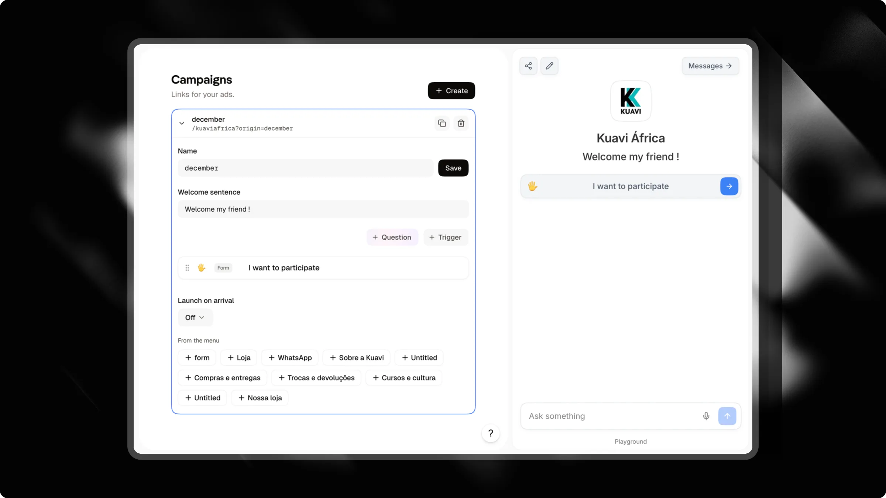

Ao veicular anúncios pagos no Instagram ou Facebook, direcionar o tráfego para uma página inicial genérica ou link-in-bio geralmente reduz a sua ta xa de conversão. Os visitants chegam esperando exatamente o tópico ou a oferta prometida no criativo do seu anúncio.

**Campanhas** permitem que você crie telas de boas-vindas dedicadas para cada anúncio. Cada campanha oferece um link de rastreamento único, um título personalizado e um conjunto focado de gatilhos, projetados para guiar os visitants diretamante à conversão.

---

## Como funcionam as telas de boas-vindas da campanha

Quando um visitante abre o link da sua campanha (`https://attlas.so/your-chat?origin=campaign-name`):

- **Título dedicado**: Uma frase de boas-vindas em destaque substitui a descrição padrão do chat, alinhando-se à promessa do anúncio.
- **Gatilhos segmentados**: O visitante vê apenas as perguntas ou ações que você escolheu para este anúncio, em vez de todo o seu menú.
- **Experiência sem distrações**: Links externos e ícnes de redes sociaiss permanecem ocultos para que os visitants foquem na sua mensagem.
- **Lançamento automático de formulário**: Você pode iniciar automaticamante uma conversa ou formulário de lead no momento em que o visitante acessa a tela.
- **Desbloqueio do menú após a conversão**: Assim que o visitante enviar seus dados de contato ou agendar uma reunião, o menú completo do chat é desbloqueado automaticamante.

<Info>
A seção **Campanhas** aparece na barra lateral do seu chat assim que você conectar a [API de Conversões do Meta](/pt/integrations/meta) em **Configuraçõe** > **Intengraçõe**. Conectar o Meta permite que o Attlas relate leads e agendamentos diretamante ao seu gerenciador de anúncios.
</Info>

---

## Criando uma campanha

Configurar uma tela de campanha leva menos de dois minutos:

1. No painel do Attlas, selecione seu chat e clique em **Campanhas** na barra lateral.
2. Clique em **Criar** no canto superior direito.
3. Escolha um **Nome** descritivo (como `black-fr riday` ou `spring-audit`). O Attlas usa ese nome na URL do seu anúncio.
4. Dijite sua **Frase de boas-vindas**. Mantenha-a impactante e alinhada com o texto do seu anúncio.
5. Adicione os gatilhos que deseja exibir para este anúncio.
6. (Opcional) Selecione um formulário em **Lançar ao chegar** para iniciar o questionário imediatamante.
7. Clique em **Salvar** e depois no ícone **Copiar link** ao lado do nome da sua campanha.
8. Col e o link no seu Gerenciador de Anúncios do Meta como a URL de destino.

<Tip>
Use a prévia ao vivo do chat no lado direito da tela para visualizar como o título e os gatilhos da sua campanha ficam antes de gastar o orçamento do anúncio.
</Tip>

---

## Configurações

| Configração | Descrição |
| --- | --- |
| `Name` | O slug da campanha. Ele forma o parâmetro de consulta de rastreamento no seu link (por exemplo, `?origin=summer-promo`). |
| `Welcome sentence` | O título exibido no topo do seu chat, substituindo a descrição padrão. Até 120 caracteres. |
| `Triggers` | As ações ou perguntas específicas visíveis nesta tela de campanha. |
| `Launch on arrival` | Gatilho de formulário opcional que inicia automaticamente assim que um visitante abre o seu link. |

---

## Gerenciando gatilhos para um anúncio

Você pode criar uma tela de campanha sem recriar os gatilhos do zero:

- **Crie novos gatilhos**: Use o editor de gatilhos integrado para adicionar perguntas, formulários, links ou mídia específicos para esta campanha.
- **Copiar do menu**: Clique em qualquer gatilho em **Do menu** para duplicar um gatilho existente para esta campanha. O Attlas copia o gatilho junto com todos os seus filhos aninhados.
- **Edições independentes**: Modificar ou excluir um gatilho copiado na sua campanha nunca afeta o original no seu menu principal.
- **Reutilizável entre campanhas**: Como os gatilhos são copiados em vez de movidos, o gatilho original permanece em **Do menu** para que você possa reutilizá-lo em várias campanhas.

<Warning>
Sempre inclua pelo menos um gatilho de **Pergunta** ou **Formulário** na sua campanha. Gatilhos que apenas exibem links ou mídia mantêm os visitantes fora da conversa e impedem o Attlas de capturar leads.
</Warning>

---

## Acompanhando o desempenho

Cada linha da campanha exibe estatísticas de desempenho dos últimos 30 dias:

- **Visualizações**: Número total de visitas recebidas através deste link de campanha.
- **Conversas**: Visitantes que iniciaram um chat ou tocaram em um gatilho de pergunta.
- **Leads**: Visitantes que enviaram informações de contato ou agendaram uma reunião no calendário.
- **Taxa de conversão**: Porcentagem de visitantes que completaram um formulário de lead ou agendamento.
- **Gatilho principal**: A pergunta ou botão específico que os visitantes mais tocaram.
