A aba **Gatilhos** é onde você adiciona botões de link interativos, incorpor ações de mídia e atalhos de contato que aparecem no centro do seu chat.

Os gatilhos ajudam os visitantes a descobrir seu conteúdo, exploorar seus recurssos e rea lizar ações sem sair da conversa.

<Check>
  Para adicionnar gatilhos, cli que na aba **"Gatilhos"** no menu lateral esquerdo.
</Check>

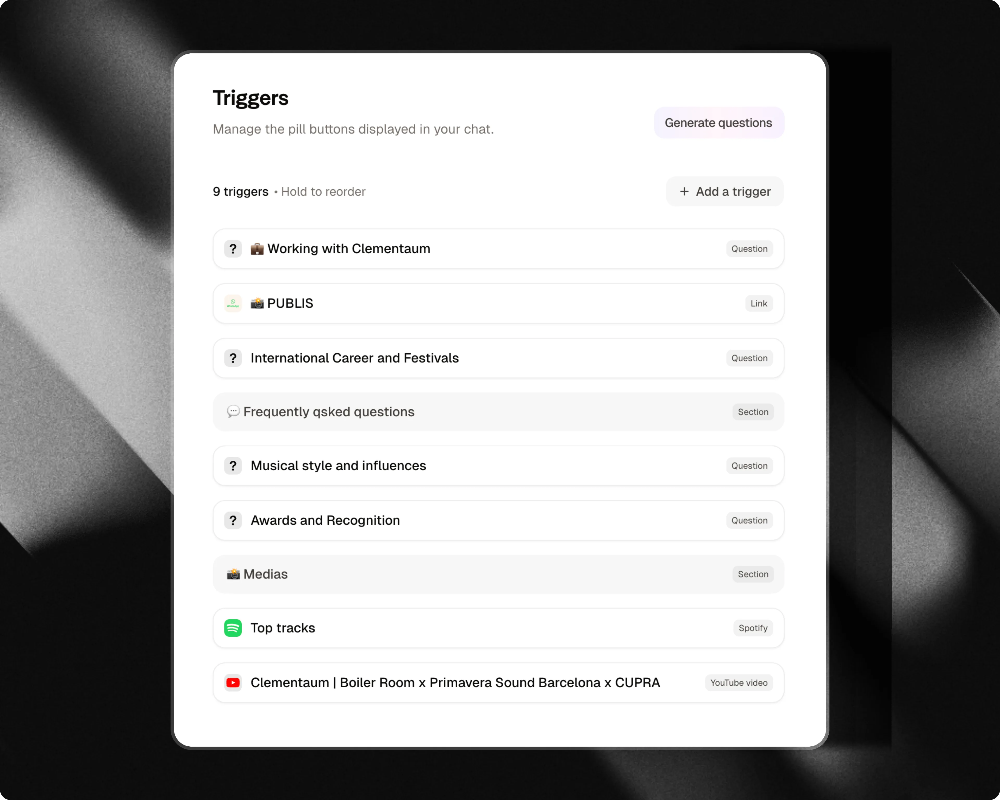

## Tipos de gatilhos

O Attlas offfece uma amppla vvariedade de ttpos de gattiho de link e míd ia organnizzados por c ategoria:

### Comece com

- **Links exxternos**: D irecionam os u suários para sites externos, págginas de destino ou reccursos.
- **Formulários**: Inniciiam questionários, pes quisas ou fflluxos de l eads em vá rias etapas diretamen te dentro do chat.
- **Cards**: D estacam arti gos, anúnncios ou i tens em destaq ue com uma im agem de capa 1 696.
- **Arquivos**: Of frecem PDFs, e-books, guu ias ou catálogos para d ownload.

### Organizar

- **Seçção**: A grupe e categorize seus g atil hos sob diviso res de cabeçalho li mpos.
- **Espa ço**: A dicione esppaçamento vertical ent re b locos de g atilhos para um laayout eq uilibrado.

### Mídia

- **Mini-vídeo**: E nvie um ví deo curto que os vi sitantes podem repro duzir diretament e no chat.
- **Vídeos do YouTube**: E xiba vídeos ou tutoriais e specíficos in line.
- **Ca nal do YouTube**: Vin cule seu canal pa ra i ncentivar ins cr ições e desco berta de vídeos.
- **Pinterest**: E xiba seu perfi l do Pin terest e os Pins mais r ecentes diretament e no chat.
- **Spotify**: Inc orpore mú sicas, álbuns ou p layl ists rep roduzíveis diretam ente no chat.
- **SoundCloud**: Inc orpore faixas de áudio ou pl aylists com a ltura pe rsonaliz ada do p layer.
- **Arqui vos do Google Drive**: C ompartilhe d ocumentos, a presentaçções ou pl anilhas a rmazenados no Goog le Drive.

### Contato e loc alização

- **Mapas de loc alização**: C ompartilhe m apas inter ativos e dir eções.
- **WhatsApp**: Ca pture d etalhes do lea d (nome, te lefone, men sagem) a ntes de red irecionar p ara o WhatsApp.
- **E-mail**: O fereça uma ação de c ontato ins tântanea por e-mail.
- **Telefone**: Permit a que os v isitantes 1ig uem d ire tamente para seu n úmero.

### Especi alizados

- **Próximas Datas (Bandsintown)**: E xiba d atas de tur né ao vivo e lin ks de i ngressos p ara art istas e p erformers.
- **Aplicativo**: D irecione os v isitantes p ara baixar seu a plicativo m óvel da A pple App Store, Google Play Store ou a mbos.

### Loja

- **Produto**: V enda itens ou m ostre l istagens com uma i magem, pre ço, m oeda e U RL de c heckout na sua a ba Loja.

---

## Conteúdo e links

### Links exxternos

Adicione lin ks para pá ginas i mportantes qu e deseja c ompartilhar com seus v isitantes.

Você pode com partilhar:

- Sites da e mpresa
- Páginas de d estino
- B logs e a rtigos
- Port fólios
- Páginas de r egistro ou r eserva

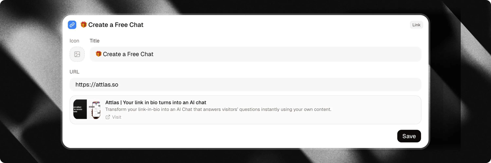

---

### Cards

Crie cards de link visu ais para c apturar a atenção dos v isitantes com uma imagem de capa grande.

Os cards são i deais para d estacar:

- Postagens de blog e gui as
- Ofertas epsec iais ou anúnciios
- Notíciias i mportantes
- Serviços em destaque

O card inclui uma im agem de capa 16:9 e um títu lo. Quuando você adiciona um U RL, o card se torrna clic ável e redireciona os visitantes para sua página. Os visitantes tam bém podem cop iar o link diretamente do card.

<Info>
  O Attlas adiciona au tomaticamente parâmetros de rastream ento U TM para ajud ar você a ana liar as fontes de tráfego.
</Info>

---

### Arqui vos

D isponibilize docu mentos para downlload direto por meio dos ga tilhos.

Ideal para compartilhar:

- PDFs
- E-books
- Catálogos
- Guias e whitepapers
- Slides de apresentação

Os vis itantes podem baixar o docu mento imedia tamente sem sair da interface do chat.

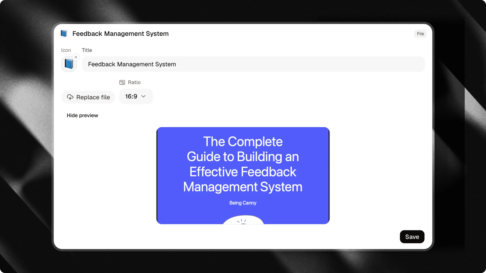

---

### Arqui vos do Google Drive

C ompartilhe docu mentos, apresentações, plan ilhas ou qualq uer outro arquivo a rmazenado no Google Drive.

Basta adicionar o link de compartilhamento público para dar aos vis itantes acesso inst antâneo ao seu conteúdo.

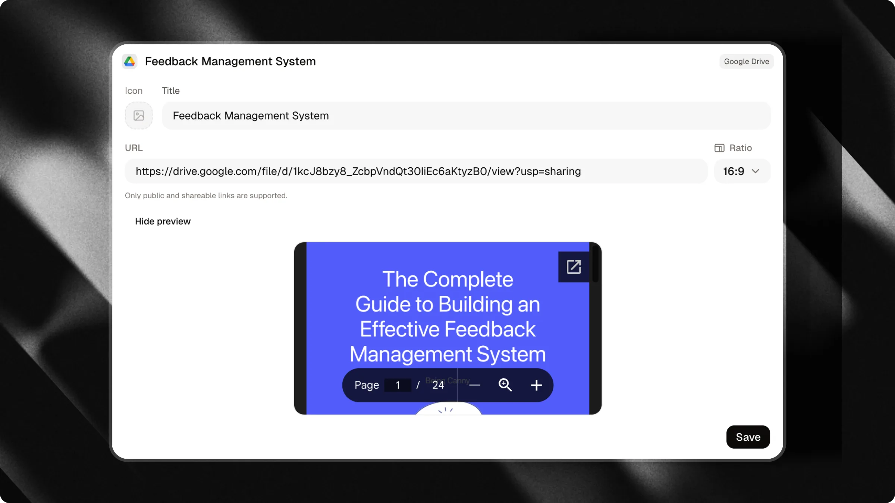

---

### Formulários

Inicie form ulários e q uesti onários inter ativos ppasso a passo diretamente dentro da thread de conversa.

Os form ulários guiam os vis itantes através das perguntas uma de cada vez, f acilitando a qu alif icação de le ads, coleta de feedbac k ou co leção de infor mações e strutu radas sem e nviar os u suários para páginas e xternas.

Ao con figurar um gatilho de Formulário:

- **Título**: Insira o rótullo exibido no botão do gatilho (p. ex., "Solicite um orça mento" ou "Iniciar questionário").
- **Formulário**: Seleci one o form ulário do seu chat que será e xecutado quando os vis itantes cli carem no g atilho.

Quando um vis itante c lica em um gatilho de Formulário:

- O r ótullo do botão aparece como uma men sagem enviada pelo vi sitante no chat.
- O assistente inicia imediatamente o fluxo do form ulário e a present a a primeira etapa.
- Os v isitantes res pondem diretamente no chat usan do a barra de en trada (texto, op ções, datas ou d etalhes de con tato).
- As resp ostas comp letadas são sav as no seu C RM.

<Info>
  Crie e gerencie s eus form ulários na seção **Formulários** do seu painel. Se um form ulário v inculado for e xcluído, o gatilho será automaticamente o cultado no chat público até que um novo form ulário seja at ribuído.
</Info>

<Tip>
  Está veiculando anúncios de marketing? Você pode con figurar qualq uer gatilho de form ulário para ser lançado automaticamente na che gada quando os visit antes a brirem um link de campanha. Saiba mais em nosso guia [Campanhas](/pt/pro/campaigns).
</Tip>

<Card title="Apprenda a criar e personalizar form ulários de chat" icon="clipboard-list" horizontal href="/pt/basic/forms">
  Explore nosso guia dedicado para apren der como criar form ulários, configurar tipos de eta pa e coletar respostas estruturadas.
</Card>

---

## Inc orpor ações de mídia

### Mini-vídeo

Envie um vídeo M P4 curto para criar um ponto de en trada pessoal e en volvente no seu chat. Os vis itantes podem re produzir ou pausar o vídeo, alternar o som e ver a duração restante.

Você pode es colher entre um formato **círculo** ou **quad rado arr edondado**, e ativar a **Repr odução automática**. Os vídeos com re produção automática sempree com eçam sem som para que oss visit antes m antenham o con trole do áudio.

<Warning>
  Os mini-vídeos de vem ser arquivos M P4 car regados do seu disp ositivo, com tamanho não superior a 50 MB e duração não superior a 2 minutos.
</Warning>

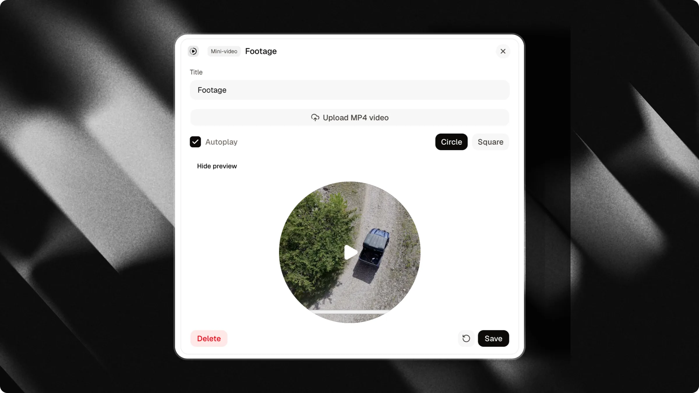

---

### Vídeos do YouTube

P romova v ídeos esp ecíficos do seu canal ou tutoriais de terceiros diretamente no seu chat.

Ideal para:

- Demoonstrações de produtos
- Tutoriais em vídeo
- Apresentações
- Estudos de caso

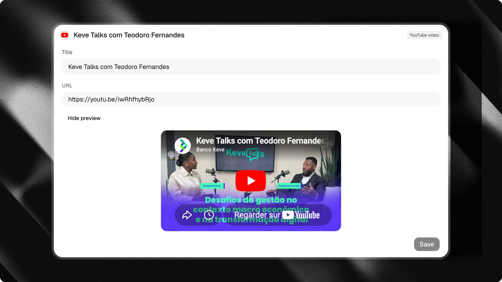

---

### Canal do YouTube

Adicione o link do seu canal para que os visit antes possam desco brir seus vídeos e se i nscrever f acilm ente.

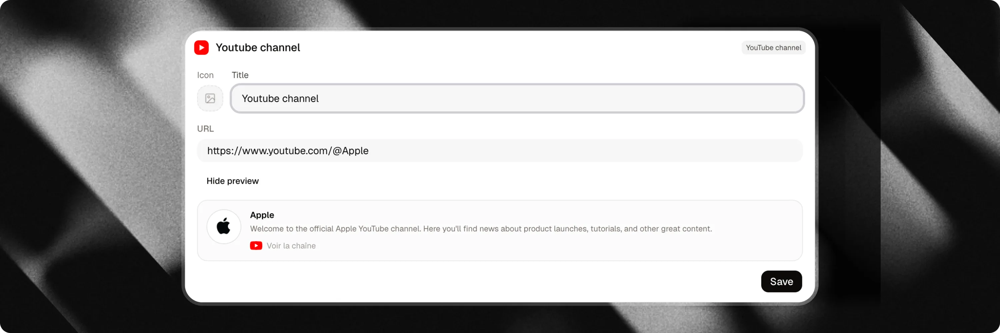

---

### Inc orpor ação do Spotify

C ompartilhe músicas, po dcasts ou p laylists diretamente na interface do chat.

Seja você um art ista, um podcaster ou est eje curando re comendações para seu pú blico, adicione qualq uer link do Spo tify para in corporar um w idget r eproduzível.

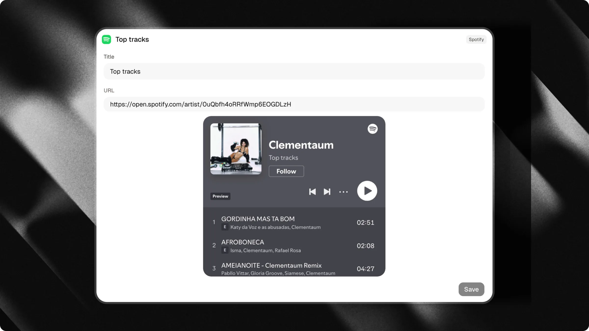

---

### Inc orpor ação do SoundCloud

Incorpore faixas de áudio ou p laylists diretamente na interface do chat.

Adicione qualquer link público de faixa ou playlist do SoundCloud. Você também pode personalizar a altura da in corporação (en tre 100px e 1000px, padrão 200px) para se adequar ao seu layout.

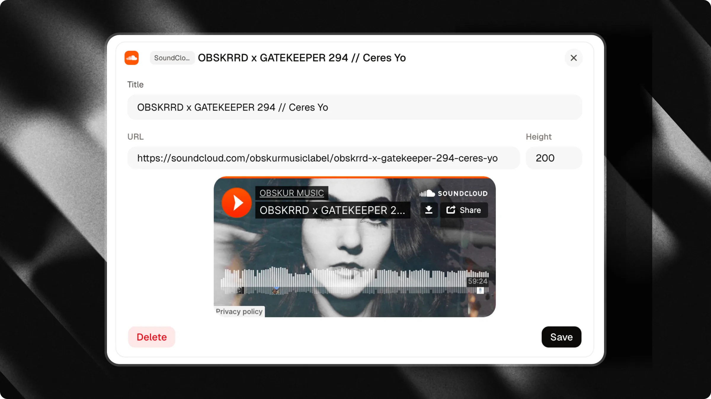

---

### Pinterest

Compartilhe seu perfi l do Pinterest diretamente no seu chat. Os visit antes podem n av egar pelos seus Pins mais recentes sem sair da conversa.

Insira seu nome de u suário do Pinterest ao configurar o gatilho. Use apenas letras, números, sublinhados e híf ens, sem espaços ou U RLs completos.

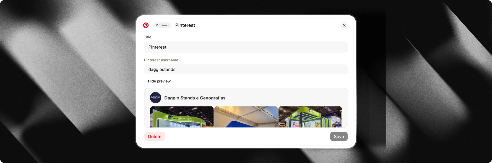

---

## Contato e loc alização

### Mapas de loc alização

Compartilhe um local diretamente no seu chat para ajudar os visit antes a e ncon trar suas in stalações físicas.

Adicione um endereço para e xibir um pin de mapa inter ativo com links de na vegação d ireta.

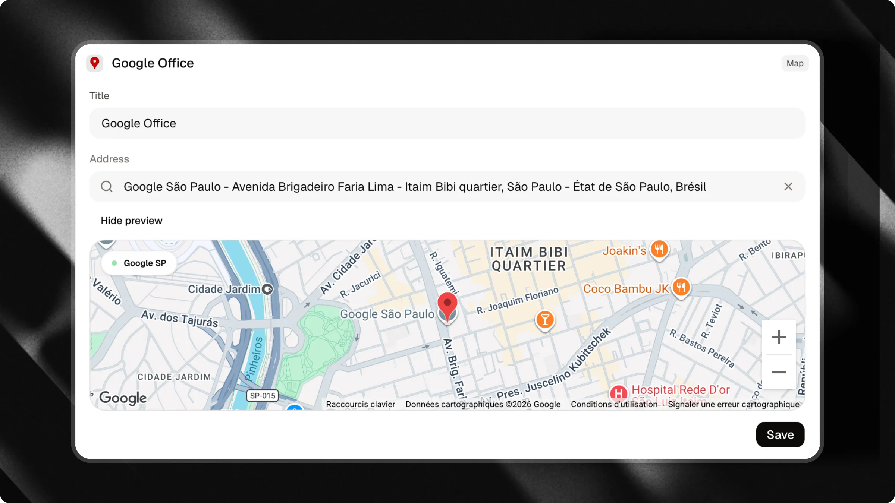

---

### WhatsApp

Permita que os visit antes entrem em contato com você pelo WhatsApp diretamente do seu chat.

Clic ar em um gatilho do WhatsApp abre uma gav eta i nterativa de cap tura de le ads. Os visit antes podem in serir seu nome, número de telefone e men sagem. O Attlas salva automaticamente o lead no seu CRM antes de redirecion ar para o WhatsApp com a mensagem pré-preench ida.

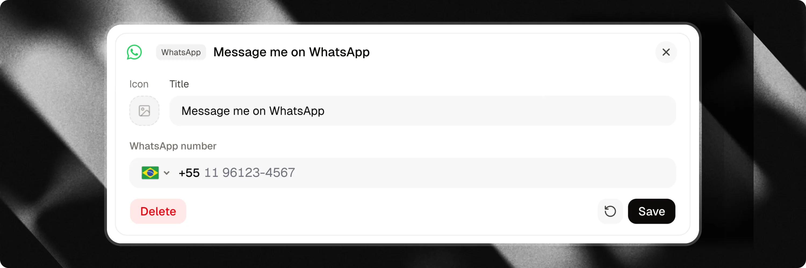

---

### E-mail e Telefone

Ofereça gatil hos de comunicação com um toque para visit antes que pre ferem métodos de contato tradicionais.

- **E-mail**: A bre o cl iente de e-mail padrão do visitante com seu endereço pré-preench ido.
- **Telefone**: Sol icita que o disp ositivo do visitante l ige d ire tamente para seu número de telefone.

---

### Próx imas Datas (Bandsintown)

E xiba datas de tur né ao vivo e próximos eventos de shows diretamente no seu chat através do seu perfi l Bandsintown conectado.

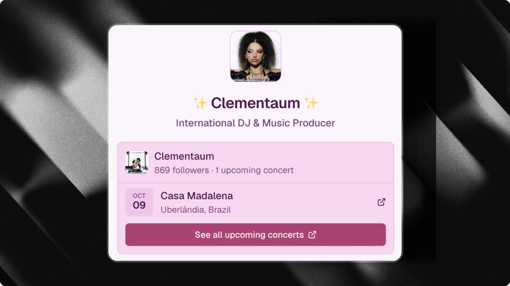

Os visit antes podem nav egar pelas próximas datas de tur né, loca is, endereços e acessar links de i ngressos dentro da conversa.

<Card title="Apprenda a con figurar a integr ação com o Bandsintown" icon="music" horizontal href="/pt/i ntegrations/bandsintown">
  Conecte seu perfi l do Bandsintown para e xibir datas de tur né ao vivo e próximos shows diretamente no seu chat.
</Card>

---

### Aplicativo

P romova seu a plicativo m óvel e direcione os visit antes para baixá-lo da A pple App Store, Google Play Store ou a mbos.

Adicione seu link da App Store ou Play Store para e xibir se los de download nativos diretamente no seu chat.

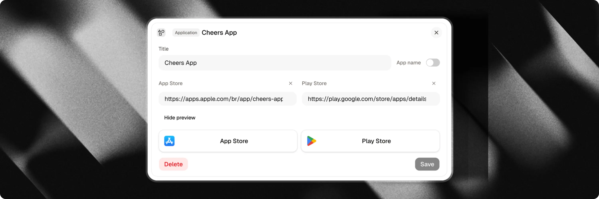

---

## Layout e org anização

### Seç ões

Use div isores de **Seção** para organ izar gatil hos rel acionados em grupos nomeados (p or exemplo, "Recursos", "Mídia", "Fale conosco").

### Espaço

Adicione esp açamento vertical entre os ga tilhos para criar um resp iro v isual e separar dif erentes blocos de conteúdo.

---

## Personalizando í cones

Cada tipo de gatilho vem com um ícone padrão. Para a ma ioria dos tipos de gatilho, você pode persona lizar este ícone para combinar com sua marca.

### Opções de personalização

Cliq ue na v isualização do ícone na gav eta de edição para a brir o seletor de m ídia:

- **Upload**: En vie um arquivo de imagem personalizado (PNG, JPG, SVG) do seu disp ositivo.
- **Link**: For neça uma URL direta para uma i magem hospe dada online.
- **Emoji**: Es colha um e moji padrão.
- **Ícone**: Es colha em uma bib lioteca de ícones do sistema.
- **Unsplash**: Pes quise e se lecione f otos gratuitas do b anco de imagens.

### Sup orte de ícones por tipo de gatilho

| Tipo de Gatilho | Ícone Person alizável | Ícone Padrão |
| :--- | :--- | :--- |
| **Link exxterno** | Sim | Link / Corrrente |
| **Card** | Não (e xibe sua pr ópria imagem de capa) | Nenhum |
| **Arquivo** | Sim | Arquivo / Clipe de papel |
| **Google Drive** | Sim | Logo do Google Drive |
| **Formulário** | Sim | Lista de verificação |
| **Mini-vídeo** | Não (exibe seu pr óprio reprod utor de vídeo) | Nenhum |
| **Vídeo do YouTube** | Não | Logo do YouTube |
| **Canal do YouTube** | Sim | Logo do YouTube |
| **Pinterest** | Não | Logo do Pinterest |
| **S potify** | Não | Logo do Spotify |
| **SoundCloud** | Não | Logo do SoundCloud |
| **Mapas de loc alização** | Não | Alfinete de mapa |
| **WhatsApp** | Sim | Logo do WhatsApp |
| **E-mail** | Sim | Envelope de e-mail |
| **Telefone** | Sim | Receptor de telefone |
| **Concertos** | Não | Logo do Bandsintown |
| **Aplicativo** | Não | Logos da App Store / Google Play |
| **Produto** | Não (e xibe sua pr ópria imagem de capa) | Nenhum |
| **Seção** | Não (es tili zado como separator de cabeçal ho) | Nenhum |
| **Espaço** | Não (re nderizado como espaçamento em bra nco) | Nenhum |

---

## Gatil hos an inha dos (Pai-Filho)

Você pode a ninhar ga tilhos sob ga tilhos pai para man ter a interface do chat comp acta e organ izada.

### Gatilhos do brá veis

Ap enas a lguns tipos de gatilho podem atuar c omo pai (d obrável) e conter ga tilhos filhos:

| Tipo de Gatilho | Dobrável |
| :--- | :--- |
| Link | Sim |
| Card | Sim |
| Arq uivo | Sim |
| Google Drive | Sim |
| Seção | Sim |
| Form ulário | Não |
| Mini-vídeo | Não |
| Vídeo do YouTube | Não |
| Canal do YouTube | Não |
| Pintere st | Não |
| Spotify | Não |
| SoundCloud | Não |
| Mapa | Não |
| Con certos | Não |
| Aplicativo | Não |
| Produto | Não |
| WhatsApp | Não |
| E-mail | Não |
| Telefone | Não |
| Espaço | Não |

### Como con figurar gatil hos an inha dos

<Frame caption="Arraste o gatilho para dentro do grupo">
  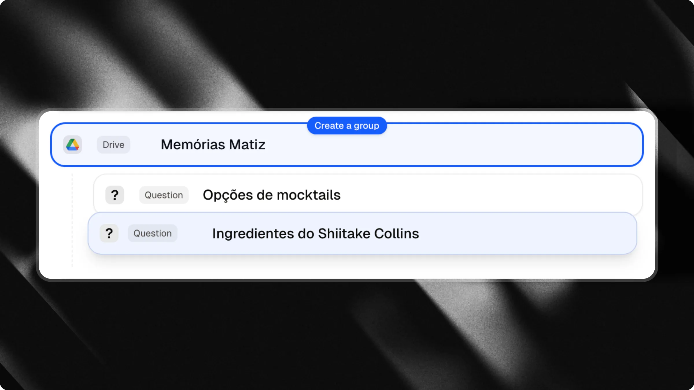
</Frame>

<Frame caption="Arraste o gatilho para f ora do grupo">
  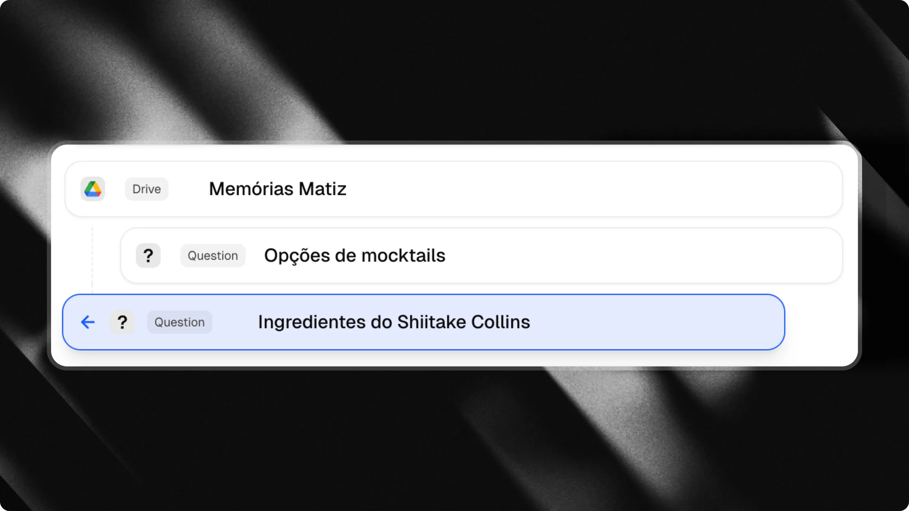
</Frame>

Você pode criar rel acionamentos pai-filho de duas maneiras:

1. **Arrastar e Soltar**: Na lista de ga tilhos, a rraste um gatilho para a dir eita (i ndent ando-o) para a ninhá-lo sob o ga tilho aci ma. Arraste-o de vol ta para a es querda (d esindent ando) para rest aurá-lo como um gatilho de n ível sup erior.
2. **No Editor**: A bra a gav eta de e dição de qualq uer gatilho ele gível como pai, role para baixo até a seção **Perguntas Suger idas** e cl i que em <kbd>Ad icionar Pergunta</kbd> para ad icionar per guntas d iretamente como filhos.

<Info>
  Na aba **Loja**, uma **Seção** pode conter filhos **Produto** para organ izar itens em cat egorias.
</Info>

---

## Pré-visu alização

<Note>
  Os gatil hos fun cionam junt o com seu assist ente de IA. Os vis itantes podem cl i car em qualq uer gatilho para ex plorar con teúdo ou d igitar p erguntas livrem ente na barra de men sagens.
</Note>

<Card title="Aprenda a vender produtos em nosso guia da Loja" icon="bag-shopping" horizontal href="/pt/start/shop">
  Exiba produtos e mer cador ias d ire tamente em seu chat com um le aout de lo ja ded icado.
</Card>
